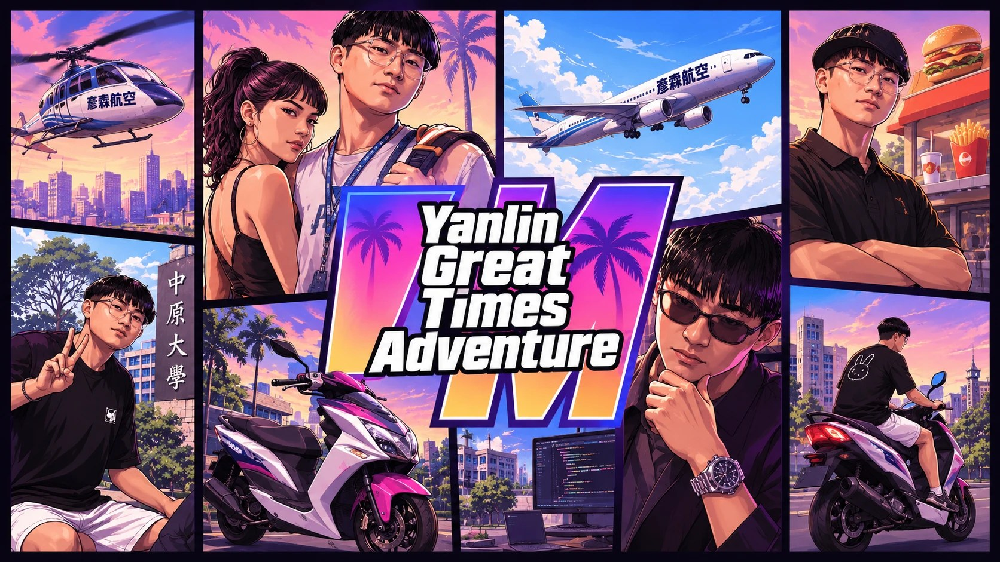

<p align="center"></p>

# 中原順起來 · 資管要贏 票投彥霖

第34屆 中原大學資訊管理學系 系學會會長候選人 **彥霖（Yanlin）** 的競選宣傳網頁遊戲。

開放世界 3D 中原大學（地圖依 OpenStreetMap 真實資料搭建），玩法類似《臺北狂飆》：騎著粉白色 **SYM JET SL** 穿梭校園、中原夜市，走進資管系館上樓進教室、到活動中心的麥當勞點餐、坐進警衛室值班，一路幫彥霖拉票！電腦與手機瀏覽器都能玩，免安裝。

---

## 🚀 本機啟動

這是**純靜態網站**，沒有 build 步驟，但因為使用 ES Modules，**不能直接雙擊 `index.html` 開啟**，一定要透過本機伺服器。以下任選一種：

### 方法 1：Python（Windows / macOS / Linux 大多已內建）
```powershell
cd YanlinGTA
python -m http.server 5173
```
瀏覽器打開 👉 http://localhost:5173

> macOS / Linux 若沒有 `python`，改用 `python3 -m http.server 5173`。

### 方法 2：Node.js
```powershell
cd YanlinGTA
npx serve -l 5173 .
```
瀏覽器打開 👉 http://localhost:5173

### 方法 3：Docker 🐳
需要先安裝 [Docker Desktop](https://www.docker.com/products/docker-desktop/)。

**用 docker compose（最簡單）**
```powershell
cd YanlinGTA
docker compose up -d --build
```
瀏覽器打開 👉 http://localhost:8080

停止：
```powershell
docker compose down
```

**或只用 docker 指令**
```powershell
docker build -t cycu-shun-qi-lai .
```
```powershell
docker run -d --name cycu-shun-qi-lai -p 8080:80 cycu-shun-qi-lai
```
瀏覽器打開 👉 http://localhost:8080 ；停止並移除：`docker rm -f cycu-shun-qi-lai`

（映像檔使用 `nginx:alpine` 提供靜態檔案，設定在 `docker/nginx.conf`。）

### 方法 4：部署到網路
整個資料夾直接丟到 GitHub Pages / Vercel / Netlify / Cloudflare Pages 即可，不需要任何設定。
GitHub Pages：Repo → Settings → Pages → Source 選 `main` 分支根目錄。

---

## 🎮 玩法

標題畫面只有一個「開始遊戲」：主線是 序章 → 傳單大作戰（限時送 5 個公布欄）→ 中原夜市宵夜補給 → 掃街拉票 → 布條保衛戰（依序計時賽）→ 學生活動中心政見發表會 → 當選結局；
主線進行中也可以隨時去收集 34 張金色選票、對同學發傳單拉票、打工、比賽或到處亂逛，結局之後可以繼續自由玩。進度會自動存檔，下次按「開始遊戲」就從上次的地方繼續。

### 可以進去的地方
- **資訊管理學系館**：依照真實外觀還原（灰色菱形花紋走廊欄杆、紅色飾條、綠色牆裙、紅門、左側紅框玻璃電梯、右側米色磁磚樓梯間）。可以走樓梯或搭電梯上 1F～3F、進每一間教室。
- **電腦教室（101、301）**：每台電腦都能按 `E` 使用，會跳出影片播放器。
- **麥當勞（活動中心東側）**：走進去在櫃檯按 `E` 點餐。室內依中原大學麥當勞的照片重做：深灰大磁磚、白色格柵天花板與崁燈、黑底白櫃台與懸吊天花下的電子菜單、深灰長沙發座與黑白壁畫、木紋高桌配彎木椅、白色大燈罩下的不鏽鋼長桌、彩色直條紋牆、黃色垃圾回收櫃；門面是深灰招牌白字「McDonald's」，旁邊深灰柱子上有金色 M。櫃台後面的內場也做出來了：出餐檯有保溫燈、飲料機、咖啡機、冰淇淋機和 KVS 出餐螢幕，中間是保溫櫃 UHC 和組裝台，後牆不鏽鋼排煙罩下有兩台雙面煎台、烤麵包機、炸雞爐、薯條爐；後門通往依內場照片做的後場走道（冷凍庫／冷藏庫、火警受信總機、糖漿箱鐵架、濾水器、紅色腳踏垃圾桶）。店員穿灰色員工服、黑帽、腰間圍裙，內場人員戴髮網。
- **麥當勞打工值班**：從櫃台北端繞到後面的員工入口按 `E` 打卡上班（彥霖會戴上員工帽、別上名牌）。同學一個個走進來排隊點餐，照點餐單按 `1`–`6`（或點畫面上的餐點）放進托盤，`Enter` 出餐；點托盤上的品項可拿掉、`⌫` 拿掉最後一樣。一班 6 位客人，薪水是時薪 NT$196（提早下班按比例）＋每單小費（越快越多），收入進 Peach Pay；出對餐也會拉到票（出餐快、被認出是候選人再加），全對再加碼。出錯客人會抱怨，等太久會直接走掉；按 `E` 可提早下班。
- **麥當勞內場值班**：走到內場第二台煎台前按 `E` 上內場。櫃台的單會跳到 KVS 螢幕上，`1` 煎台（牛肉餅）、`2` 炸雞爐、`3` 薯條爐：按一次下鍋，聽到「嗶嗶嗶」再按一次起鍋（太早沒熟、太晚燒焦都要報廢），熟的會放進保溫櫃；`Enter` 出餐最舊一張備齊的單（也可以直接點單子）。一班 6 張單，時薪同樣 NT$196＋出餐獎金，出餐快會被同事拉票；煎台的上蓋、炸籃下鍋起鍋、肉餅和薯條的熟度顏色都看得到。櫃台和內場的薪水、班數、拉票上限共用。
- **孫師傅牛肉拉麵／彥霖以前的家**：中北路 52 號的牛肉麵店（玻璃門面看得到店內的桌椅和湯鍋），店面旁邊的小門一靠近就會打開，沿樓梯上二樓，走過平台右手邊是深綠色、中間有金色框的房門。房間右側是浴室（馬桶、洗手台和鏡子、淋浴間）；左牆是松木衣櫃，按 `E` 打開可以換上衣和褲子；後牆依序是靠窗的木板床、粉紅碎花窗簾的窗戶、面對浴室的黑色電腦桌（螢幕、黑色主機、鍵盤滑鼠）。坐到電腦前按 `E` 會開啟桌面：瀏覽器（真的能上網，網頁在視窗裡載入；Google、Facebook 等不允許嵌入的網站可按 ↗ 用新分頁開）、記事本、小畫家（可存到手機相簿）、小算盤、踩地雷和競選後台。
- **存檔**：進度自動存在瀏覽器裡（localStorage，每 10 秒、主線每一段開始、暫停或關掉分頁時）：得票、金色選票、零用錢、主線進度、彩蛋、位置、衣服、打工／門禁／障礙賽紀錄、手機訊息和記事本。標題畫面只有一個「開始遊戲」，有存檔就從上次的地方繼續（進行到一半的任務從該任務開頭重來）；暫停選單的「清除紀錄重新開始」會刪掉存檔。手機相簿的照片不存。
- **新中北路障礙賽**：比賽中按 `Esc`（手把 Menu）暫停，可以選「退出比賽」。
- **全螢幕**：設定裡可以開關全螢幕（瀏覽器不支援時會提示，iPhone 可用「加入主畫面」）。
- **地圖與導航**：按 `M`（手把 View）會拿出 i-Piyan 橫放看地圖，再按一次 `M` 或右上角 ✕ 就收起來；從手機的「地圖」App 打開的話，關掉會回到手機主畫面。在地圖上點一下就能標點（鍵盤／手把：移動準星後按 `Enter`／A），會沿著道路算出路線（走路走所有路、騎車開車只走車道並遵守單行道），紫色路線同時畫在大地圖、小地圖和前方地面上，偏離路線會重新規劃，抵達後自動清除。地面導航線可以在設定關掉。
- **手機**：收起手機再拿出來，會回到上次停留的 App（聊天室也會回到同一個對話）。
- **正門警衛室（中北路）、側門警衛室（A6 校門）**：走進去按 `E` 坐下值班，旁邊的柵欄會在騎車靠近時自動升起。

### 操作
| 動作 | 鍵盤滑鼠 |
|---|---|
| 移動 / 視角 | `W` `A` `S` `D` / 滑鼠（點畫面鎖定游標） |
| 衝刺 / 跳 | `Shift` / `Space` |
| 互動（電梯、點餐、坐下、電腦、對話） | `E` |
| 上下車 | `F` |
| 發傳單拉票 | 滑鼠左鍵 |
| 比 ✌ | `G` |
| 喇叭 / 甩尾 | `H` / `Space`（駕駛中） |
| 地圖 | `M` |
| **設定 / 暫停** | `Esc` |

手機：左下搖桿移動、右側拖曳轉視角、右下按鈕操作（⚙ 為設定）。

### 🖥 畫面與畫質
- **光影**：物理大氣天空（日出、正午、夕陽、夜晚隨遊戲時間變化）、飄動的雲、星空與月亮；天空即時反映在玻璃窗與車身上（環境反射）；柔和陰影、遠景霧氣、Bloom 光暈與電影調色。
- **材質**：柏油、連鎖磚、人行道、草地、跑道、水面都是程序生成的 PBR 材質（含法線與粗糙度），並貼合真實地形起伏。
- **校園**：依實景照片替校舍套用不同外牆（懷恩樓／工學館棕褐面磚、科學館磚紅＋白色樓層帶、土木館斑點洗石子…），加上樓層線、牆腳陰影、頂樓冷氣；正門黑色石牆校名＋斜立不鏽鋼柱；資管系館前與大草坪四周的雨豆樹、大王椰子、黑松與灌木（會隨風搖曳），大草坪中央保持空曠。
- **街景**：一樓店面鐵捲門與浪板遮雨棚、廟宇屋頂、夜市條紋棚、燈籠與小吃招牌。
- **夜晚**：窗戶燈光、路燈光束與真實照明、招牌與夜市燈籠發光。
- **路上的機車**：車流與停放的通勤機車改用實心曲面建模（不會從縫隙看穿）：圓弧車殼、貼合輪框的輪胎、波浪碟盤、CVT 傳動箱、排氣管、握把與後照鏡，所有機車共用同一份幾何、只換車色。

按 `Esc` →「畫質」可切換 **自動 / 低 / 中 / 高**（自動＝電腦高、手機低，設定會記住）。天空、陰影、後製與路燈照明會立即切換；抗鋸齒、補建街區後排與人車數量在重新整理後套用。

### 🎵 音樂設定
按 `Esc`（或標題畫面「設定 / 音樂」）可以：
- 選擇背景音樂：**彥霖歌劇**（預設，無限循環播放）／**預設音樂**（遊戲內建合成音樂）／關閉
- 調整**音樂音量**、**音效音量**、滑鼠靈敏度
- 畫質（自動／高／低）與**補建街區**開關（OSM 沒資料的空白街區是否補上程式生成的示意建物，重新整理後套用）

設定會記在瀏覽器裡，下次打開還在。

---

## 🖼 載入畫面
開啟網頁與按下「開始遊戲」後，會顯示主視覺 `assets/loading.jpg` 與約 5 秒的讀取條（建立地形中、蓋資管系館…）。
要換圖：把新圖片存成 `assets/loading.jpg` 即可。

---

## 📁 專案結構
| 路徑 | 內容 |
|---|---|
| `index.html`, `css/style.css` | 頁面、HUD、選單 |
| `js/main.js` | 遊戲主程式（迴圈、選單、設定、互動） |
| `js/missions.js` | **所有劇情台詞與政見文字（要改文案改這裡）** |
| `js/interiors.js` | 可進入的建築：資管系館、麥當勞、警衛室（樓層、樓梯、電梯、互動） |
| `js/player.js` | 主角彥霖的造型 `YANLIN_LOOK`、操作、鏡頭 |
| `js/character.js` | 3D 角色模型與動作（走、跑、騎車、坐、✌），每個路人臉型略有不同，會眨眼 |
| `js/bodymesh.js` | 角色的連續蒙皮身體：軀幹、手臂、腿一整塊網格綁在關節上，手肘膝蓋自然彎曲，含腋下／膝窩陰影（網址加 `?legacy` 可看舊版身體） |
| `js/vehicles.js` | 車輛物理、SYM JET SL 與汽車模型 |
| `js/scooters.js` | 車流／停放用的一般通勤機車模型 |
| `js/mcshift.js` | 麥當勞打工值班：排隊的同學、點餐單、托盤、出餐判定、薪水小費與結算 |
| `js/mckitchen.js` | 麥當勞內場值班：KVS 出餐單、煎台／炸爐計時起鍋、保溫櫃、出餐獎金與結算 |
| `js/mcuniform.js` | 麥當勞員工制服：灰色員工服、黑帽或髮網、名牌、腰間圍裙（店員和彥霖共用） |
| `js/modeling.js` | 程序建模工具：截面放樣、管狀曲面、依材質合併網格 |
| `js/npc.js` | 車流、路人、任務 NPC |
| `js/map.js` | 由地圖資料生成建築（依校舍套用不同外牆）、道路與標線、路燈、夜市、鐘塔、正門校名牆、舊校門、噴水池 |
| `js/sky.js` | 天空（大氣散射＋雲＋星空月亮）、太陽／環境光、霧、陰影、環境反射 |
| `js/post.js` | 後製特效（Bloom、調色、暗角）與畫質切換 |
| `js/textures.js` | 程序生成 PBR 材質：柏油、連鎖磚、草地、各式外牆、屋頂、樹葉… |
| `js/vegetation.js` | 雨豆樹、圓冠樹、黑松、大王椰子、灌木（含風吹搖曳） |
| `js/terrain.js` | 地形高度查詢（`H(x,z)`）與橋面；遊戲邏輯的高度都是「離地高度」，只有畫面位置加上地形 |
| `js/hud.js` / `js/audio.js` / `js/input.js` | 小地圖與大地圖 / 音效與音樂 / 鍵盤滑鼠觸控 |
| `data/cycu.json` | 處理過的地圖資料 |
| `data/terrain.json` | 10 m 地形格網（由內政部 DTM 產生，相對高程 135 m） |
| `assets/music/yanlin-opera.m4a` | 彥霖歌劇 |
| `tools/build_map.py` | 由 `tools/osm_raw.json`（OSM 原始資料）重新產生 `data/cycu.json`：`python tools/build_map.py` |
| `tools/block_survey.json` | OSM 沒有資料的空白街區用途調查（目視判斷的文字紀錄）與補建規劃，`build_map.py` 依它補上示意建物與地面 |
| `tools/build_terrain.py` | 由內政部 20m DTM（分幅_桃園市DEM，圖幅 96224020）產生 `data/terrain.json`；原始 zip 放 `tools/.cache/`（不進 repo），下載網址寫在檔案開頭 |
| `Dockerfile`, `docker-compose.yml`, `docker/nginx.conf` | Docker 部署 |

## 授權與來源
- 地圖資料 © [OpenStreetMap](https://www.openstreetmap.org/copyright) contributors，ODbL 授權。
- 地形資料：內政部 20m 網格數值地形模型（DTM），依[政府資料開放授權條款第1版](https://data.gov.tw/license)使用。`data/terrain.json` 是由它取樣、平滑並把可進入的建物周圍壓平後的衍生資料。
- **補建街區**：OSM 在本區約 46% 的面積沒有任何建築或圖徵。這些街區的用途（透天、店面街、廠房、田地、樹林、工地…）是用眼睛看 Google 街景與衛星圖判斷後記成文字（`tools/block_survey.json`），再由 `tools/build_map.py` 用固定亂數種子**程式生成**街屋、廠房、地面與鐵皮圍籬。補建分兩輪：第一輪處理 OSM 原本的空白區（`blocks`），第二輪處理第一輪補完後還剩下的空白區（`blocks2`，約佔地圖 11%，每區都再做一次獨立判讀來複核）。它們只是示意，**不是真實建物輪廓**，位置、數量與高度都不精確；沒有下載、儲存或描繪任何影像。資料裡標 `synthetic: 1`，可在設定選單「🏘 補建街區」關閉（重新整理後套用）。
- 部分建築外觀（樓層、外牆色、屋頂造型）參考 Google 街景目視判斷，僅用眼睛觀看比對，未下載、未儲存也未使用其影像；所有材質都是程式生成。各筆依據見 `tools/overrides.json` 的 `source`。
- [Three.js](https://threejs.org/)（MIT）位於 `vendor/`（後製模組在 `vendor/jsm/`）。
- 這是學生競選宣傳用的非商業同人作品；遊戲中出現的店家、品牌名稱屬於各自的權利人。
