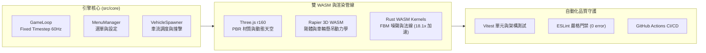

<p align="center"></p>

# 中原順起來 · 資管要贏 票投彥霖 (YanlinGTA)

[](https://github.com/howardtuan/YanlinGTA/actions/workflows/deploy.yml)
[](https://nodejs.org/)
[](https://vitejs.dev/)
[](https://threejs.org/)
[](https://rapier.rs/)
[](https://vitest.dev/)

第 34 屆中原大學資訊管理學系 系學會會長候選人 **彥霖（Yanlin）** 的競選宣傳 3D 開放世界網頁遊戲！

這是一款結合真實校園冒險、幽默競選宣傳與現代 Web 3D 工程技術的開放世界網頁遊戲。以 OpenStreetMap 真實地理資訊為骨架，搭建出完整的 3D 中原大學校園與周邊夜市商圈。你可以騎著粉白色 **SYM JET SL** 穿梭校園與新中北路、走進資管系館上樓進教室、在電腦教室登入「資管學堂」練習寫程式、到活動中心麥當勞打工炸薯條、坐進警衛室值班查門禁，一路幫彥霖拉票宣傳。免安裝任何外掛，電腦與手機瀏覽器皆可順暢暢玩！

---

## 🚀 30 秒本機啟動 (Quickstart)

專案已全方位工程化重構，採用標準的 **Vite** 建置管線與模組化體系：

### 推薦方式：Node.js 與 Vite（本機開發熱更新）
需安裝 [Node.js (>= 22.0.0 LTS)](https://nodejs.org/)：
```bash
# 1. 複製專案
git clone https://github.com/howardtuan/YanlinGTA.git
cd YanlinGTA

# 2. 安裝依賴
npm install

# 3. 啟動本機開發伺服器 (支援 HMR 熱更新)
npm run dev
```
瀏覽器打開 👉 **http://localhost:5173**

### 容器化方式：Docker 🐳（一鍵多階段生產運行）
需安裝 [Docker Desktop](https://www.docker.com/products/docker-desktop/)：
```bash
# 使用 Docker Compose 一鍵編譯與啟動
docker compose up -d --build
```
瀏覽器打開 👉 **http://localhost:8080**  
（停止並移除容器：`docker compose down`）

---

## 🎮 操作指南

| 動作 | 鍵盤 / 滑鼠 | 手把 (Xbox / PS) |
|---|---|---|
| **移動 / 視角** | `W` `A` `S` `D` / 滑鼠（點擊畫面鎖定游標） | 左搖桿 / 右搖桿 |
| **衝刺 / 跳躍** | `Shift` / `Space` | A / X |
| **互動**（電梯、點餐、坐下、電腦、對話） | `E` | X / ▢ |
| **上下車** | `F` | Y / △ |
| **發傳單拉票** | 滑鼠左鍵 | RT / R2 |
| **比 ✌** | `G` | 方向鍵上 |
| **按喇叭 / 甩尾** | `H` / `Space`（駕駛中） | B / ◯ |
| **大地圖** | `M` | View / Share |
| **視角切換**（第一人稱 / 第三人稱） | `V` | R3（按下右搖桿） |
| **暫停選單 / 設定** | `Esc` | Menu / Options |

> 📱 **手機觸控**：左下虛擬搖桿移動、畫面右側拖曳轉動視角、右下浮動按鈕進行互動與上下車。

---

## 🏛️ 校園開放世界探索特色

- **🏛️ 資訊管理學系館**：完整重現灰色菱形花紋欄杆、紅色飾條、綠色牆裙與紅框玻璃電梯，可搭電梯或走樓梯探索 1F～3F 教室。
- **💻 電腦教室（101、301）與彥霖房間**：坐到電腦前按 `E` 開啟桌面，內建瀏覽器（真的能上網）、記事本、小畫家、小算盤、踩地雷、競選後台與終端機。
- **🎓 資管學堂**（`src/systems/minigames/Learn.js`）：電腦桌面上的線上程式課，「Python 入門」與「MySQL 入門」各 9 章、「AI Agent 入門」10 章，內建 Pyodide 與 sql.js 瀏覽器端執行引擎，答對自動批改打勾。
- **🏠 孫師傅牛肉拉麵／彥霖以前的家**：位於中北路 52 號，店面旁走廊上二樓可抵達房間，內有雙人床、更衣衣櫃與電腦桌。
- **🏢 力行宿舍（力行大樓）**：四層樓開放式天井、露天涼亭、二樓中廊連通「新中北路天橋」，天橋直通學生活動中心。
- **🎭 學生活動中心**：一到四樓完整走通，包含前庭大階梯、二樓採光罩中庭、挑高兩層培英廳、麥當勞與各系社團辦公室。
- **🍟 麥當勞打工體驗**：可應徵櫃台出餐外場（依序出餐）或內場廚房（雙面煎台、炸雞爐、薯條爐計時起鍋），賺取零用錢。
- **🎸 豐富校園夥伴與作息系統**：漢克（資管同學・樂團吉他手）、羊明衫（內捲王・麥當勞經理）、YeeMing（物理系・當兵中）、吱吱（排球少年）、黃蓋瑞（古箏社幹部）、劍玉（超跑借閱與班費失竊案），每位 NPC 皆有動態作息與手機社群。
- **📈 靈感股與新聞**：模擬台股百檔成分股（第一檔為「彥霖好帥 2335」），結合校園新聞動態影響盤中漲跌。

---

## 🛠️ 技術架構亮點 (Engineering Highlights)

YanlinGTA 經歷了全方位的現代前端架構重構，具備以下工程特色：



1. **7 大領域分層架構**：嚴格劃分 `core`, `physics`, `graphics`, `world`, `entities`, `systems`, `ui`，杜絕循環引用，維持單向無環依賴。
2. **雙軌 WebAssembly 運算**：
   - 物理：`@dimforge/rapier3d-compat` WASM 處理真實剛體與懸吊物理。
   - 圖形：Rust 撰寫之 `tools/wasm-kernels/`，FBM 噪聲計算加速 **18.1 倍**，且維持純 JS Fallback 零誤差雙保險。
3. **主循環雙時鐘模型**：物理固定 60Hz 步進（Fixed Timestep）與螢幕刷新率（RAF）解耦，兼備動態畫質自動升降頻。
4. **測試金字塔保護**：涵蓋碰撞檢測、A* 路網尋路、存讀檔自癒、股市運算、任務狀態機、DOM 接線、架構分層依賴與資料一致性等自動化測試。

---

## 📁 現代化專案目錄結構

```
YanlinGTA/
├── src/                           # 核心原始碼 (7 大模組分層)
│   ├── core/                      # 引擎中樞 (Game, GameLoop, MenuManager, VehicleSpawner, Input)
│   ├── physics/                   # 物理系統 (VehPhysics 機車懸吊, Collision 碰撞檢測)
│   ├── graphics/                  # 渲染視覺 (SkySystem 天空, Textures 程序貼圖, wasm/)
│   ├── world/                     # 場景生成 (MapBuilder, Interiors, zones/, buildings/)
│   ├── entities/                  # 實體角色 (Player, Character, Vehicles, Traffic, npcs/)
│   ├── systems/                   # 業務系統 (MissionSystem, SaveSystem, StockMarket, minigames/)
│   ├── ui/                        # 人機介面 (HUD, PC 桌面, phone/ 手機系統, Prompts)
│   └── styles/                    # 樣式表 (style.css)
│
├── assets/                        # 靜態音效、貼圖與音樂
├── data/                          # 遊戲地理資料 (cycu.json, npcs.json, terrain.json)
├── docker/                        # 容器配置 (nginx.conf)
├── docs/                          # 專案文檔 (guide/ 程式與設計, references/ 建模原材, media/ 宣傳媒體)
├── tests/                         # Vitest 單元測試與 WASM 整合測試
└── tools/                         # 開發輔助工具 (npc-dashboard, check_wasm, wasm-kernels)
```

---

## 📚 專案多層級文檔手冊 (Documentation)

若需進一步了解系統底層設計或參與貢獻，請參閱專題手冊（總索引見 [docs/README.md](docs/README.md)）：

- 🏛️ **[系統架構手冊 (Architecture Guide)](docs/guide/architecture.md)**：深入了解 7 大分層邊界、依賴拓撲規範、GameLoop 調度機制與雙 WASM 子系統。
- 🎮 **[遊戲設計與內部梗手冊 (Game Design & Lore)](docs/guide/game-design.md)**：主線結構、特色小遊戲、NPC 人物誌與團隊內部梗／彩蛋總覽。
- 💻 **[開發者與貢獻指南 (Developer Guide)](docs/guide/developer-guide.md)**：本機開發工作流、npm 指令清冊、測試金字塔執行與 GitHub Flow 操作步驟。
- 🧑‍🤝‍🧑 **[NPC 創作與自訂指南 (NPC Creation Guide)](docs/guide/npc-creation-guide.md)**：視覺化儀表板使用手冊、`data/npcs.json` 綱要規格與手把手自訂 NPC 教學。
- 🚢 **[部署與運維手冊 (Deployment & Operations Guide)](docs/guide/deployment.md)**：GitHub Pages 自動發布流程、Docker / Compose 容器化部署與 Nginx 快取策略。
- 🤖 **[開發規範與協作原則 (AGENT.md)](AGENT.md)**：專案共同開發原則、GitHub Flow 規則與命名規範單一真實來源（SSOT）。

---

## 📄 授權與來源聲明

- 地圖資料 © [OpenStreetMap](https://www.openstreetmap.org/copyright) contributors，ODbL 授權。
- 地形資料：內政部 20m 網格數值地形模型（DTM），依[政府資料開放授權條款第 1 版](https://data.gov.tw/license)使用。
- 3D 渲染庫 [Three.js](https://threejs.org/) 採用 MIT 授權；物理引擎 [Rapier](https://rapier.rs/) 採用 Apache-2.0 授權。
- 這是學生系學會競選宣傳用的非商業校園同人作品；遊戲中出現的中原大學校園場景、店家與品牌名稱屬於各自之權利人。
- 專案程式碼與重構架構由 YanlinGTA 開發團隊維護。祝彥霖高票當選！🎉