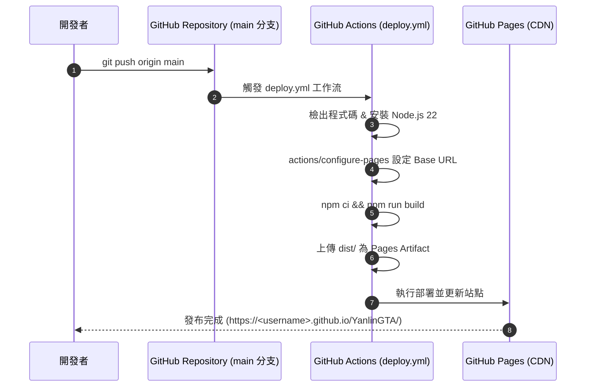
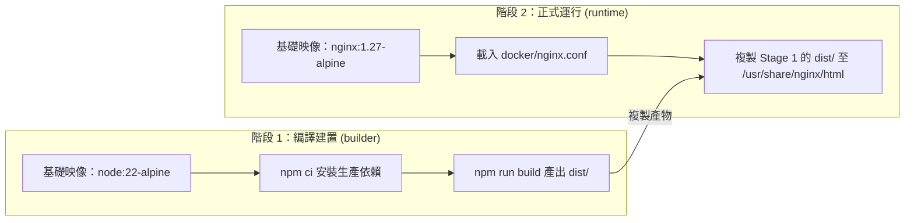
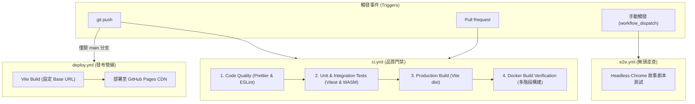

# YanlinGTA 部署與運維手冊 (Deployment & Operations Guide)

本手冊為「中原順起來 · 資管要贏 票投彥霖 (YanlinGTA)」專案的部署與維運指南，詳述 GitHub Pages 自動發布、Docker 容器化多階段建置、自建 Nginx 最佳化配置、CI/CD 自動化管線與常見疑難排解。

---

## 一、 部署模式矩陣 (Deployment Options Matrix)

YanlinGTA 提供四種靈活的部署與運行模式，滿足從本機體驗、單機容器化到全自動靜態託管的不同需求：

| 模式 | 適用環境 | 核心指令 | 說明 |
| :--- | :--- | :--- | :--- |
| **A. GitHub Pages (推薦)** | 線上公開試玩、展示網站 | `git push origin main` | 透過 GitHub Actions 自動構建並發布至 `gh-pages`，享有全域 CDN。 |
| **B. Docker Compose** | 單機私有部署、測試展示伺服器 | `docker compose up -d --build` | 自動完成 Node.js 多階段構建與 Nginx 啟動，開箱即用。 |
| **C. Docker 原生容器** | 自訂 CI 映像檔構建 | `docker build -t yanlin-gta .` | 產出標準 Alpine Nginx 映像檔。 |
| **D. 自建 Web 伺服器** | 企業內部、現有反向代理 | `npm run build` | 將產出的 `dist/` 放入 Nginx、Apache 或 Caddy 靜態目錄。 |

---

## 二、 模式 A：GitHub Pages 自動化發布

專案內建 `.github/workflows/deploy.yml`，當程式碼合併至 `main` 或 `master` 分支時，將觸發全自動編譯與發布管線。



### 倉庫設定步驟：
1. 進入 GitHub 倉庫頁面 $\rightarrow$ **Settings** $\rightarrow$ **Pages**。
2. 在 **Build and deployment** $\rightarrow$ **Source** 選項中，選擇 **GitHub Actions**。
3. 推送或合併程式碼至 `main` 分支，即可在 **Actions** 分頁觀察部署進度。

---

## 三、 模式 B & C：Docker 容器化部署

專案採用標準的 **多階段建置 (Multi-stage Build)**，產出的最終映像檔體積小於 30MB，且不包含任何開發依賴套件。

### 1. Dockerfile 設計架構


### 2. 使用 Docker Compose 一鍵啟動 (最推薦)
```bash
# 本機編譯並於背景啟動容器
docker compose up -d --build

# 檢視運行狀態
docker compose ps

# 瀏覽器訪問
# 👉 http://localhost:8080

# 停止並移除容器
docker compose down
```

### 3. 使用 Docker 原生指令
```bash
# 1. 建置映像檔
docker build -t yanlin-gta .

# 2. 啟動容器 (映射本機 8080 埠)
docker run -d --name yanlin-gta -p 8080:80 yanlin-gta

# 3. 停止與移除
docker stop yanlin-gta && docker rm yanlin-gta
```

---

## 四、 模式 D：自建 Nginx 伺服器配置規範

若將 `npm run build` 產生的 `dist/` 部署至既有 Nginx 伺服器，**必須**正確配置 WASM MIME Type 與 Gzip 壓縮，以確保極致載入速度。

### 推薦 Nginx 虛擬主機設定檔 (`docker/nginx.conf`)：
```nginx
server {
  listen 80;
  server_name your-domain.com;
  root /var/www/yanlin-gta/dist;
  index index.html;

  # 1. 確保關鍵 MIME Types 正確
  types {
    application/wasm wasm;
    audio/mp4 m4a;
    image/webp webp;
    application/manifest+json webmanifest;
  }
  include /etc/nginx/mime.types;

  # 2. 啟用 Gzip 傳輸壓縮 (大幅減少 3MB Rapier WASM 傳輸量)
  gzip on;
  gzip_vary on;
  gzip_min_length 1024;
  gzip_types application/javascript application/json text/css text/plain application/wasm;

  # 3. 帶有 Content Hash 之靜態資源長期快取 (1 年)
  location /assets/ {
    add_header Cache-Control "public, max-age=31536000, immutable";
  }

  # 4. 入口 HTML、清單與設定檔不進行快取 (確保即時更新)
  location / {
    add_header Cache-Control "no-cache";
    try_files $uri $uri/ /index.html;
  }
}
```

---

## 五、 CI/CD 自動化管線剖析 (GitHub Actions Workflows)

專案在 `.github/workflows/` 定義了三條自動化流水線：



1. **`ci.yml`（持續整合品質門禁）**：
   - 每次 Push 或 PR 自動執行 4 大 Job。
   - 包含 Prettier 排版檢查、ESLint 0 容忍檢查、Vitest 單元測試、WASM 零誤差驗收與 Docker 建置驗證。
2. **`deploy.yml`（持續交付發布管線）**：
   - 專門負責構建 `dist/` 並推送至 GitHub Pages。
   - 使用 `actions/configure-pages` 自動注入對應的儲存庫路徑 Base URL。
3. **`e2e.yml`（端對端劇本走查）**：
   - 只支援手動觸發（`workflow_dispatch`，沒有排程），在虛擬無頭瀏覽器中自動跑完主線劇情。

---

## 六、 常見部署疑難排解 (Troubleshooting)

### Q1：畫面卡在載入進度 0% 或出現 `Failed to fetch dynamically imported module`？
- **原因**：通常是靜態託管時 Base URL（子路徑）設定不匹配。
- **解法**：若部署在 `https://example.com/subpath/`，請確認 `vite.config.js` 的 `base` 設定或建置時傳入環境變數：
  ```bash
  # 範例：指定子目錄路徑
  npx vite build --base=/subpath/
  ```

### Q2：主控台報錯 `TypeError: WebAssembly.instantiate(): Incorrect response MIME type`？
- **原因**：Web 伺服器回傳 `.wasm` 檔案時，Header `Content-Type` 不是 `application/wasm`。
- **解法**：檢查 Nginx 的 `mime.types` 是否包含 `application/wasm wasm;`，如本文件第四節所述。

### Q3：改版後玩家瀏覽器仍載入舊版本資源？
- **原因**：瀏覽器快取了舊版 `index.html`。
- **解法**：
  - 確保 Web 伺服器對 `index.html` 送出 `Cache-Control: no-cache`。
  - Vite 打包的所有 JS/CSS 均自帶 Content Hash（例如 `index-NozA9uD4.js`），只要 `index.html` 為最新，即可保證 100% 載入對應的新版資產。
  - 玩家亦可按 `Ctrl + Shift + R`（Mac: `Cmd + Shift + R`）強制重新整理。