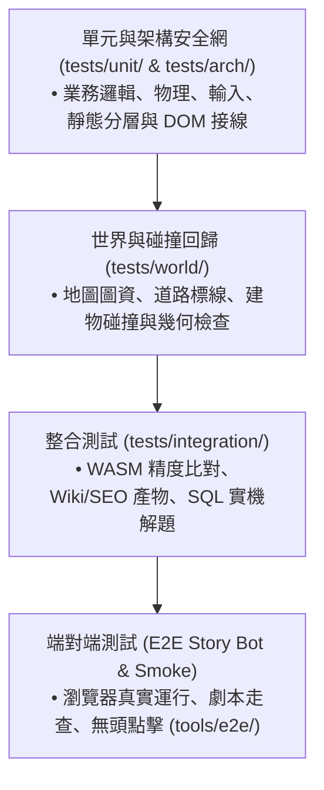

# YanlinGTA 開發者與貢獻指南 (Developer Guide)

本文件提供「中原順起來 · 資管要贏 票投彥霖 (YanlinGTA)」專案的本機環境建置、日常指令、測試執行、程式碼檢查工具與 GitHub Flow 操作手冊。

> **規範單一真實來源（SSOT）**：所有開發原則、分支命名白名單、PR 自動合併規則與專案命名規範，統一以 [AGENT.md](../../AGENT.md) 為準。

---

## 一、 前置環境與相依性 (Prerequisites)

| 工具 | 建議版本 | 說明 |
| :--- | :--- | :--- |
| **Node.js** | `>= 22.0.0` | 執行 Vite、Vitest、ESLint 與 E2E Story Bot（需 Node 22 內建 `WebSocket`）。 |
| **npm** | `>= 10.0.0` | 套件管理工具（隨 Node.js 一併安裝）。 |
| **Git** | `>= 2.30.0` | 版本控制工具（建議搭配 Worktree 多線開發）。 |
| **現代瀏覽器** | Chrome / Edge / Firefox / Safari (最新版) | 需支援 WebGL 2.0、WebAssembly 與 ES2024。 |
| *(選用)* **Docker** | Docker Desktop / Docker Engine | 用於本機容器化多階段打包驗證。 |

---

## 二、 快速上手：本機安裝與啟動 (Quickstart)

```bash
# 1. 複製專案庫
git clone https://github.com/howardtuan/YanlinGTA.git
cd YanlinGTA

# 2. 安裝所有依賴套件
npm ci

# 3. 啟動 Vite 本機熱更新開發伺服器
npm run dev
```

伺服器啟動後，請以瀏覽器開啟：  
👉 **http://localhost:5173**

---

## 三、 npm 指令清冊 (Scripts Cheat Sheet)

| 指令 | 說明 | 適用情境 |
| :--- | :--- | :--- |
| `npm run dev` | 啟動 Vite 開發伺服器（支援 HMR 熱模組替換）。 | 日常功能開發、視覺微調與 NPC 儀表板。 |
| `npm run build` | 執行 Vite 正式環境打包，產出最佳化代碼至 `dist/`。 | 發布前編譯、CI 建置。 |
| `npm run check:dist` | 檢查 `dist/index.html` 引用路徑與靜態資源完整性。 | 打包後驗證相對路徑（子路徑部署防呆）。 |
| `npm run preview` | 本機啟動 HTTP 伺服器預覽 `dist/` 正式建置產物。 | 驗證打包後行為、確認 Hash 資源。 |
| `npm test` | 執行 Vitest 單元測試與整合測試（單次運行）。 | 提交前快速驗證核心邏輯與靜態守門員。 |
| `npm run test:watch` | 啟動 Vitest 監聽模式（存檔時自動重新跑相關測試）。 | 測試驅動開發 (TDD)。 |
| `npm run test:wasm` | 執行完整 Rust WASM vs 純 JS 雙軌運算逐位元精度與效能比對。 | 貼圖計算、WASM 核心變更後驗收。 |
| `npm run test:e2e` | 執行無頭 E2E Story Bot 故事通關驗證（需本機 Chrome）。 | 改動主線任務、導航、物理或碰撞後驗收。 |
| `npm run lint` | 執行 ESLint 靜態檢查（涵蓋 `src/`、`tests/`、`tools/`，0 error / 0 warning 門禁）。 | 檢查變數宣告、語法錯誤與潛在 Bug。 |
| `npm run lint:fix` | 自動修復 ESLint 可修正之規則問題。 | 批次修正靜態規則提示。 |
| `npm run format` | 使用 Prettier 自動排版受納管檔案。 | 存檔或提交前美化測試與設定檔。 |
| `npm run format:check` | 檢查受納管檔案（`.prettierignore` 以外）是否符合 Prettier 標準。 | CI 靜態品質門禁。 |
| `npm run ci` | 一鍵串聯：`format:check && lint && test && build && check:dist`。 | **Push / 送 PR 前必跑**，模擬 CI 完整門禁。 |
| `node tools/floorplan/make.mjs` | 依建模程式重新產生 [docs/references/floorplans/](../references/floorplans/README.md) 室內 SVG 平面圖。 | 調整可進入室內建築與牆線後同步驗圖。 |
| `node tools/street_corner_check.mjs [--out 報告.md] [--json 結果.json]` | 重建遊戲實際會畫的建物（OSM、填充樓、各街屋檔佔地，扣掉 drop／hide），跟車道、人行道比對：列出侵入車道的建物（哪個檔、侵入幾公尺）、每個路口轉角有沒有建物、兩個檔重複蓋的地方、路口附近的街面空缺。 | 照街景補街屋、改路寬之後檢查路口有沒有越界、漏蓋或重複蓋。 |
| `npm run build && node tools/collision_mesh_check.mjs [--out 報告.md] [--json 結果.json] [--cdp=<port> --url=<網址>]` | 在遊戲頁面裡（`?keepgeo` 保留靜態幾何的 CPU 副本）把全圖網格跟碰撞對一次：「看得到卻穿得過」（離地 0.4～1.5 m 的牆面，玩家中心站得到、身體會陷進去）與「看不到卻被擋住」（碰撞線 0.75 m 內沒有網格），只報從出生點走得到的地方，對到哪個建物、哪個檔。多層室內（學生活動中心、宿舍）每一層各自比對；埤塘、溪邊、排水溝兩岸的空氣牆是刻意的，不列。`--low` 改抓腰部以下沒有碰撞的量體（箱子、貨架）。`--cdp` 接到別台開好的無頭 Chrome（例如家裡的 GPU 機器），`--url` 給那台連得到的網址。 | 補街屋、改立面或碰撞之後，檢查有沒有走得進去的牆、擋人的空氣牆（#302）。 |

---

### URL 查詢與除錯參數全表

| 參數 | 用途 | 對應模組 |
| :--- | :--- | :--- |
| `?bench[=xlow\|low\|medium\|high]` | 載入完自動開跑遊戲內效能測試（可指定畫質） | `Game.js`、`Benchmark.js` |
| `?headless=1` | 搭配 `?bench` 的無頭模式 | `Game.js` |
| `?perf` | 本次強制開啟開發者級效能浮層（不改存檔） | `PerfHud.js` |
| `?diag=1\|halt` | 顯示啟動診斷麵包屑；`halt` 在前次未完成載入時暫停 | `BootDiag.js`、`PerfProfile.js` |
| `?tier=mobile-lite\|desktop-igpu\|desktop-dgpu` | 覆寫硬體分檔（`mobile-ios` 為別名） | `PerfProfile.js` |
| `?texscale=0.25~2` | 覆寫畫布貼圖縮放比 | `PerfProfile.js`、`GpuMemLifecycle.js` |
| `?date=YYYY-MM-DD` | 模擬真實日期（義務役、節慶、貨運班次、真實週末判定） | `Service.js`、`Season.js`、`PinHan.js`、`Ruizhe.js` |
| `?mj=房號` | 直接加入 277 麻將多人房間 | `MahjongScene.js` |
| `?keepgeo` | 保留靜態幾何 CPU 副本（碰撞網格檢查用） | `GpuMemLifecycle.js` |
| `?nowasm` / `?nophysics` | 停用 Rust 圖形核心／Rapier，走純 JS 退回路徑 | `kernels.js`、`Physics.js` |
| `?legacy` / `?noragdoll` / `?oldwalk` / `?arcadecar` / `?physdebug` | 舊角色網格、關布娃娃、舊步行、街機車、物理除錯線 | `Character.js`、`Game.js` |

---

## 四、 測試金字塔手冊 (Testing Guide)

專案建立了包含「演算法與靜態防護單元測試」、「WASM 雙軌整合測試」與「端對端測試」的多層級防護網：



### 1. 測試目錄分層（`tests/`）
可用 `npm test` 執行全套，或依改動範圍分層快跑（`npm run test:arch`、`npm run test:unit`、`npm run test:world`、`npm run test:integration`）：
- **`tests/arch/`**：靜態架構與規範守門（`import-graph.test.js`、`dom-ids.test.js`、`no-backdrop-filter.test.js`、`data-consistency.test.js`）。
- **`tests/unit/`**：純核心／系統／物理／UI／工具單元測試（含 `collision.test.js`、`nav.test.js`、`save.test.js`、`stocks.test.js`、`missions.test.js`、`service.test.js`、`veh-physics.test.js`、`input.test.js`、`benchmark.test.js` 等）。
- **`tests/world/`**：地圖圖資與 3D 街屋碰撞回歸（如 `street-encroach.test.js`、`collision-mesh.test.js`、`map-data.test.js`、`road-marks.test.js`、`peds-walls.test.js` 等）。
- **`tests/integration/`**：跨子系統整合測試（`wasm.test.js`、`wiki.test.js`、`seo.test.js`、`autosolve.test.js`、`learn-courses.test.js`）。
- **覆蓋率內部指標（`npm run test:coverage`）**：由 `tools/coverage_summary.mjs` 彙總各 `src/` 模組分層覆蓋率並於 CI PR 寫入 `$GITHUB_STEP_SUMMARY`（不設強制門檻，亦不公開於 README）。

### 遊戲內效能測試與 PR 效能紀錄工具（`src/systems/Benchmark.js` & `tools/run_bench.mjs`）
- 給玩家用的硬體測試：標題畫面 →「📊 效能測試」，選畫質後鏡頭照固定路線跑約 155 秒（校園街道白天 65 秒 → 空拍 16 秒 → 夜間街道 65 秒，每段前 3 秒暖機不計；街道段依序 **校門口 → 資管系館前 → 進學生活動中心 B1 大廳 → 進力行大樓 1F 室內走廊 → 體育館**，每段在 1 m 網格上用與玩家走路相同的碰撞判定（含室內牆、`noReserved`、地板相對地形高度）規劃，優先走馬路與人行空間，拉直時不多切草地，鏡頭沿折線（不用樣條、不切角）在室外約 2.2 m、室內 1.65 m 眼高前進，室內放慢 4 倍（`src/systems/BenchRoute.js`）；**夜間段複用白天同一條路線與秒數**，日夜可 1:1 對照；測試與標題畫面期間也會執行室內家具距離剔除與夜間窗光等純視覺更新器 `Interiors.visualUpdaters`），跑完顯示平均 FPS、1% / 0.1% 低幀、最低／最高、畫面時間分佈、卡頓次數、主執行緒耗時（並於結果物件細分純遊戲邏輯 `logicAvg` 與繪圖提交 `renderAvg`）、繪圖呼叫與三角形，並依「每幀間隔 vs. 遊戲 JS 耗時」判斷瓶頸是 CPU、GPU 還是螢幕更新率；可複製文字或下載 JSON，上一次結果存在 `localStorage`（`cycu-bench-last`）。
- 網址加 `?bench`（或 `?bench=low` 指定畫質、`?bench=low&headless=1` 無頭模式）會在載入完自動開跑；跑完 `game.bench.result` 有完整結果，並發出 `window` 的 `benchdone` 事件。
- **Agent 自動化 iPhone 模擬實測（`npm run bench:iphone`）**：支援 Mac M 系列（Apple Metal GPU）與 Linux（自動探測 Vulkan / EGL 硬體 GPU），預設以 iPhone 視口（`430x932@3x`、`tier=mobile-lite`）自動跑完 99 秒遊戲內 Benchmark 並強制執行 GC 量測存活 `Canvas MB`、貼圖估算 MB 與三段指標，產出可直接貼入 PR 的 `tools/e2e/out/bench/pr-perf-section.md`（含 `<!-- yanlin-perf:v1 -->` 輕量標記），或以 `npm run perf:attach -- <PR編號>` 一鍵寫入 PR 內文。
- **按需歷史查詢與跨 PR 對比（`tools/perf_history.mjs`）**：平時開 PR 不做對比；需要檢視效能演進時，執行 `npm run perf:history` 或 `npm run perf:compare`（如 `npm run perf:compare -- --from=370 --to=372` 或 `--current`），會自動從已合併 PR 同步標記至本機輕量單檔 `tools/.cache/perf-history.jsonl`，並智慧區分跨機器通用的記憶體／幾何負載與同款 GPU 的真實幀率差異。
- **擴充指標**：報告另含 `boot.stages`（BootDiag 8 階段毫秒）、`boot.topZones`（`buildZones` 最慢 5 區）、`boot.toPlayMs`（點「▶ 開始遊戲」到 `play`，`--no-toplay` 略過）、`scene.*`（節點、Mesh、`matrixAutoUpdate` 節點、Standard / Lambert / Basic 材質、投影物件）與各段 `envBakeCount`（PMREM 重烘次數）、`minFps`、`maxFrameMs`、`routeM`，全部寫入 `bench-report.json` 與 `<!-- yanlin-perf:v1 -->`。
- **顯示設定邊際成本掃描（`npm run bench:iphone -- --sweep [--sweep-time=10]`）**：跑完整段後在同一頁面以 `game.applyDisplaySettings(patch, { save: false })` 逐項切換 `dprCap`、`shadows`、`envLight`、`postFx`、`nightLamps`（項目見 `tools/perf/sweep_lib.mjs`），每項跑一段短的固定路線，輸出 `sweep.json` 與 `sweep.md`（相對檔位預設的 Δ FPS / Δ 繪圖提交）。需重整的設定（`materialMode` 等）請用 `?mat=` 等網址參數分兩次跑比較。
- 跟 `npm run profile:*`（`tools/profile_scene.mjs`，開發用的 5 個固定機位快速採樣與基準比對）互補：`bench:iphone` 測的是完整動態巡航路線與貼近真實遊玩的綜合體驗。

### 2. WASM 精度整合測試 (`tests/integration/wasm.test.js` & `tools/check_wasm.mjs`)
- `npm test` 會執行快速抽樣整合測試；改動貼圖核心時須另外執行 `npm run test:wasm`，對全部 FBM 噪聲與法線貼圖參數執行完整比對，驗收門檻為 **`0 mismatched`**。

---

## 五、 程式碼風格與工具邊界

1. **ESLint（`eslint.config.js`）**：涵蓋 `src/`、`tests/` 與 `tools/` 腳本。
   - 嚴禁 `var`、強制全等比較 `===` / `!==`（`== null` 除外）、嚴禁未宣告與未使用變數（未使用參數須加底線前綴如 `_e`）。
   - 特別設定允許中文字串與註解內的全形空白（`\u3000`）。
2. **Prettier（`.prettierrc` / `.prettierignore`）**：
   - 納管 `src/`、`tests/`、`tools/`（JS/MJS/CSS/HTML）與專案設定檔，維持統一排版；僅排除建置產物、第三方套件、大型 JSON 圖資與 Markdown 文件。
   - 首次統一重排之純格式 Commit 已登錄於 `.git-blame-ignore-revs`（GitHub 原生支援忽略該 Commit 的 `git blame`）。
3. **檔案命名與註解語言**：
   - 核心類別與業務模組採 `PascalCase.js`（如 `GameLoop.js`）；`tools/` 腳本採 `snake_case`（如 `check_wasm.mjs`）。
   - 通用底層與演算法註解以英文為主；校園地景、典故與任務劇情可使用繁體中文註解（詳見 [AGENT.md](../../AGENT.md)）。

---

## 六之一、 NPC 儀表板與新增自訂 NPC

### `tools/npc-dashboard` 3D 視覺化儀表板
```bash
npm run dev
# 開啟 http://localhost:5173/tools/npc-dashboard/
```
- 滑鼠拖曳 360 度檢視人偶（與遊戲內渲染一致）；可輸入文字特徵或上傳參考照片自動抽取主色調（照片僅存本機 `tools/npc-dashboard/photos/`，不進 Git）；按「儲存」寫入 `data/npcs.json`。
- 欄位與 `look` 參數規格見 [`../specs/npcs-and-characters.md`](../specs/npcs-and-characters.md)。

### 三分鐘新增自訂 NPC
1. 在 `data/npcs.json` 的 `npcs` 陣列新增 `{ "id", "kind": "custom", "enabled": true, "name", "title", "gender", "height", "place", "look": {...}, "talks": [[["說話者","台詞"]]] }`。
2. 重新整理遊戲，走到 `place` 地標 2.6m 內按 `E` 對話，多組 `talks` 依序輪播。
3. 需要 24 小時作息、騎車、好友聊天等進階能力時，改寫專屬模組（參考 `Hank.js`、`Mingshan.js`、`Jianyu.js`、`TeaShop.js`），並同步更新 `docs/specs/npcs-and-characters.md`。

---

## 六、 GitHub Flow 日常操作步驟

上游主倉庫已啟用 `protect-main-github-flow` 與 `enforce-branch-naming` 兩條 Rulesets，禁止直推 `main` 並強制分支前綴規範：

### 1. 開工切分支（禁止直接在 `main` 提交）
```bash
# 先確保 main 與遠端同步（僅用 fast-forward）
git fetch origin
git switch main
git merge --ff-only origin/main

# 切出符合白名單的短生命週期分支（允許前綴：feat / fix / hotfix / chore / refactor / docs）
git switch -c feat/world-zone-f-detail
```
*(若採多線並行 Worktree：`git worktree add ../YanlinGTA-wt/feat-zone-f -b feat/world-zone-f-detail main`)*

### 2. 撰寫 Commit（雙語 Conventional Commits）
```
<type>(<scope>): <簡述>

# 範例：
feat(world): 補齊恩慈樓北翼東端實景量體
fix(save): handle corrupted localStorage gracefully
refactor(core): decouple vehicle spawner from Game.js
docs(guide): align developer workflow with GitHub Flow
chore(ci): add data consistency test suite
```

### 3. 本地驗證、開 PR 與自動合併
1. Push 前務必在本機執行：
   ```bash
   npm run ci
   ```
2. 推送分支並在 GitHub 建立 Pull Request（依 PR Template 勾選對應領域驗證項目）。
3. **啟用 Auto-merge**：上游目前設定為 `Required approvals = 0` 且開啟 **Allow auto-merge**；發完 PR 後請於網頁點擊 **Enable auto-merge**，或執行：
   ```bash
   gh pr merge --auto --merge
   ```
4. 待 **CI Checks 全綠**（`Verify`、`Docker Build Verification`，且所有討論串已標記為 **Resolved**）後，GitHub 會自動以 **Create a merge commit** 合併進 `main`，再刪除已合併分支與清理 Worktree。
