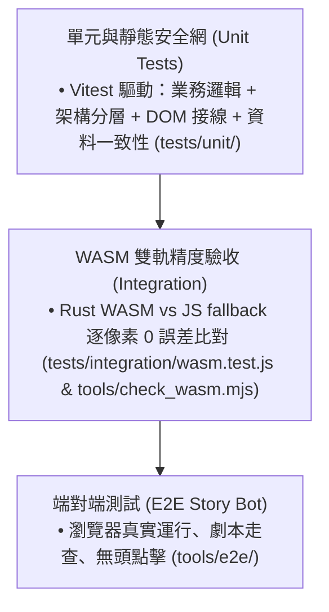

# YanlinGTA 開發者與貢獻指南 (Developer Guide)

本文件提供「中原順起來 · 資管要贏 票投彥霖 (YanlinGTA)」專案的本機環境建置、日常指令、測試執行、程式碼檢查工具與 GitHub Flow 操作手冊。

> **規範單一真實來源（SSOT）**：所有協作規則、分支命名白名單、變更分級（Tier 1 / Tier 2）、領域 SOP 與架構依賴紅線，統一以 [AGENT.md](../AGENT.md) 為準。

---

## 一、 前置環境與相依性 (Prerequisites)

| 工具 | 建議版本 | 說明 |
| :--- | :--- | :--- |
| **Node.js** | `>= 22.0.0` | 執行 Vite、Vitest、ESLint 與 E2E Story Bot（需 Node 22 內建 `WebSocket`）。 |
| **npm** | `>= 10.0.0` | 套件管理工具（隨 Node.js 一併安裝）。 |
| **Git** | `>= 2.30.0` | 版本控制工具（建議搭配 Worktree 多線開發）。 |
| **現代瀏覽器** | Chrome / Edge / Firefox / Safari (最新版) | 需支援 WebGL 2.0、WebAssembly 與 ES2024。 |
| *(選用)* **Docker** | Docker Desktop / Docker Engine | 用於本機容器化多階段打包驗證。 |

---

## 二、 快速上手：本機安裝與啟動 (Quickstart)

```bash
# 1. 複製專案庫
git clone https://github.com/hank1224/YanlinGTA.git
cd YanlinGTA

# 2. 安裝所有依賴套件
npm ci

# 3. 啟動 Vite 本機熱更新開發伺服器
npm run dev
```

伺服器啟動後，請以瀏覽器開啟：  
👉 **http://localhost:5173**

---

## 三、 npm 指令清冊 (Scripts Cheat Sheet)

| 指令 | 說明 | 適用情境 |
| :--- | :--- | :--- |
| `npm run dev` | 啟動 Vite 開發伺服器（支援 HMR 熱模組替換）。 | 日常功能開發、視覺微調與 NPC 儀表板。 |
| `npm run build` | 執行 Vite 正式環境打包，產出最佳化代碼至 `dist/`。 | 發布前編譯、CI 建置。 |
| `npm run check:dist` | 檢查 `dist/index.html` 引用路徑與靜態資源完整性。 | 打包後驗證相對路徑（子路徑部署防呆）。 |
| `npm run preview` | 本機啟動 HTTP 伺服器預覽 `dist/` 正式建置產物。 | 驗證打包後行為、確認 Hash 資源。 |
| `npm test` | 執行 Vitest 單元測試與整合測試（單次運行）。 | 提交前快速驗證核心邏輯與靜態守門員。 |
| `npm run test:watch` | 啟動 Vitest 監聽模式（存檔時自動重新跑相關測試）。 | 測試驅動開發 (TDD)。 |
| `npm run test:wasm` | 執行完整 Rust WASM vs 純 JS 雙軌運算逐位元精度與效能比對。 | 貼圖計算、WASM 核心變更後驗收。 |
| `npm run test:e2e` | 執行無頭 E2E Story Bot 故事通關驗證（需本機 Chrome）。 | 改動主線任務、導航、物理或碰撞後驗收。 |
| `npm run lint` | 執行 ESLint 靜態檢查（涵蓋 `src/`、`tests/`、`tools/`，0 error 門禁）。 | 檢查變數宣告、語法錯誤與潛在 Bug。 |
| `npm run lint:fix` | 自動修復 ESLint 可修正之規則問題。 | 批次修正靜態規則提示。 |
| `npm run format` | 使用 Prettier 自動排版受納管檔案。 | 存檔或提交前美化測試與設定檔。 |
| `npm run format:check` | 檢查受納管檔案（`.prettierignore` 以外）是否符合 Prettier 標準。 | CI 靜態品質門禁。 |
| `npm run ci` | 一鍵串聯：`format:check && lint && test && build && check:dist`。 | **Push / 送 PR 前必跑**，模擬 CI 完整門禁。 |
| `node tools/floorplan/make.mjs` | 依建模程式重新產生 [docs/floorplans/](floorplans/README.md) 室內 SVG 平面圖。 | 調整可進入室內建築與牆線後同步驗圖。 |

---

## 四、 測試金字塔手冊 (Testing Guide)

專案建立了包含「演算法與靜態防護單元測試」、「WASM 雙軌整合測試」與「端對端測試」的多層級防護網：



### 1. 單元與靜態安全網 (`tests/unit/`)
- **`collision.test.js`**：測試 2D 多邊形射線檢測、點是否在多邊形內、AABB 碰撞盒判定。
- **`nav.test.js`**：測試 A* 尋路演算法、啟發函數、校園單行道權重計算。
- **`save.test.js`**：測試進度儲存與讀取、垂直高度 `y` 同步、版本遷移與壞資料自癒。
- **`stocks.test.js`**：測試「靈感股」買賣機制、持股均價計算、資產淨值統計。
- **`missions.test.js`**：測試競選任務狀態機與角色預設設定。
- **`service.test.js`**：測試義務役服役日曆與平日軍服／休假切換邏輯。
- **`dom-ids.test.js`**：靜態掃描 `src/` 內 `getElementById` / `$()` 與 `index.html` 及動態建立節點之 ID 對應。
- **`import-graph.test.js`**：靜態解析 `src/` 匯入圖，阻擋循環引用與違反 `AGENT.md` 分層規則的跨層依賴。
- **`data-consistency.test.js`**：驗證 `data/npcs.json`、`data/cycu.json`、`data/terrain.json` 結構完整與資源路徑有效。

### 2. WASM 精度整合測試 (`tests/integration/wasm.test.js` & `tools/check_wasm.mjs`)
- `npm test` 會執行快速抽樣整合測試；改動貼圖核心時須另外執行 `npm run test:wasm`，對全部 FBM 噪聲與法線貼圖參數執行完整比對，驗收門檻為 **`0 mismatched`**。

---

## 五、 程式碼風格與工具邊界

1. **ESLint（`eslint.config.js`）**：涵蓋 `src/`、`tests/` 與 `tools/` 腳本。
   - 嚴禁 `var`、強制全等比較 `===` / `!==`（`== null` 除外）、嚴禁未宣告與未使用變數（未使用參數須加底線前綴如 `_e`）。
   - 特別設定允許中文字串與註解內的全形空白（`\u3000`）。
2. **Prettier（`.prettierrc` / `.prettierignore`）**：
   - `.prettierignore` 刻意保留 `src/`、`tools/`、`docs/` 與 `*.md` 不做全面重排，以維持 `git blame` 與多組並行分支相容性；`format:check` 主要保護設定檔與 `tests/` 測試檔。
3. **檔案命名與註解語言**：
   - 核心類別與業務模組採 `PascalCase.js`（如 `GameLoop.js`）；`tools/` 腳本採 `snake_case`（如 `check_wasm.mjs`）。
   - 通用底層與演算法註解以英文為主；校園地景、典故與任務劇情可使用繁體中文註解（詳見 [AGENT.md](../AGENT.md)）。

---

## 六、 GitHub Flow 日常操作步驟

上游主倉庫已啟用 `protect-main-github-flow` 與 `enforce-branch-naming` 兩條 Rulesets，禁止直推 `main` 並強制分支前綴規範：

### 1. 開工切分支（禁止直接在 `main` 提交）
```bash
# 先確保 main 與遠端同步（僅用 fast-forward）
git fetch origin
git switch main
git merge --ff-only origin/main

# 切出符合白名單的短生命週期分支（允許前綴：feat / fix / hotfix / chore / refactor / docs）
git switch -c feat/world-zone-f-detail
```
*(若採多線並行 Worktree：`git worktree add ../YanlinGTA-wt/feat-zone-f -b feat/world-zone-f-detail main`)*

### 2. 撰寫 Commit（雙語 Conventional Commits）
```
<type>(<scope>): <簡述>

# 範例：
feat(world): 補齊恩慈樓北翼東端實景量體
fix(save): handle corrupted localStorage gracefully
refactor(core): decouple vehicle spawner from Game.js
docs(guide): align developer workflow with GitHub Flow
chore(ci): add data consistency test suite
```

### 3. 本地驗證、開 PR 與合併
1. Push 前務必在本機執行：
   ```bash
   npm run ci
   ```
2. 推送分支並在 GitHub 建立 Pull Request（依 PR Template 勾選對應領域驗證項目）。
3. 確認 **4 項 CI Checks 全綠**、取得 Review Approve 並將所有討論串標記為 **Resolved** 後，使用 **Create a merge commit** 合併進 `main`，並刪除已合併分支與清理 Worktree。
   > **提醒**：Review 後若有新 Push 會自動作廢既有 Approve，請改完一次再推。
