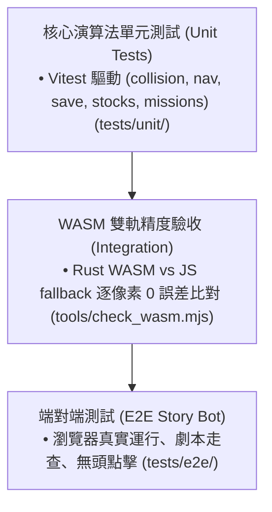

# YanlinGTA 開發者與貢獻指南 (Developer Guide)

本文件提供「中原順起來 · 資管要贏 票投彥霖 (YanlinGTA)」專案的本機環境建置、日常開發工作流、測試金字塔執行、程式碼風格規範與 Git 協作流程指南。

---

## 一、 前置環境與相依性 (Prerequisites)

本專案採用現代化前端工具鏈，開發前請確保本機已安裝以下環境：

| 工具 | 建議版本 | 說明 |
| :--- | :--- | :--- |
| **Node.js** | `>= 20.19.0 (LTS)` | 執行 Vite、Vitest 與各項建置工具所需的執行時環境。 |
| **npm** | `>= 10.0.0` | 套件管理工具（隨 Node.js 一併安裝）。 |
| **Git** | `>= 2.30.0` | 版本控制工具。 |
| **現代瀏覽器** | Chrome / Edge / Firefox / Safari (最新版) | 需支援 WebGL 2.0、WebAssembly 與 ES2024。 |
| *(選用)* **Docker** | Docker Desktop / Docker Engine | 用於本機容器化多階段打包驗證。 |

---

## 二、 快速上手：本機安裝與啟動 (Quickstart)

```bash
# 1. 複製專案庫
git clone https://github.com/hank1224/YanlinGTA.git
cd YanlinGTA

# 2. 安裝所有依賴套件
npm install

# 3. 啟動 Vite 本機熱更新開發伺服器
npm run dev
```

伺服器啟動後，請以瀏覽器開啟：  
👉 **http://localhost:5173**

---

## 三、 npm 指令清冊 (Scripts Cheat Sheet)

專案預先配置了完整的自動化指令，涵蓋開發、測試、語法排版與正式建置：

| 指令 | 說明 | 適用情境 |
| :--- | :--- | :--- |
| `npm run dev` | 啟動 Vite 開發伺服器（支援 HMR 熱模組替換）。 | 日常功能開發、視覺微調。 |
| `npm run build` | 執行 Vite 正式環境打包，產出最佳化代碼至 `dist/`。 | 發布前編譯、CI 建置。 |
| `npm run preview` | 本機啟動 HTTP 伺服器預覽 `dist/` 正式建置產物。 | 驗證打包後行為、確認 Hash 資源。 |
| `npm test` | 執行 Vitest 單元測試與整合測試（單次運行）。 | 提交前快速驗證核心邏輯。 |
| `npm run test:watch` | 啟動 Vitest 監聽模式（存檔時自動重新跑相關測試）。 | 測試驅動開發 (TDD)。 |
| `npm run test:wasm` | 執行 Rust WASM vs 純 JS 雙軌運算精度與效能基準比對。 | 貼圖計算、WASM 核心變更後驗收。 |
| `npm run lint` | 執行嚴格 ESLint 靜態檢查（0 errors / 0 warnings 門禁）。 | 檢查變數宣告、語法錯誤與潛在 Bug。 |
| `npm run lint:fix` | 自動修復 ESLint 標記之格式與規則問題。 | 批次修正語法風格。 |
| `npm run format` | 使用 Prettier 自動排版全倉庫檔案。 | 存檔或提交前美化程式碼。 |
| `npm run format:check` | 檢查程式碼排版是否符合 Prettier 標準。 | CI 靜態品質門禁。 |
| `npm run ci` | 一鍵串聯：`format:check && lint && test && build`。 | **提交前必跑**，模擬 CI 完整門禁。 |

---

## 四、 測試金字塔手冊 (Testing Guide)

專案建立了包含「演算法單元測試」、「WASM 雙軌整合測試」與「端對端測試」的多層級測試防護網：



### 1. 單元測試 (`tests/unit/`)
- **`collision.test.js`**：測試 2D 多邊形射線檢測、點是否在多邊形內、AABB 碰撞盒判定。
- **`nav.test.js`**：測試 A* 尋路演算法、啟發函數、校園單行道權重計算。
- **`save.test.js`**：測試進度儲存與讀取、預設值降級、版本相容與壞資料自癒。
- **`stocks.test.js`**：測試「靈感股」買賣機制、持股均價計算、資產淨值統計。
- **`missions.test.js`**：測試競選任務狀態機、前置條件判定與獎勵得票派發。

### 2. WASM 精度整合測試 (`tools/check_wasm.mjs`)
執行 `npm run test:wasm` 時，會針對 67 組 FBM 噪聲參數與 502 組法線貼圖參數，同步運行 Rust WASM 模組與純 JavaScript 實作：
- **驗收門檻**：`0 mismatched`（容許誤差嚴格限制為 0）。
- **效能確認**：FBM 加速約 18x，Normal Map 加速約 2.3x。

---

## 五、 程式碼風格與品質規範 (Code Style Standards)

為了維持大型 3D 專案的可讀性與穩定性，本專案實施嚴格的程式碼風格與 Lint 規範：

### 1. ESLint 嚴格規則 (`eslint.config.js`)
- **嚴禁 `var`**：一律使用 `const`（首選）或 `let`（僅在需要重新賦值時）。
- **強制全等比較**：必須使用 `===` 與 `!==`，嚴禁使用寬鬆比較 `==`（除了 `== null` 檢查 null/undefined）。
- **未使用變數門禁 (`no-unused-vars`)**：
  - 本地變數與 Import 若未使用直接報錯（`error`）。
  - 若介面回呼需要保留未用參數，變數名稱必須以前綴底線標註（例如 `_req`, `_idx`）。
- **中文排版相容**：特別配置略過中文全形空格（`\u3000`），避免故事對白與排版被誤判為不規則空白。

### 2. 註解與命名慣例
- **檔案命名**：
  - 核心類別與業務模組採用 **大駝峰 (PascalCase)**：`GameLoop.js`, `MenuManager.js`, `SkySystem.js`。
  - 工具腳本採用 **小寫加底線 (snake_case)**：`check_wasm.mjs`, `build_terrain.py`。
- **程式碼註解**：
  - 底層引擎演算法、數學運算與 API 封裝建議使用英文註解。
  - 涉及到中原大學校園場景、歷史典故、特定任務對白與競選情境邏輯，請保留清晰繁體中文註解。

---

## 六、 Git 提交與分支協作流程 (Git Workflow)

專案遵循 **Conventional Commits** 提交規範，所有 commit 訊息必須具備清晰的前綴與語意：

### 1. Commit 格式
```
<type>(<scope>): <description>

# 範例：
feat(physics): support motorcycle drift friction curve
fix(save): handle corrupted localStorage gracefully
refactor(core): decouple vehicle spawner from Game.js
docs(guide): add developer workflow instructions
chore(deps): bump three to 0.160.0
test(nav): add unit tests for cross-campus A* pathfinding
```

| Type | 說明 |
| :--- | :--- |
| `feat` | 新增功能（如新任務、新車輛、新 NPC）。 |
| `fix` | 修復 Bug（如碰撞穿透、選單無法關閉）。 |
| `refactor` | 重構（無功能破壞的程式碼結構調整）。 |
| `docs` | 文檔更新（如 architecture.md、README）。 |
| `test` | 新增或修復測試案例。 |
| `chore` | 工具配置變更、相依套件升級、CI 工作流調整。 |

### 2. 提交前檢查清單 (Pre-commit Checklist)
在執行 `git push` 前，請務必於本機執行：
```bash
npm run ci
```
確保 **Prettier 格式化、ESLint 檢查、Vitest 單元測試、WASM 雙軌比對、Vite 建置** 全部為綠燈，始可推送遠端分支並發起 Pull Request。