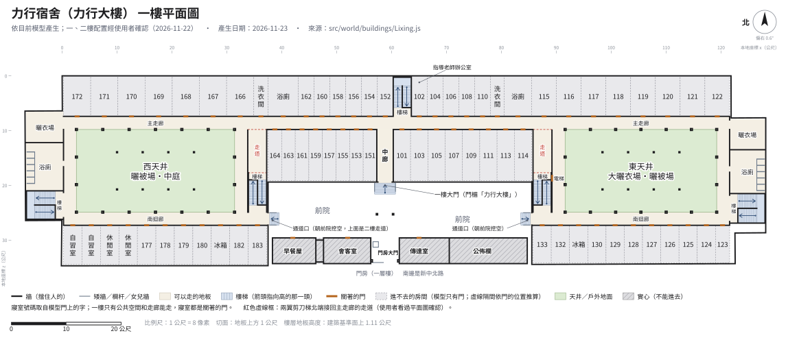
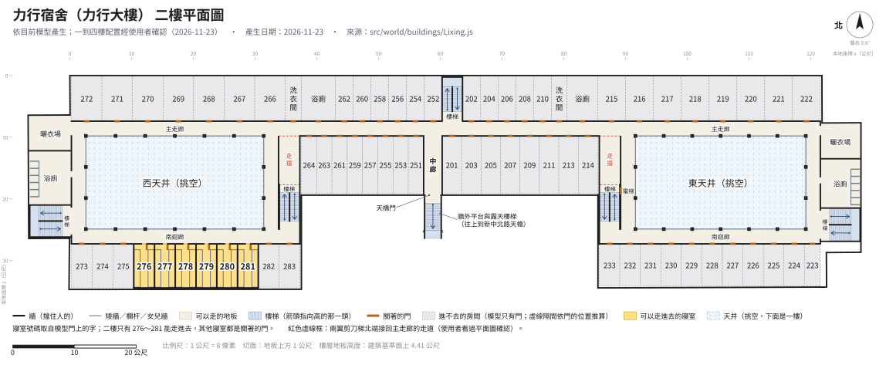
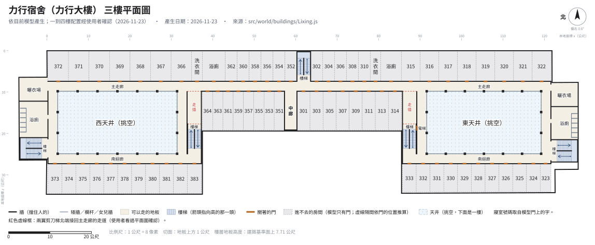
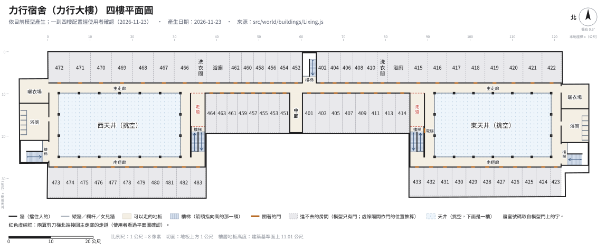
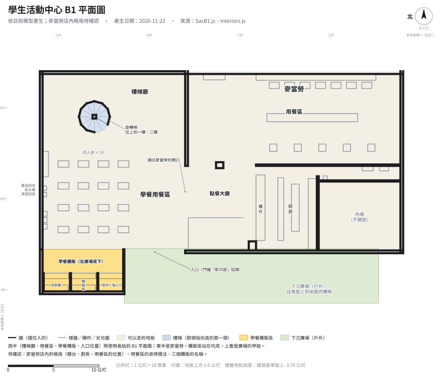
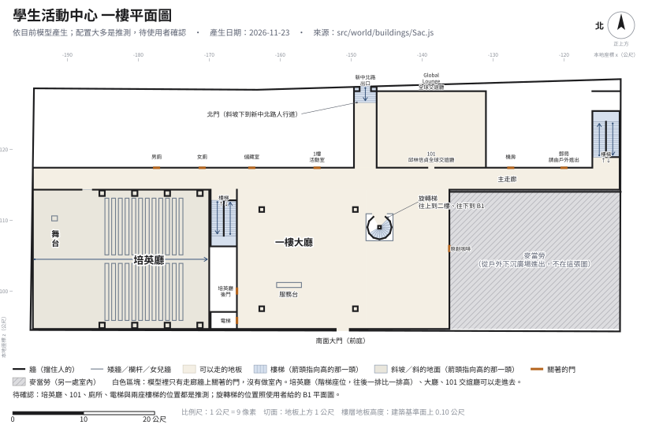
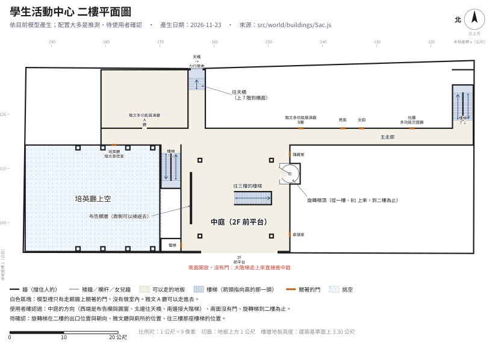
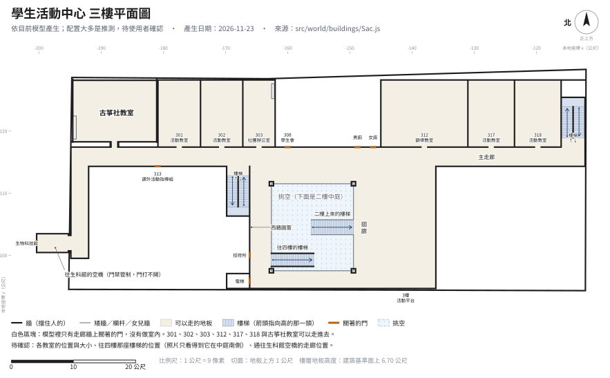
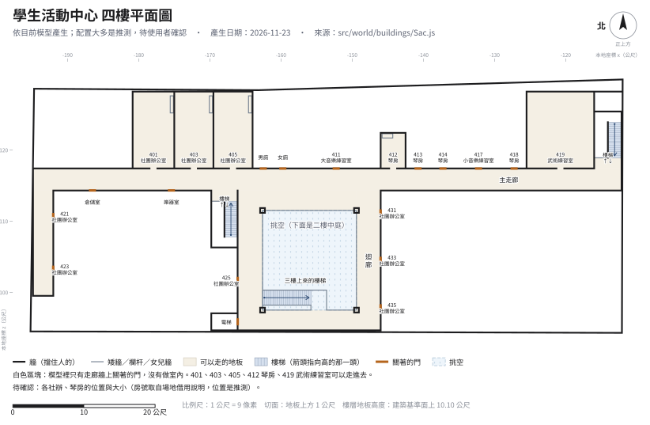

# 建築平面圖

`docs/floorplans/` 放建築室內的平面圖（SVG），依建築物分資料夾。圖不含外部字型和腳本，GitHub 上可以直接看：

| 資料夾 | 建築 | 圖 | 狀態 |
| --- | --- | --- | --- |
| [`lixing/`](lixing/) | 力行宿舍（力行大樓） | [一樓](lixing/lixing-1f.svg)、[二樓](lixing/lixing-2f.svg)、[三樓](lixing/lixing-3f.svg)、[四樓](lixing/lixing-4f.svg) | 一到四樓配置經使用者確認（2026-11-23） |
| [`sac/`](sac/) | 學生活動中心 | [B1](sac/sac-b1.svg)、[一樓](sac/sac-1f.svg)、[二樓](sac/sac-2f.svg)、[三樓](sac/sac-3f.svg)、[四樓](sac/sac-4f.svg) | 一到四樓配置大多是推測，待確認；B1 的麥當勞店內格局待確認 |

每棟建築一個資料夾，資料夾名稱就是設定檔的 `id`，檔名是 `<建築>-<樓層>.svg`。`README.md`（這份說明）留在最上層。

### 力行宿舍（力行大樓）









### 學生活動中心











## 圖是怎麼來的

遊戲裡的建築室內用 `src/world/Kit.js` 的 `Kit`（本地座標的建模工具）蓋模型，擋人的牆走 `Interiors.addWall`，可以走的地板和樓梯走 `Interiors.addSurface`。

平面圖工具在 `tools/floorplan/`（開發用，`tools/` 不會被部署）。它用 node 直接跑遊戲自己的建模程式，不開瀏覽器、也不用開發伺服器，拿到真正的 `Interiors` 牆線和地板再畫圖。所以圖不會和模型脫節：模型改了，重跑就是新圖。

- 在該層地板上方 1 公尺切一刀：跨過這個高度的牆畫成牆線；頂端不到地板上方 2.3 公尺的畫成細線（矮牆、欄杆、女兒牆、家具）。
- 高度等於該層地板的可走面畫成地板；斜的可走面畫成樓梯（很緩的畫成斜坡），箭頭指向高的那一頭。
- 模型裡門板和招牌貼圖上的字會被讀出來（門牌號碼、「浴廁」「洗衣間」這類），所以房間號碼也是取自模型。
- 進不去的房間在模型裡只有走廊牆上一扇關著的門，沒有隔間牆。工具假設每扇門在它那間的正中間，從門的位置一間一間推出隔間，畫成虛線；推不出來時改用相鄰兩扇門的中點，並印出警告。
- 圖上有標題、註記（設定檔的 `note`；個別樓層可以在 `floors()` 回傳的那一層另外給 `note`，例如學生活動中心 B1 的註記和其他樓層不同）、產生日期、來源檔、指北針（北在上，標出偏幾度）、上緣和左緣的本地座標刻度（每 10 公尺）、圖例、比例尺。

每棟建築一個設定檔 `tools/floorplan/buildings/<名稱>.mjs`，只負責「哪一塊叫什麼」：

- `build(env)`：呼叫該棟的建模函式，回傳 `{ kit, base, ... }`。
- `floors(ctx)`：回傳每層 `{ id, name, y, top }`。`y` 是該層地板在建築基準面以上的高度，`top` 是上一層地板的高度。
- `plan(...)`：回傳 `closedRows`（一排進不去的房間的範圍，和門在哪一邊）、`zones`（天井、可以走進去的房間、實心區塊等著色範圍）、`labels`（名稱與位置）、`legend`（圖例下方的補充說明）。位置盡量用 `readConsts('src/world/buildings/某棟.js')` 讀該檔最上層的 `const` 常數來算，或用讀到的門牌／招牌位置，不要抄死數字。

工具的檔案：

| 檔案 | 做什麼 |
| --- | --- |
| `tools/floorplan/make.mjs` | 指令本體 |
| `tools/floorplan/lib/env.mjs` | 在 node 裡載入遊戲模組（假的 canvas 只記下寫了什麼字） |
| `tools/floorplan/lib/extract.mjs` | 切樓層：牆、地板、樓梯、文字、進不去的房間 |
| `tools/floorplan/lib/svg.mjs` | 畫成 SVG |
| `tools/floorplan/lib/consts.mjs` | `readConsts()`：讀 js 檔最上層的常數 |
| `tools/floorplan/buildings/lixing.mjs` | 力行宿舍的設定檔 |
| `tools/floorplan/buildings/sac.mjs` | 學生活動中心的設定檔 |

## 重跑力行宿舍的圖

在 repo 根目錄執行（在 node 22 測過）。遊戲程式的 `three` 來自 `node_modules`，第一次要先跑 `npm ci`：

```bash
# 重產力行某一層到 docs/floorplans/lixing/
node tools/floorplan/make.mjs lixing 1f
node tools/floorplan/make.mjs lixing 2f

# 四層都產到別的資料夾
node tools/floorplan/make.mjs lixing all --out /tmp/lixing-plans

# 看有哪些樓層、地板高度分布、讀到哪些門牌文字
node tools/floorplan/make.mjs lixing --list
```

圖上的產生日期預設是今天；只有要重現某一天的圖時才加 `--date 2026-11-22` 這樣指定。`--title`、`--note` 可以改標題和註記；`--scale` 改一公尺幾個像素（力行是 8）。核對時加 `--debug` 會把讀到的每個門牌、招牌用紅字標在它的位置上；加 `--json <路徑>` 會把這一層的牆、地板、樓梯、文字、房間格存成 JSON。`node tools/floorplan/make.mjs --help` 有完整說明。

要轉成 PNG 看（macOS）：

```bash
# Quick Look 的縮圖是正方形，寬的圖直接丟進去只會看到左半邊；先做一份把畫布補成正方形的暫存副本
sed -E '1s/width="([0-9.]+)" height="[0-9.]+" viewBox="0 0 [0-9.]+ [0-9.]+"/width="\1" height="\1" viewBox="0 0 \1 \1"/' docs/floorplans/lixing/lixing-1f.svg > /tmp/lixing-1f-full.svg
qlmanage -t -s 2400 -o /tmp /tmp/lixing-1f-full.svg
```

會產生 `/tmp/lixing-1f-full.svg.png`（2400 × 2400，整張圖在上半部，下面是空白）。這個做法假設圖的寬大於高；不想轉檔的話直接用瀏覽器開 SVG 也看得到全圖。不要用 `sips` 轉，它畫不出字的白邊。

## 其他建築怎麼照做

1. 找到該棟的 js 檔和建模函式。`src/world/zones/Zones.js` 列了每一區呼叫哪個 build 函式，例如 `buildSac(I, scene, data, collision, Kit, regMat)`。看檔頭註解的本地座標說明（原點在哪、x 和 z 朝哪邊）和各樓層高度的變數。
2. 複製 `tools/floorplan/buildings/lixing.mjs` 成新檔，先只留 `id`、`name`、`source`、`note`、`build()`、`floors()`，把 `plan()` 整個拿掉。`build()` 裡用 `env.game('src/world/buildings/某棟.js')` 載入模組，呼叫建模函式時傳 `env.I`、`env.scene`、`env.data`、`env.collision`、`env.Kit`、`env.regMat`，回傳它的 `Kit` 和基準面高度。最小的樣子：

   ```js
   const SRC = 'src/world/buildings/Sac.js';
   export default {
     id: 'sac', name: '學生活動中心', source: SRC, note: '依目前模型產生、配置待確認',
     async build(env) {
       const { buildSac } = await env.game(SRC);
       const r = buildSac(env.I, env.scene, env.data, env.collision, env.Kit, env.regMat);
       return { kit: r.k, base: 0, FL: r.FL };
     },
     floors(ctx) { const FL = ctx.built.FL; return FL.map((y, i) => ({ id: `${i + 1}f`, name: `${i + 1} 樓`, y, top: FL[i + 1] ?? y + 3.4 })); },
   };
   ```

   `base` 是「模型的 y = 0 在世界上的高度」：力行是建築基準面（`buildLixing` 回傳的 `B`），活動中心的 y 直接是世界高度，所以是 0。建模函式沒有回傳樓層高度的話，下一步的 `--list` 可以幫忙找。
3. 跑 `node tools/floorplan/make.mjs <名稱> --list`，看「平的可走面的高度分布」：面積大的幾個高度就是各樓層地板，對一下 `floors()` 給的 `y`。
4. 跑 `node tools/floorplan/make.mjs <名稱> all --out /tmp/<名稱>`。沒有 `plan()` 時工具會自動把讀到的門牌、招牌寫在牆後面，先看牆、地板、樓梯對不對。
5. 再補 `plan()`（要保留自動標示就讓它回傳 `autoLabels: true`）：
   - `closedRows`：`{ x0, x1, z0, z1, doors }`，把成排進不去的房間框起來，`doors` 是門在這個框的哪一邊（`'n'`＝z 小的那邊、`'s'`＝z 大的那邊、`'w'`＝x 小、`'e'`＝x 大）。框裡已經有地板或樓梯的地方（樓梯間、穿堂、走得進去的房間）會自動跳過。
   - `zones`：`{ x0, x1, z0, z1, style, label }`，`style` 有 `open`（可以走進去的房間）、`void`（挑空）、`outdoor`（天井／戶外地面）、`solid`（實心）、`note`（紅色虛線框，只標示範圍，不會出現在圖例，要自己在 `legend` 補一句說明）。
   - `labels`：`{ text, x, z }`，另外可以給 `size`、`bold`、`vertical`（直排）、`anchor`（`'start'`／`'end'`）、`leader: [x, z]`（拉一條引線到那個點）。
   - `zoneNames`：`{ open: '可以走進去的寢室' }` 這樣改圖例上各種 `style` 的名稱（預設名稱在 `tools/floorplan/lib/svg.mjs` 的 `ZONE_STYLES`）。`bounds`：`{ x0, x1, z0, z1 }`，指定圖要畫的範圍；不給就自動包住所有牆、地板和標籤。
   - `plan()` 的參數裡有 `sl.texts`（這一層讀到的門牌和招牌，含位置）和 `find()`，可以拿來定位。
6. 核對：加 `--debug` 看紅字和自己標的名稱有沒有對上；挑十個以上的位置（牆的位置、門口缺口、樓梯起點、房間隔間），拿 `--json` 存下來的數字和 js 檔的常數比；再開開發伺服器 `npm run dev`，瀏覽器開 `http://localhost:5173/` 進遊戲走一趟那一層確認。
7. 確認沒問題再把 SVG 產出來（不給 `--out` 就是 `docs/floorplans/<名稱>/<名稱>-<樓層>.svg`，每棟建築自己一個資料夾），並在這份文件最上面的表格補一列、下面補上各層的圖。

第二棟是學生活動中心（`src/world/buildings/Sac.js`，`Kit` 原點 0,0、不旋轉），設定檔 `tools/floorplan/buildings/sac.mjs` 可以當另一個範例：

```bash
node tools/floorplan/make.mjs sac all
```

- `build()` 照遊戲的順序先呼叫 `zoneGTerrain`（挖下沉廣場的坑）、`buildSacB1`（旋轉梯在這裡）再呼叫 `buildSac`，一樓和二樓才看得到旋轉梯。
- `plan()` 回傳 `autoLabels: true`，門牌和招牌照自動標示；教室裡的海報、指示牌這類不該當房間名稱的字，在 `plan()` 開頭從 `sl.texts` 濾掉。
- B1 西半（樓梯廳、用餐區、學餐攤販）在 `SacB1.js`，東半是麥當勞。麥當勞的 `buildMcD` 寫在 `src/world/Interiors.js` 裡沒有匯出，用 `env.gamePrivate('src/world/Interiors.js', ['buildMcD'])` 取（工具在載入時替這份副本補上匯出，遊戲的檔案不用改）。
- 學餐攤販在廣場底下，牆是用世界高度登記在世界碰撞（`collision.addSegment`），不是 `Interiors.addWall`；把 `env.worldWalls` 當成 `collision` 傳給 `buildSacB1`，這些牆就會一起進平面圖。
- 樓層可以各自帶 `scale`、`cut`、`note`、`source`：B1 比較小，用 `scale: 18`；`cut: 0.6` 讓 0.75 公尺高的餐桌也畫得出來。
- 一到四樓的配置大多是推測（找不到平面圖，空間名稱取自課指組的場地借用說明），圖上的「待確認」要等使用者看過才能拿掉。

## 常見問題

- **出現「找不到常數」**：js 檔的常數改名了，更新設定檔裡 `readConsts` 的名單。
- **出現「門不在格子正中間或範圍不合」的警告**：`closedRows` 的範圍沒對到那排房間的兩端，或那棟的門本來就不在正中間。這時虛線隔間只是示意。
- **出現「碰撞輪廓找不到」這類該棟自己印的警告**：工具裡的 `collision` 是替身，不影響平面圖。
- **圖上某面牆不見了**：那面牆沒有碰撞（只有模型、沒有 `addWall`），或它的高度沒有跨過地板上方 1 公尺。可以在 `floors()` 回傳的那一層加 `cut` 改切的高度。
- **家具被畫成粗牆，或矮牆被畫成細線**：粗細的分界是地板上方 2.3 公尺，可以在那一層加 `full` 改。
- **樓梯只畫一半**：折返梯和剪刀梯上下兩段在平面上重疊，工具只畫從這一層往上的那一段；最上層沒有往上的梯段，才畫往下的。
- **`readConsts` 讀不到某個常數**：它只讀檔案最上層、用得到的東西都是純數字／字串／陣列／物件的 `const`。寫在函式裡面的數字讀不到，改用門牌或招牌的位置來定位。
- **不要為了畫圖去改建築的 js 檔**：設定檔拿不到的數字用 `readConsts` 讀，或用門牌位置推。

## 圖的限制

- 圖只反映遊戲模型，不是實際建築的測量圖。力行宿舍的配置是照寢室分布圖套進 OSM 輪廓做的，一到四樓的圖使用者看過確認（2026-11-23）。
- 只有有碰撞的牆和可走的面會出現；純裝飾的模型（沒有碰撞的柱子、家具、窗戶）不會畫出來，開著的門洞只看得到牆上的缺口。
- 進不去的房間的隔間線是推算的；房間的深度是設定檔框的範圍，不代表模型裡有那面牆。
- 名稱的位置是設定檔決定的。模型改了格局時，牆、樓梯和門牌會自動跟著變，但設定檔裡手動補的名稱要人工檢查。
- 地形高度用 `data/terrain.json`。建築基準面在 node 裡和在遊戲裡可能差一個固定高度，只影響圖上寫的「樓層地板高度」那個數字，不影響平面位置。
- 字的寬度是估的，沒有真的量字型；房間很窄時字會縮小或改成直排，換了字型可能會稍微超出格子。
