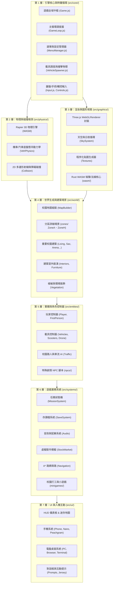
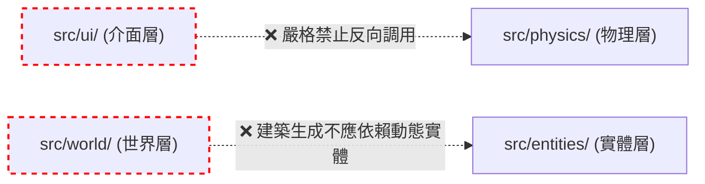
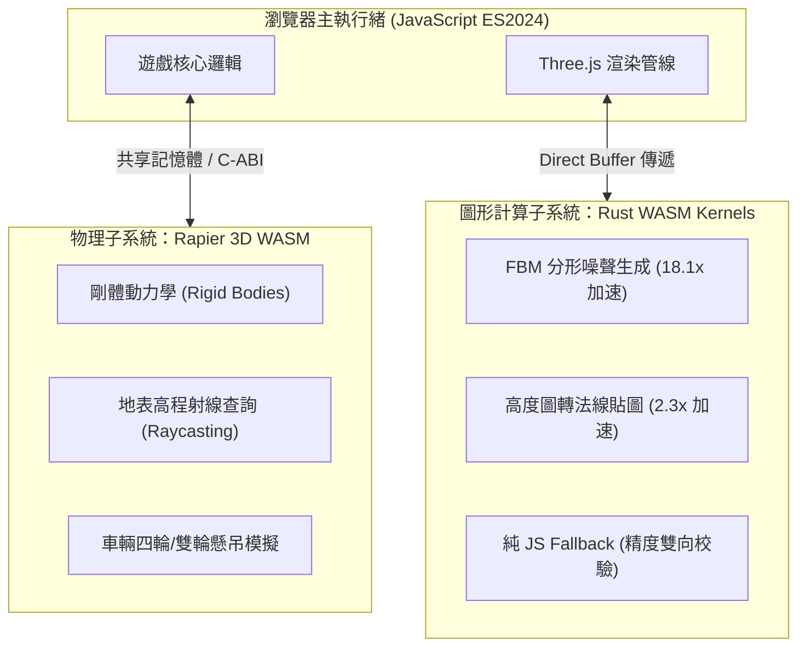
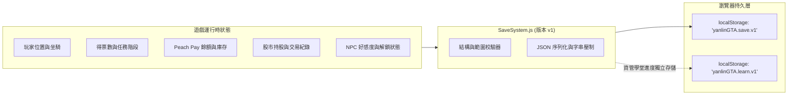

# YanlinGTA 系統架構手冊 (System Architecture Guide)

本手冊為「中原順起來 · 資管要贏 票投彥霖 (YanlinGTA)」專案的架構設計核心文檔，詳述專案的分層結構、時序調度、雙 WASM 運算子系統、依賴拓撲規範與資料流設計。

---

## 一、 架構願景與核心心智模型 (Mental Model)

YanlinGTA 是一款運行於瀏覽器端的 3D 開放世界校園冒險網頁遊戲。整體系統設計遵循**「高內聚、低耦合、單向無環（DAG）」**的模組化原則，將原本扁平龐雜的單一腳本庫解耦為清楚自治的 7 大領域分層。

### 核心設計哲學
1. **單向依賴約束**：底層邏輯（如物理、數學、資料）絕對不得反向依賴上層邏輯（如場景組裝、UI、音效）。
2. **時脈與渲染解耦**：嚴格區分物理離散時間步長（Fixed Timestep）與螢幕刷新幀率（Variable RAF），確保不同螢幕更新率（60Hz、120Hz、144Hz）下的運動與物理表現一致。
3. **雙軌高效能運算 (Dual-track WASM)**：對運算密集型模組（剛體碰撞、程序化噪聲紋理）導入 WebAssembly 加速，並維持純 JavaScript Fallback 作為安全性雙保險。
4. **狀態集中與無痛序列化**：遊戲進度、角色外觀、購置資產、股市持股與任務狀態統一經由 `SaveSystem` 管理，並提供防篡改與結構校驗。

---

## 二、 7 大領域分層與職責定義 (7-Layer Architecture)



### 分層職責清單

| 分層名稱 | 目錄路徑 | 核心職責 | 關鍵模組 |
| :--- | :--- | :--- | :--- |
| **1. 引擎核心層** | `src/core/` | 遊戲生命週期、RAF 循環調度、固定步長推進、全域事件中樞、輸入狀態映射。 | `Game.js`, `GameLoop.js`, `MenuManager.js`, `VehicleSpawner.js`, `Input.js` |
| **2. 物理碰撞層** | `src/physics/` | Rapier 3D 物理世界封裝、機車與四輪車底盤懸吊計算、地面投影射線檢測、邊界牆碰撞。 | `VehPhysics.js`, `Collision.js` |
| **3. 視覺圖形層** | `src/graphics/` | Three.js 場景與燈光管理、日夜循環動態天空、程序化瀝青/草地貼圖生成（Rust WASM 雙軌）。 | `SkySystem.js`, `Textures.js`, `kernels.wasm` |
| **4. 世界生成層** | `src/world/` | OpenStreetMap 座標轉換、校園建築幾何拼裝、分區（Zone A~H）、室內空間與植被生成。 | `MapBuilder.js`, `Interiors.js`, `zones/*`, `buildings/*` |
| **5. 遊戲實體層** | `src/entities/` | 玩家第三人稱/第一人稱控制、骨骼姿勢網格、機車與汽車操控實體、校園巡邏路人與劇情 NPC。 | `Player.js`, `Character.js`, `Vehicles.js`, `Traffic.js`, `npcs/*` |
| **6. 業務系統層** | `src/systems/` | 競選任務推進狀態機、本機 LocalStorage 存讀檔、A* 路線規劃、Web Audio 音效、校園打工迷你遊戲。 | `MissionSystem.js`, `SaveSystem.js`, `Navigation.js`, `minigames/*`, `mahjong/*`（277 台式麻將） |
| **7. 介面互動層** | `src/ui/` | 速度表與得票 HUD、手機作業系統（Peachgram、新聞、動態）、電腦桌面系統（終端機、瀏覽器）、對話介面。 | `HUD.js`, `PC.js`, `phone/Phone.js`, `Prompts.js` |

---

## 三、 依賴原則與拓撲約束 (Dependency Rules)

為了杜絕循環引用與保持架構可測試性，專案強制執行以下**依賴單向無環原則**：

### 1. 允許的依賴方向
- **由上而下單向調用**：高層業務邏輯（如 `src/ui`、`src/systems`）可以引用底層工具（如 `src/physics`、`src/graphics`）。
- **同層模組間橫向引用**：同一分層內部之模組允許互相引用（例如 `src/world/zones/ZoneA.js` 可以引用 `src/world/Interiors.js`）。
- **中樞依賴注入**：`src/core/Game.js` 作為頂層裝配者（Orchestrator），負責將各子系統實例化並注入給需要的實體，各子模組不應手動直接 import 單例 `Game`。

### 2. 明確禁止的反模式 (Anti-Patterns)

- **禁止底層向高層反向 import**：
  - ❌ `src/physics/` 嚴禁 import `src/ui/`、`src/entities/` 或 `src/systems/`。
  - ❌ `src/world/` 嚴禁 import `src/entities/Player.js`。世界生成應純粹產出場景幾何，角色透過註冊點由實體層裝配。
- **禁止全域狀態隱性耦合**：
  - 各模組不得隨意在 `window` 物件掛載可變遊戲狀態；所有跨系統數據交換必須透過 `Game` 中樞傳遞或自 `GameState` 讀取。

---

## 四、 核心循環與時鐘調度 (GameLoop Lifecycle)

遊戲運行時的核心心智模型由 `src/core/GameLoop.js` 驅動，採用經典的 **累積時間步長（Accumulator Fixed Timestep）** 模型：

```mermaid
sequenceDiagram
    autonumber
    participant Browser as 瀏覽器 (requestAnimationFrame)
    participant Loop as GameLoop.js
    participant Physics as Rapier 3D (Fixed 60Hz)
    participant Systems as 實體與業務系統 (Entities & Systems)
    participant Three as Three.js WebGLRenderer

    Browser->>Loop: 每幀觸發 RAF (delta時間)
    Loop->>Loop: 累加 delta 到時間累積池 (accumulator)
    
    loop 當 accumulator >= fixedDt (1/60s)
        Loop->>Physics: 物理步進 physicsWorld.step(fixedDt)
        Loop->>Physics: 車輛懸吊更新 vehPhysics.update(fixedDt)
        Loop->>Loop: 扣除 fixedDt
    end

    Loop->>Systems: 依據渲染幀推進邏輯 (玩家控制器、相機平滑、NPC動畫)
    Loop->>Loop: 自動動態調頻 (_autoQuality: 監測 FPS 並調整 PixelRatio)
    Loop->>Three: 畫面繪製 renderer.render(scene, camera)
    Three-->>Browser: 呈現畫面
```

### 1. 固定時間步長 (Fixed Timestep)
- **物理步長設定**：固定為 `1 / 60` 秒（約 16.67ms），不受螢幕高刷新率（如 144Hz 或 240Hz）影響。
- **防止卡頓螺旋 (Spiral of Death)**：若累積延遲超過上限（如 100ms），強制捨棄累積量，避免物理引擎連續補算造成畫面永久凍結。

### 2. 動態畫質調頻 (Dynamic Quality Scaling)
- `GameLoop` 內部維持移動平均 FPS 監控：
  - 當幀率持續低於 35 FPS 時，自動縮減 `renderer.setPixelRatio`（最低降至 0.75x），並停用非關鍵後製輝光。
  - 當幀率穩定維持 58 FPS 以上時，平滑調升畫質至裝置原生解析度。

### 3. 效能顯示浮層 (`src/core/PerfHud.js`)
- 設定 →「📊 效能顯示」可選 關閉／簡易／詳細／開發者，存在 `settings.perfHud`；網址帶 `?perf` 則本次強制開到「開發者」（不改存檔）。
  - 簡易：只有 FPS（≥50 綠、30–49 黃、<30 紅）。
  - 詳細：再加 1% 低幀與最慢一幀、主執行緒負載 %（遊戲 JS 每幀工作時間 ÷ 幀間隔；瀏覽器拿不到真正的 CPU／GPU 使用率）、JS 記憶體（`performance.memory`，僅 Chromium）、繪圖呼叫與三角形數。
  - 開發者：再加 邏輯／物理／繪製 各自耗時、`renderer.info.memory` 紋理與幾何數、著色器數、車流／行人／NPC 數量、剛體與碰撞體、畫質與效能檔位、WASM、解析度×像素比、玩家座標與所在區域、GPU 名稱。
- `GameLoop.loop()` 只在開啟時呼叫 `frameStart` / `renderStart` / `frameEnd`；文字每 0.5 秒更新一次。關閉時不做任何量測。效能重構要加的新數據（例如串流區塊數）請加在 `PerfHud._draw()` 的開發者層級。

### 4. 畫布貼圖記憶體 (`src/graphics/GpuMemLifecycle.js`，效能重構 Phase 1A)
iPhone 的 Safari／LINE／IG 內建瀏覽器，`<canvas>` 佔用超過幾百 MB 就會把頁面殺掉；原本一次載入會留下約 1.75 GB 的畫布（光是 28 張 2048×4096 的街屋招牌圖集就 896 MB）。規格見 `perf-refactor/specs/phase-1-ios-memory-rescue.md`。
- **設定**：`Game.init()` 建好 renderer 後呼叫 `configureGpuMem(perfProfile, renderer)`。每個檔位都照 `PerfProfile` 的 `texScale` 存放畫布貼圖：獨顯電腦（`desktop-dgpu`）1 倍、內顯電腦（`desktop-igpu`，含 Apple M 系列）0.75、手機（`mobile-lite`）0.5、BootDiag 安全模式 0.375，網址 `?texscale=` 可覆寫；圖集依 `atlasMaxW` × `atlasMaxH` 限制大小。
- **建立畫布**：`canvasTexture(w, h, draw, repeat)` / `scaledCanvas(w, h)`。畫布以 `texScale` 存放，但 context 已縮放，`draw(g, w, h)` 照原本的 w × h 畫；縮小的畫布用 `cv.lw` / `cv.lh` 記住原尺寸。拿不到 2D context（記憶體不足）時回傳共用的 1×1 `blankTexture()`，不會當掉。`Kit.ctex`、各區（ZoneA～H）、`Dorms`、`Lixing`、`Sac` 的貼圖都走這裡。
- **釋放**：
  - 街屋圖集（`finishRow` 的 sheet）一畫完就 `uploadAndRelease()`：上傳 GPU、畫布縮成 1×1。`Sac` 的門牌／招牌圖集、`Lixing` 的門牌圖集也在全部畫完後這樣處理。
  - 被複製進圖集的小招牌畫布，每蓋完一個 zone 由 `releaseAtlasSources(scene, TEX)` 放掉（場景裡還有別的 mesh 直接用的會留著），並從 `TEX` 移除；之後再要同一個 key 會重畫一張（畫法沒有亂數，像素相同）。
  - 共用的靜態貼圖（`canvasTexture`、`src/graphics/Textures.js` 產生的地面／立面、車牌、地名標籤、家具招牌圖集、校門牆面）：載入最後（進標題前）由 `flushShared(scene)` 把場景裡用到的全部上傳 GPU（同一張畫布的複製貼圖也一起），再釋放畫布。之後若有人對它設 `needsUpdate`，`canvasTexture` 做的會先重畫一次，其他的會在主控台警告。
  - `Textures.js` 一律先照原尺寸生成（花紋是以像素畫的），再縮到 `texScale` 才做成貼圖，外觀相同、像素變少；高度圖 `hc`、髒污暫存 `dc` 用完立刻釋放。
  - 合併過的靜態幾何（`MapBuilder` 的 `Geo.mesh()`、`Kit.finish()`、`finishRow()`）用 `markStaticGeometry()`：先算好包圍球／盒，WebGL 上傳後就把 JS 端的頂點陣列換成空陣列（`count` 保留）。物件第一次被畫到時才會上傳，所以是邊玩邊釋放。
  - Apple WebKit（iPhone Safari、LINE / IG）建完世界與進標題前各呼叫一次 `gcNudge()`，提醒 JavaScriptCore 回收建置期的垃圾（5 秒內最多一次）。
  - WebGL context 遺失後還原時，已釋放的畫布與頂點陣列傳不回 GPU，所以會直接重新整理頁面（離開前會自動存檔；BootDiag 會在下次啟動進安全模式）。
- **新增貼圖時請遵守**：
  - 靜態的畫布貼圖用 `Kit.ctex` 或 `canvasTexture`，不要自己 `document.createElement('canvas')`，手機才會縮小。
  - 畫圖時用傳進來的 `w`、`h`，不要用 `g.canvas.width`／`cv.width`（縮小後只會畫到四分之一）；需要 `getImageData` 逐像素處理的貼圖（例如 `src/graphics/Textures.js` 的法線圖）不要走 `scaledCanvas`。
  - 之後還會重畫的貼圖（螢幕、門牌、計分板、等圖片載入才畫上的貼圖）要標成動態：`canvasTexture(w, h, draw, repeat, { dynamic: true })` 或 `markDynamic(ctex(...))`，否則載入完成後畫布會被 `flushShared` 釋放。也不要用 `k.plane()` 放進街屋：`finishRow` 會把 `k.plane()` 建的平面打包進圖集，原畫布之後會被釋放；請自己建 mesh 放進 `k.group`（只有 `k.plane()` 的平面會被打包）。
  - **地圖分塊（Phase 2）**：`MapBuilder` 的 `Geo.mesh()` 若三角形分布超過兩格（每格 120 m），會回傳 `ChunkedMesh`（`isChunkedMesh`），每格一個子 mesh，讓視錐與陰影剔除能丟掉畫面外的部分。它的 `castShadow`、`receiveShadow`、`frustumCulled`、`renderOrder` 會設到每個子 mesh；材質請用 `chunkMaterial`（它刻意沒有 `material`，否則 three.js 會把容器當成要畫的物件），也沒有 `geometry`。
  - 世界的靜態網格（`Geo.mesh()`、`Kit.finish()`、`finishRow()` 的輸出）在畫過之後沒有頂點資料可讀：不要對它們做 raycast、`Box3.setFromObject()`、合併或改頂點；要用請在建置時（第一次畫之前）做，或改用碰撞資料（`world.collision`、`interiors`）。
- **量測**：`npm run profile:mobile -- --assert-ios-budget`（進標題時畫布 ≤ 220 MB）；數據記在 `perf-refactor/agent-handoff-log.md`。
- **載入時不做的事（Phase 1B）**：
  - renderer 不要 stencil buffer（專案沒有任何地方用到；three r160 預設會要），非開發、非 `?diag` 時關掉 `debug.checkShaderErrors`（讀每支著色器的編譯紀錄是同步的 GPU 往返）。之後若要用 stencil，記得把 `Game.init()` 的 `stencil: false` 拿掉。
  - low／xlow 一開始就不開陰影（`shadowMap.enabled`、太陽 `castShadow`），畫質升上去時 `GameLoop.applyQuality()` 會打開。
  - 歌劇背景音樂（3 MB）`preload = 'none'`，第一次播放時才下載。
  - 第一人稱後照鏡的 render target 第一次坐上車才建立（`FirstPerson.rt`）；`renderer.localClippingEnabled` 只在坐進汽車、車艙被切開時才打開（每一幀每個繪圖呼叫都會多一次檢查）。
  - 林口體育館（`src/world/buildings/Arena.js`）：座椅 `A1`／`A2` 與螢光棒恢復視錐剔除（原本人在校園時每幀也畫 4 公里外約 46 萬個三角形）；場館外殼平常隱藏，`Concert.js` 搭接駁車去時才顯示、回中原時再隱藏。

### 5. 可共用的小工具（隨涼韌足體養生加入）
- **`hud.fade(text, mid, after, { midText, dark, hold })`**（`src/ui/HUD.js`）：全螢幕黑幕加一行字（跟睡覺同一層 `#sleepFade`）。變黑後執行 `mid()`，文字可換成 `midText`，再淡回來後執行 `after()`。適合「時間往後跳」「瞬間移動」的轉場。
- **`player.sitAt(x, z, h, { mode, dy })`**（`src/entities/Player.js`）：除了坐下（預設 `'sit'`），也可以 `'down'` 仰躺或 `'prone'` 趴著（`Character.js` 的姿勢）。`dy` 是把身體抬高多少（床的高度）。躺下時根節點的旋轉順序會暫時改成 `YXZ`，身體才會順著朝向躺（預設的 `XYZ` 會固定沿世界座標軸躺）；`standUp()` 會改回來。
- **新中北路街屋的 `inside: true`**（`src/world/buildings/StreetXinzhongbei.js`）：那一格只蓋二樓以上的外殼，一樓的立面、店內與碰撞由那段的 `custom()` 自己蓋（範例：`src/world/buildings/MassageShop.js`）。街屋是整排合併的 mesh，會動、會亮、會隱藏的東西（門、燈、鐵捲門）要用自己的 mesh 放進 `k.group`，移動後要呼叫 `updateMatrix()`（整排已經 freeze）。
- **系統接管鏡頭**：跟打工、門禁、羊明衫一樣，在 `Game._update` 的 `rig.update` 之後呼叫 `X.camera(this.camera, dt)`（例：`massage.camera`）；要讓玩家暫時不能動，把旗標加進 `busy` 清單（例：`massage?.busy`）。

### 6. 滑鼠鎖定與 Esc 暫停 (Pointer Lock)
- 遊玩中失去滑鼠鎖定（`pointerlockchange`）會被當成玩家按了 Esc 而打開暫停選單（`MenuManager.js`）。
- 任何「自己放開滑鼠」的畫面（成績單、商店、電腦、手機、麻將……）必須讓 `Game.mouseOwnedByUI()` 回傳 true（`g.modal()` 會自動設 `_modalOpen`；其他畫面請加進該清單或設 `g._overlay`），否則一放開滑鼠就會誤跳暫停選單。例：障礙賽成績單（`race.state === 'results'`）。

---

## 五、 雙 WebAssembly 運算子系統 (Dual WASM Architecture)

YanlinGTA 在追求流暢度與真實度的同時，策略性地導入雙 WebAssembly 引擎：



### 1. Rapier 3D 物理引擎 (Physics Subsystem)
- **架構優勢**：採用 Rust 編譯的 `@dimforge/rapier3d-compat` WASM 模組，提供極致穩定的連續碰撞檢測（CCD）與剛體計算。
- **機車懸吊物理 (`src/physics/VehPhysics.js`)**：
  - 模擬 SYM JET SL 的車重、轉向幾何（Caster Angle）、傾角回正力矩與輪胎抓地力曲線。

### 2. Rust WASM 圖形計算核心 (`tools/wasm-kernels/`)
- **應用場景**：遊戲啟動時需程序化生成校園柏油路面、人行道花崗岩、操場 PU 跑道等數十張高解析度貼圖。
- **效能比對基準**（由 `npm run test:wasm` 自動驗收）：
  - **FBM 噪聲生成**：Rust WASM 耗時 256 ms vs 純 JS 耗時 4,628 ms（**18.1 倍效能躍升**）。
  - **法線貼圖計算**：Rust WASM 耗時 6,955 ms vs 純 JS 耗時 15,998 ms（**2.3 倍效能躍升**）。
- **零誤差雙保險 (Bit-for-bit Equivalence)**：
  - 在無法載入 WASM 的極端環境下，`src/graphics/Textures.js` 提供 100% 相同演算法的純 JavaScript 實作，數值誤差嚴格限制為 0。

---

## 六、 資料儲存與世界持久化 (Data & State Persistence)



1. **版本化存檔結構**：存檔金鑰帶有版本後綴（`v1`），載入時若發現舊版資料自動執行結構遷移（Migration），防止改版破壞玩家進度。
2. **容錯與重設**：若 LocalStorage 損壞或被手動竄改，`SaveSystem` 會優雅回退至預設初始狀態（Default State）並通知 HUD 彈窗，避免遊戲啟動崩潰。
3. **分區存儲隔離**：迷你遊戲「資管學堂（iCode）」的練習進度與主遊戲解耦，獨立存放於專屬金鑰中。

---

## 七、 總結

YanlinGTA 的現代架構藉由清楚的 7 層邊界劃分、單向無環依賴、固定時脈物理循環與高效能雙 WASM 運算，兼顧了校園開放世界的探索樂趣與軟體工程的高標準。後續所有新功能與劇情擴充，均應嚴格遵守本架構規範。