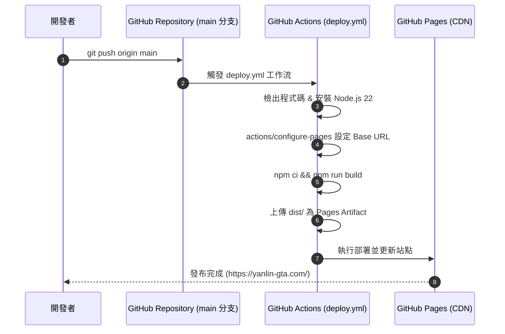
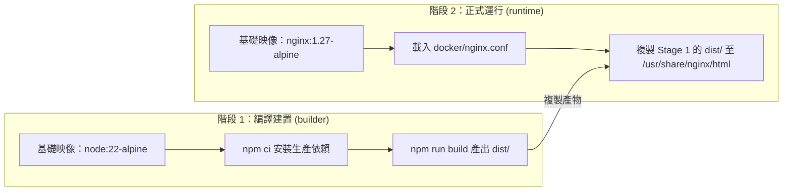
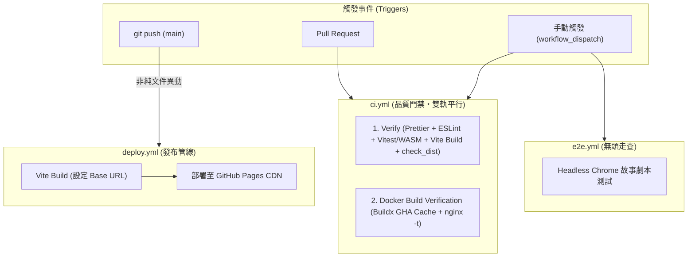

# YanlinGTA 部署與運維手冊 (Deployment & Operations Guide)

本手冊為「中原順起來 · 資管要贏 票投彥霖 (YanlinGTA)」專案的部署與維運指南，詳述 GitHub Pages 自動發布、Docker 容器化多階段建置、自建 Nginx 最佳化配置、CI/CD 自動化管線與常見疑難排解。

---

## 一、 部署模式矩陣 (Deployment Options Matrix)

YanlinGTA 提供四種靈活的部署與運行模式，滿足從本機體驗、單機容器化到全自動靜態託管的不同需求：

| 模式 | 適用環境 | 核心指令 | 說明 |
| :--- | :--- | :--- | :--- |
| **A. GitHub Pages (推薦)** | 線上公開試玩、展示網站 | `git push origin main` | 透過 GitHub Actions 自動構建並發布至 `gh-pages`，享有全域 CDN。 |
| **B. Docker Compose** | 單機私有部署、測試展示伺服器 | `docker compose up -d --build` | 自動完成 Node.js 多階段構建與 Nginx 啟動，開箱即用。 |
| **C. Docker 原生容器** | 自訂 CI 映像檔構建 | `docker build -t yanlin-gta .` | 產出標準 Alpine Nginx 映像檔。 |
| **D. 自建 Web 伺服器** | 企業內部、現有反向代理 | `npm run build` | 將產出的 `dist/` 放入 Nginx、Apache 或 Caddy 靜態目錄。 |

---

## 二、 模式 A：GitHub Pages 自動化發布

專案內建 `.github/workflows/deploy.yml`，當程式碼合併至 `main` 或 `master` 分支時，將觸發全自動編譯與發布管線。



### 倉庫設定步驟：
1. 進入 GitHub 倉庫頁面 $\rightarrow$ **Settings** $\rightarrow$ **Pages**。
2. 在 **Build and deployment** $\rightarrow$ **Source** 選項中，**務必選擇 GitHub Actions**（切勿保留 `legacy`，避免與 `deploy.yml` 互相覆蓋線上版本）。
3. 透過 Pull Request 合併程式碼至受保護的 `main` 分支，即可在 **Actions** 分頁觀察部署進度。

### 自訂網域 `yanlin-gta.com`（Cloudflare DNS）
正式網址為 **https://yanlin-gta.com/**（網域於 Cloudflare 註冊與代管 DNS）。因採 GitHub Actions 發布，**不需要**在 repo 放 `CNAME` 檔；網域設定存在 GitHub 倉庫的 Pages 設定裡。Vite 使用相對路徑 `base: './'`，換網域不需改程式。

1. **GitHub**：Settings → Pages → **Custom domain** 填 `yanlin-gta.com`（或 `gh api -X PUT repos/howardtuan/YanlinGTA/pages -f cname=yanlin-gta.com`），憑證發好後勾選 **Enforce HTTPS**。
2. **Cloudflare DNS**（Proxy status 設 **DNS only／灰雲**，讓 GitHub 能自動簽發 HTTPS 憑證）：

| Type | Name | Content |
| :--- | :--- | :--- |
| A | `@` | `185.199.108.153` |
| A | `@` | `185.199.109.153` |
| A | `@` | `185.199.110.153` |
| A | `@` | `185.199.111.153` |
| CNAME | `www` | `howardtuan.github.io` |

舊網址 `https://howardtuan.github.io/YanlinGTA/` 會由 GitHub 自動轉址到自訂網域。

### 遊戲百科 Wiki：`yanlin-gta.com/wiki/`
Wiki 是遊戲網站底下的靜態頁面，原始檔在 `wiki/`，由 `wiki/build.mjs` 讀 `data/npcs.json`（人物設定）＋ `wiki/people.json`（分類、開發者、LinkedIn／GitHub 連結）＋ `wiki/quests.json`（任務）＋ `wiki/shops.json`（合作店家）＋ `wiki/news.json`（最新消息）產出到 `dist/wiki/`。

- **部署**：`npm run build` 時 `vite.config.js` 會自動產生 `dist/wiki/`，跟遊戲一起由 GitHub Pages 發布，不需要額外設定；`check:dist` 會確認 `wiki/index.html` 有產出。
- **本機預覽**：`npm run build` 後 `npm run preview`，開 `http://localhost:4173/wiki/`；只改 Wiki 時可以 `npm run wiki:build` 單獨重產 `dist/wiki/`。Wiki 的「開始玩」用相對路徑 `../` 回到遊戲。
- **遊戲裡的入口**：標題畫面的「📖 彥霖GTA WIKI」按鈕（取代原本的「關於彥霖」，`src/core/MenuManager.js` 的 `btnWiki`）開新分頁到 `wiki/`。YanlinGTA 的 GTA = **Great Times Adventure**，Wiki 頁首與概覽都有寫。
- **背景顏色**：表頭右上角「自動／亮色／暗色」切換（`wiki/build.mjs` 的 `THEME_SWITCH`、`wiki.js`），選擇存在 `localStorage` 的 `yanlinWiki.theme`，換頁也記得；`<head>` 的小程式在畫面出來前就套用，不會先閃一下別的顏色。自動＝跟著系統的深淺色。
- **分享與連結預覽**：每頁標題右上角「🔗 分享」打開小視窗，顯示這頁的完整網址（`pageUrl()`，例如 `https://yanlin-gta.com/wiki/characters/`）、複製按鈕、LINE／Facebook／X 分享，手機有系統分享時多一顆「更多…」。每頁 `<head>` 有 canonical、Open Graph 與 Twitter card（標題、說明取自該頁引言、預覽圖用完整 `https://` 網址：操作教學用遊戲截圖，其他頁用封面）；**最新消息每篇文章都有自己的頁面** `news/<id>/`（`postSlug()`），連結預覽用文章照片（寬高由 `jpegSize()` 讀出）、標題與第一段，`og:type` 是 article；列表上每篇有「閱讀全文」與「分享文章」（手機有系統分享時打開系統分享，否則複製文章連結）。遊戲首頁 `index.html` 也有同一套，預覽圖是 `assets/loading.jpg`。換了網域要改 `wiki/build.mjs` 的 `SITE` 和 `index.html` 的網址。
- **快取**：`style.css`、`game-controls.css`、`wiki.js` 的網址會加上內容雜湊 `?v=…`（`buildWiki`），更新後瀏覽器一定拿到新版，不會新 HTML 配舊 JS。
- **版面**：技術文件式多頁網站（`wiki/build.mjs` 的 `PAGES`），每個主題一頁：`/wiki/`（介紹）、`news/`、`controls/`、`characters/`、`main-quests/`、`side-quests/`、`cases/`、`shops/`、`team/`。三欄整塊置中：左邊分組編號的目錄、中間麵包屑＋標題＋內容＋上一頁／下一頁、右邊「本頁內容」（捲動時標出目前段落；1200px 以下收起，900px 以下左邊目錄收成「☰ 目錄」抽屜）。舊的單頁網址（`/wiki/#characters`、`#npc-zz`、`#q-m1`…）會由 `wiki.js` 轉到對應的頁面。「操作教學」的按鍵圖直接用遊戲「⌨ 操作說明」的同一份 HTML（`src/core/Controls.js` 的 `controlsHTML`，手把以 Xbox 標示）和同一份樣式（build 時從 `src/styles/style.css` 抽出相關規則、加上 `.game-ctl` 前綴，輸出成 `dist/wiki/game-controls.css`），遊戲改按鍵 Wiki 重建就跟著變。截圖在 `wiki/shots/`，改了 HUD／觸控按鈕／標題畫面後 `npm run build && node tools/wiki_shots.mjs` 重截。
- **虛構角色**：`wiki/people.json` 的 `group: "fiction"`（Tzuyu），只出現在手機聊天室、沒有遊戲 NPC 的 Winter 放在 `extras`（欄位跟 `data/npcs.json` 一樣）；虛構角色不放社群連結，卡片只標「虛構角色」。
- **首頁宣傳片**：封面放 README 那支 58 秒宣傳片（`docs/media/promo/yanlin-promo-58s-v2.mp4`，約 47 MB），build 時複製成 `dist/wiki/media/promo.mp4`；`preload="none"`，先顯示 poster、按播放才下載。換影片時改 `wiki/build.mjs` 的檔名。
- **網頁圖示與加入主畫面**：Wiki 有自己的圖示（`wiki/icons/`：favicon、192／512、iPhone 用的 apple-touch-icon）與 `wiki/manifest.webmanifest`（`start_url` 為 `./`，加到主畫面後開回 `/wiki/`）；build 時複製到 `dist/wiki/`。
- **補社群連結**：改 `wiki/people.json` 的 `linkedin`／`github`（完整 `https://` 網址，留空就不顯示該按鈕，兩個都空則整個區塊不出現）；AI 設 `social: false` 不顯示。
- **不上 Wiki 的角色**：在 `wiki/people.json` 設 `"wiki": false`（目前 Tzuyu、勞大與校園人物小芸、小琪、小萱、阿宇）；只想換掉 Wiki 上的人際關係文字時填 `relations`（彥霖那筆用來拿掉女朋友）。
- **最新消息**：`news/` 是部落格／粉專式的文章列表，文章寫在 `wiki/news.json`（`id`、`date` YYYY-MM-DD、`title`、`image`、`alt`、`body` 一段一個字串、`tags` 不加 #），照片放 `wiki/news/`（先縮到寬 1600px 以內，例如 `ffmpeg -i in.jpg -vf scale=1600:-2 -q:v 4 out.jpg`），build 時複製到 `dist/wiki/news/`。頁面依日期新到舊排序，首頁「最新消息」段落顯示最新兩篇。文字一律當純文字輸出。
- **合作店家**：加在 `wiki/shops.json`（`url` 只收 `https://`，留空不顯示連結）。
- **新增 NPC 時**：`data/npcs.json` 每個 id 都要在 `wiki/people.json` 有一筆，否則 `tests/integration/wiki.test.js` 會擋下 CI。

### SEO / AEO / GEO 與 Google Search Console
讓 Google 搜得到（SEO）、讓 Google 答案框與 ChatGPT／Perplexity／Gemini 等 AI 搜尋能正確引用（AEO / GEO）。全部在 build 時自動產生，新增 Wiki 頁面或最新消息文章不用另外維護。

| 檔案 | 產生方式 | 用途 |
| :--- | :--- | :--- |
| `dist/sitemap.xml` | `wiki/seo.mjs` `sitemapXml()` | 遊戲首頁＋Wiki 每一頁＋每篇文章（文章帶 `lastmod`），提交給 Search Console |
| `dist/robots.txt` | `wiki/seo.mjs` `robotsTxt()` | 全站開放（含 AI 爬蟲），指向 sitemap |
| `dist/llms.txt` | `wiki/seo.mjs` `llmsTxt()` | 給 AI 讀的純文字網站摘要：遊戲介紹、常見問題、任務、角色、Wiki 頁面（[llmstxt.org](https://llmstxt.org/)） |
| `index.html` JSON-LD | 手寫 | `WebSite`＋`VideoGame`（免費、平台、中原大學地點）；`<noscript>` 放遊戲說明與 Wiki 連結給不跑 JS 的爬蟲 |
| Wiki 每頁 JSON-LD | `wiki/build.mjs` `pageJsonLd()` | 首頁 `WebSite`＋`FAQPage`；一般頁 `WebPage`＋`BreadcrumbList`；文章 `NewsArticle` |
| Wiki 首頁「常見問題」 | `wiki/build.mjs` `faqs()` | 看得到的 Q&A，跟 `FAQPage` 與 `llms.txt` 共用同一份；遊戲內容改了（例如新玩法、操作鍵）記得改這裡 |

`check:dist` 會確認三個檔案都有產出，`tests/integration/seo.test.js` 檢查 sitemap 網址、JSON-LD 合法、FAQ 問題在頁面上看得到。

**Google Search Console 設定（一次性）**
1. 到 <https://search.google.com/search-console> 新增資源，選 **網域（Domain）** 輸入 `yanlin-gta.com`（會涵蓋 `www` 與 http/https）。
2. 照指示到 **Cloudflare DNS** 加一筆 `TXT` 記錄（名稱 `@`，內容 `google-site-verification=…`），回 Search Console 按驗證。不需要改程式或放驗證檔。
3. 左側 **Sitemap** 提交 `https://yanlin-gta.com/sitemap.xml`。
4. 用 **網址審查** 輸入 `https://yanlin-gta.com/` 與 `https://yanlin-gta.com/wiki/`，按「要求建立索引」加快收錄。
5. 驗證結構化資料：<https://search.google.com/test/rich-results> 貼 Wiki 首頁網址，應看到「常見問題」與「導覽標記（麵包屑）」。

Bing（也供 ChatGPT 搜尋使用）可在 <https://www.bing.com/webmasters> 直接「從 Google Search Console 匯入」。

---

## 三、 模式 B & C：Docker 容器化部署

專案採用標準的 **多階段建置 (Multi-stage Build)**，產出的最終映像檔體積小於 30MB，且不包含任何開發依賴套件。

### 1. Dockerfile 設計架構


### 2. 使用 Docker Compose 一鍵啟動 (最推薦)
```bash
# 本機編譯並於背景啟動容器
docker compose up -d --build

# 檢視運行狀態
docker compose ps

# 瀏覽器訪問
# 👉 http://localhost:8080

# 停止並移除容器
docker compose down
```

### 3. 使用 Docker 原生指令
```bash
# 1. 建置映像檔
docker build -t yanlin-gta .

# 2. 啟動容器 (映射本機 8080 埠)
docker run -d --name yanlin-gta -p 8080:80 yanlin-gta

# 3. 停止與移除
docker stop yanlin-gta && docker rm yanlin-gta
```

---

## 四、 模式 D：自建 Nginx 伺服器配置規範

若將 `npm run build` 產生的 `dist/` 部署至既有 Nginx 伺服器，**必須**正確配置 WASM MIME Type 與 Gzip 壓縮，以確保極致載入速度。

### 推薦 Nginx 虛擬主機設定檔 (`docker/nginx.conf`)：
```nginx
server {
  listen 80;
  server_name your-domain.com;
  root /var/www/yanlin-gta/dist;
  index index.html;

  # 1. 確保關鍵 MIME Types 正確
  types {
    application/wasm wasm;
    audio/mp4 m4a;
    image/webp webp;
    application/manifest+json webmanifest;
  }
  include /etc/nginx/mime.types;

  # 2. 啟用 Gzip 傳輸壓縮 (大幅減少 3MB Rapier WASM 傳輸量)
  gzip on;
  gzip_vary on;
  gzip_min_length 1024;
  gzip_types application/javascript application/json text/css text/plain application/wasm;

  # 3. 靜態圖片、音訊與影片資源快取（7 天）
  location /assets/ {
    add_header Cache-Control "public, max-age=604800";
  }

  # 4. 入口 HTML、清單與設定檔不進行快取 (確保即時更新)
  location / {
    add_header Cache-Control "no-cache";
    try_files $uri $uri/ /index.html;
  }
}
```

---

## 五、 CI/CD 自動化管線剖析 (GitHub Actions Workflows)

專案在 `.github/workflows/` 定義了三條自動化流水線：



1. **`ci.yml`（持續整合品質門禁）**：
   - 針對 `main` 的 Pull Request（與手動 `workflow_dispatch`）平行執行 2 大 Job（`Verify`、`Docker Build Verification`），與倉庫 `protect-main-github-flow` Ruleset 綁定為必要通過檢查（合併至 `main` 後不再重複執行）。
   - `Verify` 單次安裝依賴後依序執行 Prettier 全倉檢查、ESLint 0 error / 0 warning、Vitest 單元與 WASM 整合測試、Vite 打包與 `check_dist.mjs`；`Docker Build Verification` 平行執行多階段建置（搭配 Buildx GHA 層快取）並以 `nginx -t` 驗證設定。
2. **`deploy.yml`（持續交付發布管線）**：
   - 當程式碼合併至 `main` 且非純文件／測試異動（`paths-ignore` 略過 `docs/**`、`tests/**`、`*.md` 等）時，自動構建 `dist/` 並部署至 GitHub Pages。
   - 使用 `actions/configure-pages` 自動注入對應的儲存庫路徑 Base URL。
3. **`e2e.yml`（端對端劇本走查）**：
   - 只支援手動觸發（`workflow_dispatch`，沒有排程），在虛擬無頭瀏覽器中自動跑完主線劇情。

---

## 六、 常見部署疑難排解 (Troubleshooting)

### Q1：畫面卡在載入進度 0% 或出現 `Failed to fetch dynamically imported module`？
- **原因**：通常是靜態託管時 Base URL（子路徑）設定不匹配。
- **解法**：若部署在 `https://example.com/subpath/`，請確認 `vite.config.js` 的 `base` 設定或建置時傳入環境變數：
  ```bash
  # 範例：指定子目錄路徑
  npx vite build --base=/subpath/
  ```

### Q2：主控台報錯 `TypeError: WebAssembly.instantiate(): Incorrect response MIME type`？
- **原因**：Web 伺服器回傳 `.wasm` 檔案時，Header `Content-Type` 不是 `application/wasm`。
- **解法**：檢查 Nginx 的 `mime.types` 是否包含 `application/wasm wasm;`，如本文件第四節所述。

### Q3：改版後玩家瀏覽器仍載入舊版本資源？
- **原因**：瀏覽器快取了舊版 `index.html`。
- **解法**：
  - 確保 Web 伺服器對 `index.html` 送出 `Cache-Control: no-cache`。
  - Vite 打包的所有 JS/CSS 均自帶 Content Hash（例如 `index-NozA9uD4.js`），只要 `index.html` 為最新，即可保證 100% 載入對應的新版資產。
  - 玩家亦可按 `Ctrl + Shift + R`（Mac: `Cmd + Shift + R`）強制重新整理。