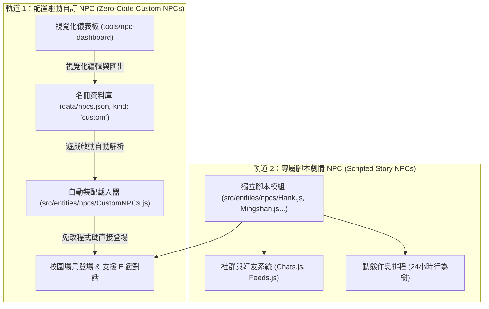
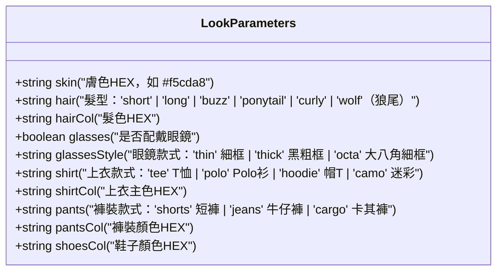

# YanlinGTA NPC 創作與自訂指南 (NPC Creation Guide)

本指南說明如何在「中原順起來 · 資管要贏 票投彥霖 (YanlinGTA)」中新增、自訂與排程校園 NPC，涵蓋視覺化儀表板使用、`data/npcs.json` 格式規格、3D 外觀參數配置與互動對話設定。

---

## 一、 NPC 系統雙軌架構概述 (NPC System Architecture)

YanlinGTA 的 NPC 系統採用**「配置驅動的通用自訂 NPC」**與**「專屬腳本劇情 NPC」**雙軌機制：



| 類別 | 代表人物 | 實作方式 | 支援能力 |
| :--- | :--- | :--- | :--- |
| **自訂 NPC (`custom`)** | 一般系上同學、學弟妹、路人好友 | 透過 `data/npcs.json` 設定，無需修改任何 JavaScript。 | 3D 外觀即時生成、定點站位、面向設定、名牌顯示、多輪輪播對話樹。 |
| **劇情 NPC (`builtin`)** | 漢克、羊明衫、黃蓋瑞、劍玉、阿哲、小安 | `src/entities/npcs/` 專屬類別模組。 | 24 小時作息排程、換裝換地點、i-Piyan 加好友聊天、Peachgram 發限動、借車、打工值班。 |

---

## 二、 視覺化儀表板：`tools/npc-dashboard`

為了讓企劃與創作者能直觀捏角與調配對白，專案內建了 3D 視覺化 NPC 編輯器。

### 1. 啟動儀表板
啟動本機開發伺服器後：
```bash
npm run dev
```
以瀏覽器開啟儀表板專用頁面：  
👉 **http://localhost:5173/tools/npc-dashboard/**

### 2. 核心功能操作
- **3D 即時人偶檢視**：滑鼠拖曳旋轉 360 度全身模型，觀察服裝剪裁、髮型與眼鏡配飾，與遊戲內部渲染效果 100% 一致。
- **文字與照片色彩抽取**：
  - 輸入文字特徵（如：「皮膚白皙的女生，雙馬尾，穿黃色連帽衫」）。
  - 或上傳本機參考照片，系統將自動提取主色調至服飾調色盤（照片僅存於本機 `tools/npc-dashboard/photos/`，不會進 Git）。
- **名單存檔**：編輯完成後點擊「儲存」，自動寫入 `data/npcs.json`。

---

## 三、 `data/npcs.json` 資料綱要規格 (Schema Reference)

`data/npcs.json` 是全遊戲的 NPC 名冊中心，包含校園可選地標（`places`）與人物名冊（`npcs`）。

### 1. 校園預設座標地標 (`places`)
```json
"places": {
  "資訊管理學系館": { "x": 91.8, "z": 131.7, "h": -0.4 },
  "學生活動中心": { "x": -161.4, "z": -124.8, "h": -2.67 },
  "張靜愚紀念圖書館": { "x": -151.9, "z": -42.3, "h": 1.57 },
  "二一鐘塔": { "x": -13.8, "z": 96.4, "h": 2.78 }
}
```
- `x`, `z`：遊戲世界水平座標（公尺）。
- `h`：NPC 面向角度（弧度制 Radians）。

### 2. 自訂 NPC 設定項目 (`npcs[i]`, kind: "custom")

```json
{
  "id": "ashun",
  "kind": "custom",
  "enabled": true,
  "name": "阿順",
  "title": "資管系學弟",
  "gender": "男",
  "height": 1.0,
  "place": "資訊管理學系館",
  "look": {
    "skin": "#d89e7a",
    "hair": "short",
    "hairCol": "#222222",
    "glasses": true,
    "glassesStyle": "thick",
    "shirt": "hoodie",
    "shirtCol": "#2a5298",
    "pants": "jeans",
    "pantsCol": "#1e2a38",
    "shoesCol": "#ffffff"
  },
  "talks": [
    [
      ["阿順", "彥霖學長！競選加油！我們會長就靠你了！"],
      ["彥霖", "謝啦阿順！資管系學會交給我們準沒錯！"]
    ],
    [
      ["阿順", "剛剛看到漢克騎著 ZMAX 去跑山了，不知道幾點才會回來麥當勞上班。"]
    ]
  ]
}
```

#### 欄位詳細定義：
| 欄位名稱 | 型別 | 必填 | 說明 |
| :--- | :--- | :---: | :--- |
| `id` | `string` | 是 | 唯一辨識碼（英數字與底線）。 |
| `kind` | `string` | 是 | 固定填 `"custom"`（若是寫死腳本則為 `"builtin"`）。 |
| `enabled` | `boolean` | 否 | 是否在校園生成（預設為 `true`；設為 `false` 可隱藏）。 |
| `name` | `string` | 是 | 顯示名稱（如「阿順」）。 |
| `title` | `string` | 否 | 頭銜或稱謂（會與姓名組合成名牌：「資管系學弟 阿順」）。 |
| `height` | `number` | 否 | 身高縮放比例（預設 `1.0`；高個子可設 `1.08`，嬌小可設 `0.92`）。 |
| `place` | `string` | 否 | 出沒地標名稱（須為 `places` 定義的鍵值之一）。 |
| `spot` | `object` | 否 | 若不使用預設地標，可直接指定座標 `{ "x": 10.5, "z": -20.2, "h": 1.57 }`。 |
| `look` | `object` | 是 | 3D 角色外觀網格配色與樣式設定（見下節）。 |
| `talks` | `array` | 否 | 對話輪播陣列。玩家每次走近按 `E` 會依序說下一組對話。每組對話為 `[說話者, 台詞]` 的陣列。 |

---

## 四、 3D 外觀樣式參數表 (`look`)

角色網格由 `src/entities/BodyMesh.js` 參數化程序生成，`look` 物件支援以下屬性：



> 進階外觀參數（直接寫在 `look`，儀表板「細部調整」也看得到；實際名稱以 `src/entities/Character.js` 的 `createCharacter` 註解為準）：
> `hairStyle: 'wolf'`（狼尾）、`glassesStyle: 'octa'`（大八角細框）、`sole`（鞋底顏色）、`longTee`（oversize 長版 T）、`wash`（水洗刷色）、
> `pantsLow` ／ `pantsSplit`（膝下另一個顏色：短褲接長褲的兩截褲）、`wide`（寬褲蓋過鞋面）。範例見瑞哲（`src/entities/npcs/Ruizhe.js` 的 `RUIZHE_LOOK`）。

---

## 五、 手把手實作教學：新增一位「熱血資管系學弟」

跟著以下 4 個步驟，在 3 分鐘內新增一位校園 NPC：

### 步驟 1：開啟 `data/npcs.json`
在 `npcs` 陣列末尾（或透過儀表板儲存），新增一段自訂設定：

```json
{
  "id": "freshman_bo",
  "kind": "custom",
  "enabled": true,
  "name": "小柏",
  "title": "大一資管新鮮人",
  "gender": "男",
  "height": 0.98,
  "place": "資訊管理學系館",
  "look": {
    "skin": "#ecc6a3",
    "hair": "curly",
    "hairCol": "#3c2918",
    "glasses": true,
    "glassesStyle": "thin",
    "shirt": "tee",
    "shirtCol": "#ff7043",
    "pants": "shorts",
    "pantsCol": "#37474f",
    "shoesCol": "#eeeeee"
  },
  "talks": [
    [
      ["小柏", "學長好！請問 101 電腦教室要怎麼走？"],
      ["彥霖", "進系館大門左轉就是囉！裡面還能登入資管學堂練習 Python！"]
    ],
    [
      ["小柏", "學長競選海報貼得好漂亮，我有叫全宿舍都投你一票！"]
    ]
  ]
}
```

### 步驟 2：存檔並回到遊戲
因為 Vite 具備動態熱更新，只要重新整理遊戲頁面（或本機 `npm run dev` 啟動）：  
👉 打開 **http://localhost:5173**

### 步驟 3：校園驗證
1. 騎車或走路前往「資訊管理學系館前」。
2. 即可看到穿著橘色 T 恤、戴眼鏡、頂著捲髮的「大一資管新鮮人 小柏」站在走廊。
3. 走近至 2.6 公尺內，畫面下方將出現提示標籤：`按 E 和小柏聊天`。
4. 按下鍵盤 `E` 鍵，對話框將跳出第一組指引對白；再次對話則會輪播至第二組拉票對白！

---

## 六、 進階：升級為劇情 NPC (Scripted NPC)

如果該 NPC 未來需要以下進階能力：
- 24 小時作息移動（例如：白天上課、晚上在麥當勞打工、半夜回宿舍睡覺）。
- 騎機車/開跑車在車流中兜風。
- 加為 i-Piyan 手機好友，可傳訊息聊天、追蹤 Peachgram 限動。
- 專屬語音對白、特殊音效（如漢克彈吉他、黃蓋瑞鬧鐘）。

請參考既有典範模組：
- **作息與騎乘**：[`src/entities/npcs/Hank.js`](../../src/entities/npcs/Hank.js)
- **跳舞與寵物互動**：[`src/entities/npcs/Mingshan.js`](../../src/entities/npcs/Mingshan.js)
- **車庫與跑車出借**：[`src/entities/npcs/Jianyu.js`](../../src/entities/npcs/Jianyu.js)
- **手搖飲店打工互動**：[`src/systems/minigames/TeaShop.js`](../../src/systems/minigames/TeaShop.js)