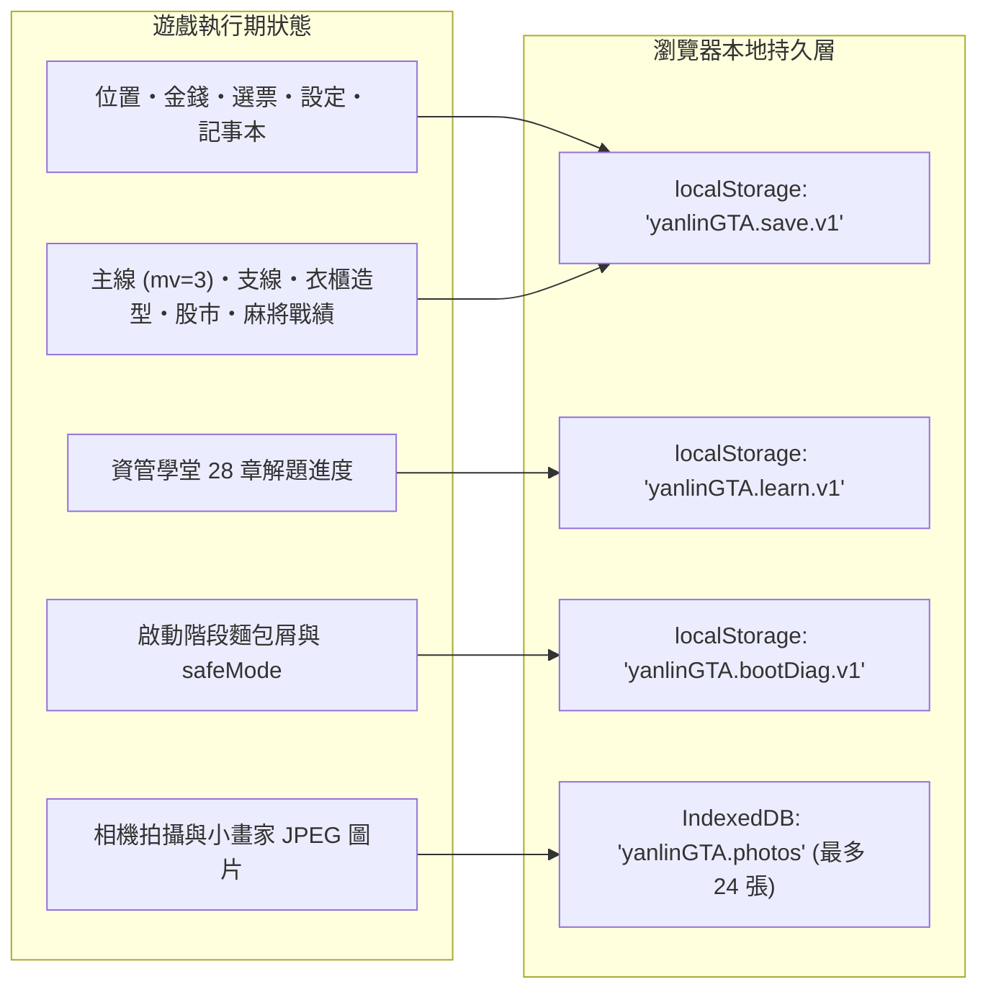

# 系統架構與引擎底層規格 (`architecture.md`)

本文件為 YanlinGTA 引擎核心、分層邊界、啟動自癒、渲染與記憶體生命週期、雙 WASM 運算及持久化系統的**單一事實來源（SSOT）**。凡修改 `src/core/`、`src/physics/`、`src/graphics/` 或 `src/systems/SaveSystem.js`，動工前須查閱本規格並於同一 PR 同步維護。

---

## 一、 核心設計哲學

1. **單向無環依賴（DAG）**：全專案劃分為 7 大領域分層，底層模組（核心、物理、圖形）嚴禁反向匯入上層業務或 UI 模組，由 `tests/unit/import-graph.test.js` 於 CI 強制把關。
2. **時脈與渲染解耦**：物理推進固定為離散時間步長（`1 / 60` 秒），與瀏覽器可變刷新率（`requestAnimationFrame` 60Hz～240Hz）解耦，確保跨裝置操控手感與碰撞一致。
3. **雙軌高效能 WASM**：剛體物理（Rapier 3D）與程序化噪聲／法線貼圖（Rust Kernels）皆採用 WebAssembly 加速，並具備零誤差或輕量級純 JavaScript Fallback。
4. **行動端記憶體防護與啟動自癒**：針對 iOS Safari / `WKWebView` 嚴格的 `<canvas>` 記憶體配額，實施依硬體分檔縮放、兩階段上傳即釋放與連續崩潰自動進入安全模式（`safeMode`）。
5. **集中式版本化持久化**：遊戲進度經 `SaveSystem` 統一校驗與序列化，獨立子系統（資管學堂、啟動診斷、手機相簿）分區隔離儲存。

---

## 二、 7 大領域分層與職責定義 (7-Layer Architecture)

```mermaid
flowchart TD
    subgraph Layer7["第 7 層：UI 與人機互動 (src/ui/)"]
        HUD["HUD 儀表板・對話框・轉場 (HUD, Prompts)"]
        Phone["i-Piyan 智慧手機・拍照觀景窗 (phone/*, PhotoMode)"]
        PC["電腦桌面・終端機・一鍵通關介面 (PC, AutoSolveUI)"]
        Wardrobe["衣櫃換裝・24 號球衣殼層 (Wardrobe, Jersey)"]
    end

    subgraph Layer6["第 6 層：遊戲業務系統 (src/systems/)"]
        Mission["競選主線與 5 大支線 (MissionSystem, quests/*)"]
        Save["存讀檔與相簿持久化 (SaveSystem, PhotoStore)"]
        Audio["音效與情境配樂 (AudioSystem)"]
        Economy["靈感股市・校園新聞・衣櫃資料 (StockMarket, News, Outfits)"]
        Nav["A* 路網尋路與動態追蹤 (Navigation)"]
        MiniGames["打工・偵探・一鍵通關・277 麻將 (minigames/*, mahjong/*)"]
    end

    subgraph Layer5["第 5 層：實體與角色控制器 (src/entities/)"]
        Player["玩家控制器・骨骼網格・IK (Player, Character, BodyMesh, Walker)"]
        Vehicles["汽機車・多車型速克達・無人機 (Vehicles, ScooterVariants, Drone)"]
        Traffic["校園車流・路人・台鐵火車 (Traffic, NPC, Trains)"]
        StoryNPCs["專屬劇情 NPC 與勞大 (Pilot, npcs/*)"]
    end

    subgraph Layer4["第 4 層：世界生成與建築場景 (src/world/)"]
        Map["地圖分塊組裝・CPU 地面挖洞 (MapBuilder, GroundCut)"]
        Kit["室內合批建模工具・互動註冊 (Kit, Interiors)"]
        Zones["校園分區與專屬建築 (zones/*, buildings/*)"]
        Env["鐵道平交道・街道剛體道具・節慶 (Railway, WorldProps, Season, Festive)"]
    end

    subgraph Layer3["第 3 層：渲染與圖形視覺 (src/graphics/)"]
        GpuMem["畫布與靜態幾何生命週期 (GpuMemLifecycle)"]
        SkyPost["日夜天空・後製・排序・準心光暈 (SkySystem, PostFX, RenderSort, AimGlow)"]
        Tex["程序化貼圖生成器與全息圖騰 (Textures, HoloRing)"]
        WasmKernels["Rust WASM 噪聲/法線核心 (wasm/kernels.js)"]
    end

    subgraph Layer2["第 2 層：物理與碰撞檢測 (src/physics/)"]
        RapierWasm["Rapier 3D 物理世界封裝 (Physics)"]
        VehPhys["機車傾角與四輪懸吊動力學 (VehPhysics)"]
        Coll["2D 多邊形射線與高程碰撞 (Collision)"]
    end

    subgraph Layer1["第 1 層：引擎核心與時鐘循環 (src/core/)"]
        Game["頂層裝配中樞 (Game.js)"]
        Loop["固定步長與動態調頻調度器 (GameLoop.js)"]
        Diag["硬體分檔・啟動診斷・效能浮層 (PerfProfile, BootDiag, PerfHud)"]
        InputMenu["輸入映射・觸控轉譯・選單・載具生成 (Input, Controls, KeyHints, MenuManager, VehicleSpawner, ParkedScooters)"]
    end

    Layer1 --> Layer2
    Layer1 --> Layer3
    Layer2 --> Layer4
    Layer3 --> Layer4
    Layer4 --> Layer5
    Layer5 --> Layer6
    Layer6 --> Layer7
```



| 分層 | 路徑 | 核心職責 | 關鍵模組 |
| :--- | :--- | :--- | :--- |
| **1. 引擎核心層** | `src/core/` | 啟動診斷與硬體分檔、RAF 迴圈與固定步長調度、選單管理、輸入與按鍵轉譯、全圖載具生成。 | `Game.js`, `GameLoop.js`, `PerfProfile.js`, `BootDiag.js`, `PerfHud.js`, `MenuManager.js`, `Input.js`, `KeyHints.js`, `VehicleSpawner.js`, `ParkedScooters.js` |
| **2. 物理碰撞層** | `src/physics/` | Rapier 3D WASM 封裝、汽機車懸吊與傾角物理、2D 多邊形／線段牆體與高程碰撞檢測。 | `Physics.js`, `VehPhysics.js`, `Collision.js` |
| **3. 視覺圖形層** | `src/graphics/` | 畫布貼圖與頂點記憶體釋放、日夜天空、後製管線、材質排序、程序化貼圖（Rust WASM 雙軌）。 | `GpuMemLifecycle.js`, `SkySystem.js`, `PostFX.js`, `RenderSort.js`, `Textures.js`, `AimGlow.js`, `HoloRing.js`, `wasm/kernels.js` |
| **4. 世界生成層** | `src/world/` | OSM 地圖 120m 分塊、CPU 地面挖洞、分區（Zone A～H）、可進入校舍與街屋、平交道、節慶佈置。 | `MapBuilder.js`, `GroundCut.js`, `Kit.js`, `Interiors.js`, `Terrain.js`, `Railway.js`, `WorldProps.js`, `Season.js`, `Festive.js`, `Locate.js`, `zones/*`, `buildings/*` |
| **5. 遊戲實體層** | `src/entities/` | 第一／第三人稱玩家控制器、連續蒙皮角色網格與手臂 IK、汽機車與無人機、車流路人、火車與劇情 NPC。 | `Player.js`, `FirstPerson.js`, `Walker.js`, `Character.js`, `BodyMesh.js`, `Armik.js`, `Vehicles.js`, `ScooterVariants.js`, `Drone.js`, `Traffic.js`, `Trains.js`, `Pilot.js`, `npcs/*` |
| **6. 業務系統層** | `src/systems/` | 主線與 5 大支線狀態機、存讀檔與相簿儲存、A* 導航、股市與新聞、打工競賽、SQL 偵探與一鍵通關、277 麻將。 | `MissionSystem.js`, `SaveSystem.js`, `PhotoStore.js`, `AudioSystem.js`, `Navigation.js`, `StockMarket.js`, `News.js`, `AutoSolve.js`, `LaodaInsult.js`, `Outfits.js`, `quests/*`, `minigames/*`, `mahjong/*` |
| **7. 介面互動層** | `src/ui/` | HUD 與小地圖、智慧手機全 App 與 Gemini Nano 對話、後鏡頭拍照模式、電腦桌面、衣櫃與球衣殼層。 | `HUD.js`, `Prompts.js`, `PC.js`, `AutoSolveUI.js`, `PhotoMode.js`, `Wardrobe.js`, `Jersey.js`, `phone/*` |

---

## 三、 依賴原則與拓撲約束 (Dependency Rules)

- **單向調用與同層協作**：高層模組可匯入低層工具，同層模組可橫向引用；頂層裝配統一由 `src/core/Game.js` 實例化並透過建構子或方法參數注入，子模組禁止反向匯入 `Game.js` 單例。
- **明確禁止的反模式**：
  - ❌ `src/physics/` 與 `src/graphics/` 嚴禁匯入 `src/world/`、`src/entities/`、`src/systems/` 或 `src/ui/`。
  - ❌ `src/world/` 嚴禁匯入動態實體控制器（如 `Player.js`）；場景互動一律透過 `interiors.actions` 與 `interiors.updaters` 註冊介面解耦。
  - ❌ 除測試與效能鉤子（`window.game`、`window.__bench` 等）外，業務模組不得在 `window` 掛載隱性可變全域狀態。

---

## 四、 硬體分檔、啟動診斷與安全降階自癒 (`PerfProfile.js` & `BootDiag.js`)

### 1. 執行期硬體分檔 (`src/core/PerfProfile.js`)
啟動時依觸控能力（`matchMedia('(pointer: coarse)')` / `maxTouchPoints`）與 WebGL `UNMASKED_RENDERER_WEBGL` 字串，將裝置歸類為三檔（可用 `?tier=`、`?texscale=` 覆寫）：

| 檔位 (`tier`) | 判定條件 | `texScale` | 圖集上限 (`atlasMaxW × H`) |
| :--- | :--- | :---: | :---: |
| `mobile-lite`（別名 `mobile-ios`） | 觸控裝置（手機／平板） | `0.5` | `1024 × 2048` |
| `desktop-igpu` | Apple M 系列、Intel Iris / UHD / HD、AMD Radeon 內顯、GeForce MX、軟體渲染或未知 GPU | `0.75` | `2048 × 2048` |
| `desktop-dgpu` | NVIDIA GTX / RTX / Quadro、Radeon RX / Pro、Intel Arc A/B 系列獨顯 | `1.0` | `2048 × 4096` |

> **單一畫質職責邊界**：`PerfProfile` 僅管轄貼圖縮放、圖集尺寸與診斷旗標；視覺畫質（視距 `far`、霧濃度 `fog`、像素比 `pr`、陰影、後製 `PostFX`）統一由 `GameLoop.js` 的 `QPROF` 單一持有。

### 2. 啟動檢查點與自癒安全模式 (`src/core/BootDiag.js`)
為防止行動端在載入階段因記憶體尖峰遭瀏覽器強制重整並陷入無限迴圈，`BootDiag` 將啟動麵包屑持久化於 `localStorage`（金鑰 `yanlinGTA.bootDiag.v1`）：

- **生命週期追蹤**：`begin()` 讀取前次狀態並寫入 `completed: false` $\rightarrow$ 各載入階段呼叫 `checkpoint(step, pct, label)` 記錄耗時 $\rightarrow$ 進入標題畫面呼叫 `complete()` 將 `completed` 標為 `true` 並歸零 `crashCount`（若拋出例外則呼叫 `fail(err)`）。
- **開發者診斷浮層（`?diag=1` / `?diag=halt`）**：
  - 於畫面左下角顯示前次未完成階段、錯誤訊息與本次各階段耗時麵包屑。
  - 阻斷重整迴圈：`?diag=halt` 只要前次未完成載入即在啟動前暫停；`?diag=1` 於連續未完成載入 `>= 2` 次時暫停，等待點擊「▶ 繼續單次載入」才放行。
- **玩家端自動安全降階與健康恢復（預設開啟，`?safemode=0` 可停用、`?safemode=1` 可強制啟用）**：
  - **觸發條件**：前次啟動未完成累計達 **連續 2 次（`crashCount >= 2`）**，或畫布曾觸發 **`webglcontextlost`** 事件（`attachCanvas` 監聽）。
  - **降階效果**：`applySafeMode(profile)` 自動將 `texScale` 壓低至 **`<= 0.375`**（除非網址明確指定 `?texscale=`），並將圖集上限壓至 **`1024 × 1024`**，同時調降初始畫質確保順利進場。
  - **自動恢復**：進入遊玩狀態後每幀呼叫 `tickHealthy(dt)`，累計穩定遊玩滿 **`180 秒`（`HEALTHY_RECOVERY_SEC`）** 即自動解除 `safeMode` 與 `contextLost` 標記。

---

## 五、 核心循環、動態調頻與渲染管線 (`GameLoop.js` / `PerfHud.js` / `PostFX.js`)

```mermaid
sequenceDiagram
    autonumber
    participant RAF as requestAnimationFrame
    participant Loop as GameLoop.js
    participant Phys as Rapier 3D (Fixed 60Hz)
    participant Logic as 實體與業務系統
    participant Render as Three.js / PostFX

    RAF->>Loop: 傳入幀間隔 dt
    Loop->>Loop: 累加至 accumulator（上限截斷防卡頓螺旋）
    loop accumulator >= 1/60s
        Loop->>Phys: physics.step(1/60) & vehPhysics.update(1/60)
        Loop->>Loop: accumulator -= 1/60
    end
    Loop->>Logic: 更新角色、車流、任務、相機與室內距離剔除
    Loop->>Loop: autoQuality() 監測 3 秒區間 FPS 動態調降畫質
    alt 電腦桌面 (pc.isOpen) 或全螢幕影片 (videoOpen) 開啟中
        Loop-->>RAF: 略過 3D 渲染（防止打字與影片掉幀）
    else 武嶺翻車影片或 277 麻將桌進行中
        Loop->>Render: 改繪製獨立小 THREE.Scene（主場景燈數不變）
    else 一般遊玩 / 標題背景
        Loop->>Render: 繪製主場景（低畫質直繪 / 中高畫質 PostFX）
    end
```

1. **動態畫質調頻（`GameLoop.autoQuality`）**：
   - 畫質設為「自動」時，初始等級由 `guessGpu()` 決定：觸控裝置、舊款 Intel UHD / HD 或 `<= 4` 核裝置預設 `low`；Apple M 系列、Iris Xe、Radeon 680M/780M/880M 與獨顯預設 `medium`（`high` 僅在玩家手動選擇時啟用）。
   - 遊玩時先暖機 **3 秒**，之後每 **3 秒** 計算平均幀率；若 `< 28 FPS` 則自動降一級（`medium` $\rightarrow$ `low` $\rightarrow$ `xlow`）並寫入 `settings.autoQ`，降級後重新暖機 3 秒。
2. **四級效能監控浮層（`src/core/PerfHud.js`）**：
   - 設定選單可選 `關閉`／`簡易`（僅色標 FPS）／`詳細`（1% 低幀、最慢幀、JS 主執行緒負載 %、Chromium JS Heap、Draw Calls、Triangles）／`開發者`（細分邏輯／物理／繪製耗時、紋理與幾何數、著色器數、實體與剛體數、硬體檔位、座標區域與 GPU 名稱）；網址帶 `?perf` 強制以開發者模式顯示（不改存檔）。關閉時完全不執行量測。
3. **渲染與著色器最佳化契約**：
   - **WebGL 初始化**：停用專案未使用的模版緩衝（`stencil: false`）；非開發環境且未帶 `?diag` 時關閉 `renderer.debug.checkShaderErrors` 避免同步 GPU 往返卡頓。
   - **後製管線（`PostFX.js`）**：`low` / `xlow` 直接渲染至畫面，後製模組於首次升上中高畫質時才動態 `import()`；`medium` 關閉 MSAA 並使用 1/4 解析度 Bloom；`high` 啟用 4× MSAA 與 1/2 Bloom，色調映射與調色合併為單一 Pass。
   - **隔幀陰影與材質降階**：`low` / `xlow` 預設關閉陰影貼圖；非 `desktop-dgpu` 檔位太陽陰影每兩幀更新一次（額外呼叫 `renderer.render()` 如 `FirstPerson.renderMirrors` 須先保存 `shadowMap.needsUpdate` 並於繪後還原）。`low` / `xlow` 外牆與地面改用 `MeshLambertMaterial` 搭配 `lambertSky()` 天空漫射補償，並跳過法線與粗糙度貼圖生成。
   - **不透明排序與按需資源**：`RenderSort.js` 依 `groupOrder` $\rightarrow$ `renderOrder` $\rightarrow$ shader program $\rightarrow$ 距離排序以減少狀態切換；第一人稱後照鏡 RenderTarget 與 `localClippingEnabled` 僅在坐進車內時啟用；小地圖僅在位移 `> 0.35m`、轉角 `> 0.02 rad`、縮放變更或逾 `50ms` 時重繪。

---

## 六、 畫布貼圖與靜態幾何生命週期 (`GpuMemLifecycle.js`)

為將行動端存活 `<canvas>` 記憶體壓在 iOS 安全線（`<= 220 MB`）內，全專案貼圖與靜態網格須遵守以下生命週期規則：

1. **統一透過 `canvasTexture` / `scaledCanvas` 建立靜態畫布**：
   - 嚴禁對靜態建築或招牌自行呼叫 `document.createElement('canvas')`。`scaledCanvas(w, h)` 會依 `PerfProfile.texScale` 縮小實體畫布並預設好 2D context 縮放，繪圖函式 `draw(g, w, h)` **必須使用傳入的邏輯寬高 `w, h`**（禁止讀取 `cv.width`，否則縮小後只畫到角落）；記憶體耗盡拿不到 context 時自動退回共用 1×1 `blankTexture()`。
   - 需透過 `getImageData` 逐像素計算的貼圖（如 `Textures.js` 法線圖、`Jersey.js` 滾邊距離場）先以原尺寸計算再縮放或快取，不走 `scaledCanvas`。
2. **兩階段上傳與釋放**：
   - 街屋與校舍門牌圖集（`finishRow`、`Lixing`、`Sac`）繪畢立即呼叫 `uploadAndRelease()` 上傳 GPU 並將畫布縮為 `1×1`；每個分區建置完畢由 `releaseAtlasSources(scene, TEX)` 釋放已併入圖集的來源小畫布。
   - 進入標題畫面前由 `flushShared(scene)` 將所有共用靜態貼圖一次上傳 GPU 並釋放底層畫布，同時在 Apple WebKit 環境呼叫 `gcNudge()` 觸發垃圾回收。
   - **動態貼圖標記紅線**：執行期仍會重繪的畫布（螢幕、計分板、動態載入頭像海報）**必須傳入 `{ dynamic: true }` 或呼叫 `markDynamic()`**，且不得用 `k.plane()` 併入街屋圖集。
3. **靜態幾何 CPU 陣列釋放（`markStaticGeometry`）**：
   - `MapBuilder`（`Geo.mesh`）、`Kit.finish()` 與 `finishRow()` 產出的靜態合併網格在首次繪製上傳 WebGL 後，自動將 JS 端頂點 TypedArray 替換為空陣列（保留包圍球與頂點 `count`；網址帶 `?keepgeo` 時保留陣列供 `tools/collision_mesh_check.mjs` 檢查）。
   - **禁止執行期讀取靜態網格頂點**：上傳後嚴禁對世界靜態網格執行 Three.js `Raycaster`、`Box3.setFromObject()` 或二次幾何合併；空間查詢一律改走 `world.collision` 或 `interiors`。
   - 當瀏覽器發生 WebGL context 遺失後還原時，因畫布與頂點陣列已釋放，系統會先自動存檔再重新整理頁面（由 `BootDiag` 接手降階保護）。

---

## 七、 雙 WebAssembly 運算子系統 (Dual WASM)

| 子系統 | 模組路徑 | 核心職責與退回機制 |
| :--- | :--- | :--- |
| **Rapier 3D 物理引擎** | `src/physics/Physics.js`<br>`src/physics/VehPhysics.js` | 採用 `@dimforge/rapier3d-compat` 提供連續碰撞檢測（CCD）、汽機車懸吊與傾角回正力矩、可撞飛街道剛體（三角錐／紙箱）及角色膠囊控制器（`Walker.js`）。若環境不支援 WASM 或帶 `?nophysics`，自動退回 `Collision.js` 2D 多邊形與線段碰撞。 |
| **Rust 圖形計算核心** | `tools/wasm-kernels/`<br>`src/graphics/wasm/kernels.js`<br>`src/graphics/Textures.js` | 以 Rust 編譯之 `kernels.wasm` 加速啟動期程序化地面與立面貼圖生成（FBM 分形噪聲加速約 **18.1×**、高度轉法線貼圖加速約 **2.3×**）。若載入失敗或帶 `?nowasm`，無縫切換至 `Textures.js` 演算法完全一致的純 JS 實作（由 `npm run test:wasm` 驗證逐位元 `0 mismatched`）。 |

---

## 八、 資料儲存與世界持久化 (`SaveSystem.js` & `PhotoStore.js`)



1. **主存檔與結構遷移（`SaveSystem.js`）**：
   - 金鑰為 `yanlinGTA.save.v1`。載入時自動執行範圍校驗與向後相容遷移：包含主線任務版本遷移（`mission.mv = 3`，插入任務六「宿舍拉票」後自動平移舊發表會／結局索引）、衣櫃欄位補齊（`normalizeLook` 相容僅有舊四欄位的存檔）、移除無聯絡人 ID 的舊版預設聊天室紀錄，以及讀檔後由 `Phone.resumePending()` 補送未完成的訊息回覆。
   - 若 `localStorage` 損毀或遭非法竄改，自動回退至預設初始狀態並跳出 HUD 提示，確保不阻斷啟動。
2. **獨立分區存儲**：
   - **資管學堂進度**：獨立存於 `localStorage` 的 `yanlinGTA.learn.v1`，重開新局或重設主存檔不會清空程式課程紀錄。
   - **手機相簿（`PhotoStore.js`）**：因拍攝與小畫家產出的 JPEG Data URL 體積超過 `localStorage` 配額，獨立存入 `IndexedDB`（資料庫 `yanlinGTA.photos`、ObjectStore `kv`、鍵值 `list`，最新在前、上限 `MAX_PHOTOS = 24` 張）；若無痕模式阻擋 IndexedDB，照片仍保留於當次記憶體工作階段中。
