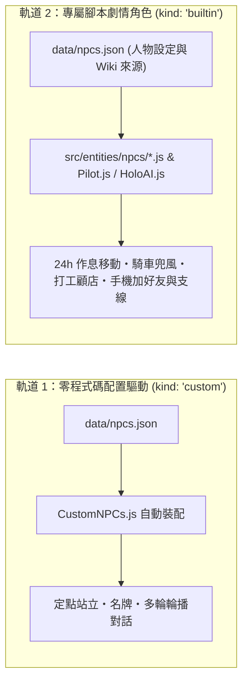

# NPC 角色架構、3D 造型與全名冊規格 (`npcs-and-characters.md`)

本文件收錄 YanlinGTA 雙軌 NPC 架構、`data/npcs.json` 資料綱要、3D 連續蒙皮外觀與紫金 24 號球衣殼層技術、勞大完整三態日常與打籃球系統、15 位劇情角色作息排程，以及義務役真實日期日曆的**單一事實來源（SSOT）**。凡修改 `data/npcs.json`、`src/entities/Character.js`、`BodyMesh.js`、`Pilot.js`、`src/entities/npcs/*` 或 `src/ui/Jersey.js`，動工前須查閱本規格並於同一 PR 同步維護。

> 視覺化捏角工具 `tools/npc-dashboard` 的啟動與新增自訂 NPC 實作步驟，請參閱 [`../dev/developer-guide.md`](../dev/developer-guide.md)。

---

## 一、 雙軌 NPC 架構與 `data/npcs.json` 綱要

### `data/npcs.json` 核心欄位定義
- **`places`**：預設校園地標座標字典 `{ "<地標名>": { "x": number, "z": number, "h": radians } }`。
- **`npcs[]` 單筆結構**：
  | 欄位 | 型別 | 說明 |
  | :--- | :--- | :--- |
  | `id` | `string` | 唯一英文識別碼。 |
  | `kind` | `'custom' \| 'builtin'` | `'custom'` 由 `CustomNPCs.js` 自動生成於場景；`'builtin'` 由專屬模組控制行為。 |
  | `enabled` | `boolean` | `custom` 角色是否啟用生成（預設 `true`）。 |
  | `name` / `title` / `gender` | `string` | 顯示名稱、頭銜稱謂與性別。 |
  | `height` | `number` | 身高縮放倍率（預設 `1.0`）。 |
  | `place` / `spot` | `string` / `object` | 站位地標鍵名，或自訂水平座標 `{ "x", "z", "h" }`。 |
  | `look` | `object` | 3D 角色外觀配色與剪裁參數（見第二節）。 |
  | `talks` | `array` | `custom` 角色按 `E` 輪播之對話組陣列 `[[[說話者, 台詞], ...], ...]`。 |
  | `dept` / `personality` / `interests` / `likes` / `where` / `relations` / `catchphrase` / `background` | `string` / `string[]` | 角色背景設定（供遊戲內 Gemini Nano 角色扮演 Prompt 與玩家百科共用）。 |

---

## 二、 3D 角色網格與 24 號球衣殼層技術 (`Character.js` / `BodyMesh.js` / `Jersey.js`)

### 1. 參數化角色外觀 (`look`)
角色由 `BodyMesh.js` 連續蒙皮網格（帶 `?legacy` 時退回舊分塊網格）與 `Character.js` 配件程序生成：
- **基礎欄位**：`skin`（膚色 HEX）、`hair` / `hairCol`（髮色）、`hairStyle`（`'short'` | `'long'` | `'buzz'` | `'pony'`/`'ponytail'` | `'curly'` | `'bowl'` | `'bald'`）、`beard`（如 `'goatee'` 山羊鬍）、`glasses`（布林）、`glassesStyle`（`'thin'` 細框 | `'thick'` 黑粗框 | `'octa'` 大八角細金屬框）、`shirt` / `shirtCol`、`shorts` / `pants` / `pantsCol`、`hem`（褲長）、`shoes` / `shoesCol`、`build`（體寬倍率）、`belly`、`arm`、`jaw`。
- **進階潮流剪裁參數**：
  - 女性／特殊髮型：`hairStyle: 'wolf'`（狼尾，`wolfLocks` 多束壓扁錐體合成）、`'hime'`（齊瀏海黑長直髮）、`'bob'`（齊下巴鮑伯頭）。
  - 服飾細節：`longTee`（蓋臀五分袖 oversize T）、`wash`（水洗刷色）、`pantsLow` / `pantsSplit`（短褲接長褲雙截配色）、`wide`（蓋鞋面寬褲）、`sole`（獨立鞋底色）。

### 2. 超橢圓軀幹殼層與程序化滾邊貼圖 (`src/ui/Jersey.js`)
為在連續蒙皮軀幹上呈現銳利不變形的無袖球衣與夏威夷印花襯衫，採用 **`9mm` 貼身外殼（`shellGeometry`）＋表面距離場程序貼圖** 架構：
- **幾何切面**：沿軀幹高度 `Y0 = 0.9m`（蓋過球褲腰頭微外擴）至 `Y1 = 1.548m`（頸根），以超橢圓截面 $p_e(t) = \text{sign}(t)|t|^{0.8}$ 偏移 `9mm` 建立蒙皮外殼並掛載於 `ch.torso`，下肢球褲外側則在 `legs[].hp` 掛載貼合大腿弧度的側條網格（`polygonOffset` 防閃爍）。
- **天光色偏校正與雙遍距離場滾邊**：
  - 官方紫色 `#552583` 在遊戲正午天光下會偏藍紫，故布料改採暖紫 **`#74267a`**（正午實測落點接近原色），搭配金 **`#fdb927`**、白 `#ffffff`、黑 `#141414`。
  - 於 `1536 × 512` 貼圖上以 `onCloth` 定義深挖袖口與前 V 領／後圓領（非布料像素 `alpha = 0` 搭配 `alphaTest: 0.5`），並執行**雙遍二維倒角距離傳播（Two-pass Chamfer Distance，跨背部接縫環繞）**計算每個像素沿三維布料表面距裁切邊緣與側縫的真實公尺距離，使領口、腋下轉角與身體兩側的金白黑滾邊在任何體寬（`build`）下皆保持等寬。
  - 胸前斜體白邊金字 `LAKERS` 與小號 `24`、背後大號 `24` 皆以公尺座標精準印製（黃蓋瑞的熱帶葉印花襯衫 `Garry.js` `dressAloha` 亦複用同一套 `shellGeometry` 與 `onCloth` 基底）。

---

## 三、 彥霖航空機長與勞大（`Pilot.js` / `LaodaMode.js`）

### 1. 預設駕駛：彥霖航空機長
- 預設的直升機駕駛與校園散步角色為 **彥霖航空機長**（`createCaptain`：白色短袖制服、四條槓肩章、領帶、胸章與機長帽）。
- 全地圖僅此一人：開直升機空投時於地面隱藏，未飛時於校園步道散步；按 `E` 打招呼講機長台詞，**不播放勞大語音、不打籃球、無罵人肘擊彩蛋**（`provoke` 一律拒絕，手機不偵測罵人）。

### 2. 隱藏駕駛：勞大（由終端機 `mamba` 喚回，`LaodaMode.js`）
- 勞大預設隱藏（開關獨立存於 `localStorage` `yanlinGTA.laoda`，不隨存檔重設）；於電腦終端機輸入隱藏指令 **`mamba`** 叫回後立即取代機長（即時切換空投駕駛艙與校園模型，並恢復手機聊天室與定位顯示），輸入 **`mamba out`** 可再藏回（詳見 [`easter-eggs-and-secrets.md`](easter-eggs-and-secrets.md)）。
- 叫回後的勞大（高一個頭 `scale(1.04, 1.06, 1.04)`、光頭山羊鬍、穿紫金 24 號球衣配及膝球褲），具備**三態嚴格互斥**機制（同一時間絕不會在兩處出現）：

1. **狀態 A — 直升機空投飛行（`Airdrop.busy`）**：
   - 當玩家呼叫載具空投時，地面散步或球場上的勞大立即隱藏（`hide`），坐進彥霖航空直升機駕駛艙執行吊掛並播放呼叫語音 `assets/sfx/pilot/voice1.mp3`。
2. **狀態 B — 校園步道散步（`mode = 'walk'`）**：
   - 非打球時段且未飛行時，於距玩家 `30–90m` 的校內步道節點生成，頭戴**橄欖綠航空耳機（含延伸至嘴角的麥克風桿）**，以 `1.35 m/s` 漫步 `2.5–5 分鐘`（偶爾駐足張望；若玩家正透過導航追蹤他則自動延長停留）。
   - **當面打招呼與冷笑話**：走近 `2.4m` 按 `E`，勞大轉向玩家隨機播放 `voice2.mp3`～`voice4.mp3`（保證不連續重複），並隨機講出三則冷笑話之一（問答兩段式：「最後一個獎 $\rightarrow$ 螺旋槳」、「what bee doesn't fly $\rightarrow$ Ko-bee」、「背號 8 變 24 $\rightarrow$ 以前一天睡 8 小時，現在一天睡 24 小時」），最後一句固定收尾 **「`孩子們，這並不好笑`」**，並在對話框底部附上**當面回嘴文字框**（友善回話獲 Mamba 風格誇獎；若出言侮辱則觸發復仇肘擊，詳見 [`easter-eggs-and-secrets.md`](easter-eggs-and-secrets.md)）。
3. **狀態 C — 體育園區光電球場打籃球（`mode = 'court'`，`BallGame`）**：
   - **時段判定（`pilotBall(clock)`）**：依遊戲日雜湊，每日早上 **`07:00–08:30`（30% 機率）** 或下午 **`15:30–18:00`（50% 機率）** 前往體育園區東側中場練投（若玩家已在球場 `75m` 內，則從視線外步道運球進場；上場時自動**摘下航空耳機**）。
   - **完整投籃物理與雙臂 IK**：自動循環「運球走位（`dribble`）$\rightarrow$ 原地墊步瞄籃（`set`）$\rightarrow$ 起跳急停跳投（`shot`，離地 `0.4m`、最高點右手壓腕出手跟進）$\rightarrow$ 追球撿籃板（`chase` / `pick`）」，每投 6 球換邊進攻另一籃框。投籃命中率為 **`72%`**（空心刷網高頻音效 vs 打鐵彈框物理反彈），雙手扶球、單手運球與壓腕姿勢全程由 `Armik.js` 的 `reachArm` 即時解算。打球時按 `E` 改觸發三組籃球主題對話（同附回嘴輸入框）。

---

## 四、 全體劇情角色作息、床位、座駕與連動總表

| 角色 (`id`) | 模組路徑 | 寢室床位／據點與專屬座駕 | 24 小時作息與跨系統連動摘要 |
| :--- | :--- | :--- | :--- |
| **漢克 (`hank`)** | `Hank.js` | 力行 279 寢 **2 號床（上舖）**・白牌 155cc `ZMAX` | `18:00–22:00` 麥當勞內場炸薯條（穿制服戴髮網）；`23:00–00:00` 與 `06:00–10:00` 在 279 練彈給女友的吉他曲（`guitar.mp3` `14m` 內漸強循環）；`00:00–06:00` 睡覺；其餘時段騎 ZMAX 隨車流兜風或背吉他校園散步（對話時當場彈奏 14 秒；ZMAX 若被撞倒會跑回扶起）。 |
| **肉舖老闆 (`gd`)** | `Gordon.js` | 力行 279 寢 **4 號高架床**・夜幕灰新款 `大A` | `08:00–23:00` 顧戈登肉鋪（須先買肉才可加好友）；`23:00–24:00` 寢室打 LOL（部分夜晚 `23:00–23:40` 與吱吱騎大A夜衝）；`00:00–08:00` 睡覺（`06:00` 起鬧鐘長鳴彩蛋）；加好友後大A可借騎並自動歸位。 |
| **羊明衫 (`mingshan`)** | `Mingshan.js` | 資管系館前／麥當勞・飼養橘貓 | `09:00–17:00` 資管系館前 8 拍 K-POP 練舞（偶與男友 YeeMing 牽手散步），身旁橘貓支援 21:9 特寫摸頭與餵食戈登肉鋪肉品；`18:00–22:00` 擔任麥當勞外場值班經理。 |
| **YeeMing (`yeeming`)** | `Yeeming.js` | 物理系（服役中，穿迷彩軍服鋼盔） | 白天陪羊明衫散步或於戶外排球場與吱吱練球（吱吱受傷期間停播打球閒聊），見面固定揪打麻將；`22:00–09:00` 收假回營。 |
| **吱吱 (`zz`)** | `Zz.js` `TeaShop.js` | 力行 276 寢 **2 號床**（受傷時與彥霖換睡 3 號下舖）・白紅舊款 `大A` | `02:00–08:00` 睡覺、`22:00–02:00` 書桌打 LOL／楓吱谷；依 4 日班表於茶學苑打工，其餘白天在體育館與泳池間練排球，部分夜晚與 Yulu 散步或與肉舖老闆夜騎；主導支線「吱吱武嶺跑山受傷」。 |
| **黃蓋瑞 (`garry`)** | `Garry.js` `GarryHome.js` | 中北路孫師傅牛肉拉麵 2F 隔壁「黃宅」 | 穿程序化熱帶葉夏威夷衫，依 6 日週期輪替：`06:00–07:30`／`17:30–19:00` 體育園區跑道慢跑（換深灰運動 T，帶 4 名陪跑學生）、`12:00–13:30`／`19:00–21:30` 學活 3F 古箏社（前 15 分鐘整理琴盒、後 45 分鐘坐老師位彈琴），其餘時間在房內書桌或睡覺（含 `07:00` 鬧鐘彩蛋）。 |
| **劍玉 (`jianyu`)** | `Jianyu.js` | 力行 278 寢 **1 號高架床**・系館西側停車場 3 台超跑 | `02:00–10:00` 睡覺、`10:00–17:00` 資管系館停車場顧超跑（部分整點開藍寶堅尼進車流兜風，期間不可劫車）、`17:00–02:00` 書桌打特戰英豪；加好友解鎖超跑借開，觸發 SQL 支線「班費失竊案」與書桌偷零錢彩蛋。 |
| **侯舌 (`houshe`)** | `Houshe.js` | 力行 276 寢 **4 號床**（桌上擺 Nikon Z50） | 開發者角色；於二一鐘塔拍畢業照、排球場活動，每日 `13:00–15:00` 與 `18:00–20:00` 依天數輪流與三位學妹（張娜榮／楊子嫻／金采源）在校園步道約會，夜間於吱吱受傷支線協助扶洗殘廢澡。 |
| **理查 (`richard`)** | `Richard.js` | 力行 280 寢 **2 號床** | 開發者角色；白天於資管系館前與羊明衫尬舞交流、夜間回 280 寢打 ARAM。 |
| **霍華德 (`howard`)** | `Howard.js` | 力行 279 寢 **3 號下舖**・黑色仿賽 `忍 400` | 開發者角色；於寢室練撲克牌魔術、`14:00–16:00` 騎忍 400 校園兜風、傍晚體育館外重訓、`18:30–22:30` 與女友 Tzuyu 校園牽手散步；主導支線「LeetCode：Two Sum」解鎖忍 400。 |
| **Tzuyu (`tzuyu`)** | `Howard.js` `TzuyuWagyu.js` | 韓國女團「兔瓦斯」成員（霍華德女友） | 平時在首爾，僅 `18:30–22:30` 與霍華德散步時現身校園；加好友觸發「幫 Winter 帶和牛」支線。 |
| **Yulu (`yulu`)** | `Yulu.js` | 商業設計館南側步道 | 吱吱女友；`09:00–18:30` 於商設館前散步，約 40% 夜晚 `19:00–21:00`（吱吱未打工且未受傷時）與吱吱牽手散步；觸發「送無糖茶給吱吱」支線。 |
| **品漢堡 (`pinhan`)** | `PinHan.js` | 力行 278 寢 **4 號高架床** | 白天於書桌輪讀英文／計概／資結／管資（桌面書本隨作息切換），`17:00–19:00` 體育館外重訓；**真實世界週末** 50% 機率 `12:00–23:00` 外出約會；完成「找一台車」支線後解鎖漢堡車 App，且每 3 天有 1 天 `14:00–17:00` 開車帶大家去 IKEA。 |
| **瑞哲 (`ruizhe`)** | `Ruizhe.js` | 力行 278 寢 **5 號上舖**（左側中段書桌） | 穿水洗黑 `INVOLUTION` 印花長 T 與狼尾八角框眼鏡；`03–09` 睡覺、`09–13` 寫資結作業、`13–17` 圖書館東門滑手機、`17–22` 刷題配直播小窗、`22–23:30` 與劍玉雙排、`23:30–03` 看致敬 VTuber 直播；**真實世界週末** 50% 機率 `10:00–20:00` 赴台北同人場離校。 |
| **古箏社社員 (`club_qi` / `xuan` / `yu`)** | `ClubMembers.js` | 學生活動中心 3F 古箏社教室 | 社長小琪、社員小萱、器材阿宇（皆設 `wiki: false`）；黃蓋瑞社課時段全員合奏〈漁舟唱晚〉，其他平日 `17:00–18:30` 由小萱與阿宇自主練習，僅在有人彈奏且玩家位於同層教室／門邊時發出五聲音階撥弦聲。 |
| **彥霖航空機長 (`pilot`)** | `Pilot.js` | 彥霖航空直升機（預設駕駛） | 穿白色短袖機長制服配四條槓肩章與機長帽；執行空投或於校園步道散步（無語音、無籃球與肘擊彩蛋）。 |
| **勞大 (`laoda`，預設隱藏)** | `Pilot.js` `LaodaMode.js` | 彥霖航空直升機（`mamba` 叫回後取代機長） | 紫金 24 號球衣、冷笑話與「Man～」口頭禪；三態互斥（空投飛行／校園散步／體育園區打籃球）。 |
| **全息 AI 搭檔 (`monday` / `wednesday` / `sunday`)** | `HoloAI.js` `Sunday.js` | 舊正門（青）／資管系館（紫）／畫面右下角（金） | 詳見 [`missions-and-quests.md`](missions-and-quests.md)。 |

---

## 五、 義務役真實日期日曆 (`src/entities/npcs/Service.js`)

系統讀取玩家裝置的**真實世界日期**（非遊戲內時鐘；可透過網址 `?date=YYYY-MM-DD` 強制模擬任意日期，由 `tests/unit/service.test.js` 守門），於對應入退伍區間內自動替役男角色換裝並更新頭頂名牌：

| 梯次與服役區間（含首日、退伍當日恢復） | 適用角色 | 平日 vs 週末換裝規則 |
| :--- | :--- | :--- |
| **`2026-11-06` ～ `2027-03-06`** | 肉舖老闆（`gd`：含戈登肉鋪顧店、279 寢、夜騎三處） | 1. **真實週一至週五**：換穿迷彩軍服＋迷彩鋼盔。 2. **真實週六、週日**：休假出營換回個人便服。 3. **名牌前綴**：整個服役區間（含週末休假）頭頂名牌皆冠上 `義務役服役中`。 |
| **`2026-11-30` ～ `2027-03-30`** | 黃蓋瑞（`garry`）、霍華德（`howard`） | 同上（黃蓋瑞週末恢復夏威夷衫／慢跑 T 切換）。 |
| **`2026-12-18` ～ `2027-04-18`** | 吱吱（`zz`）、侯舌（`houshe`）、理查（`richard`） | 同上（涵蓋茶學苑打工與校園約會等所有現身狀態）。 |
