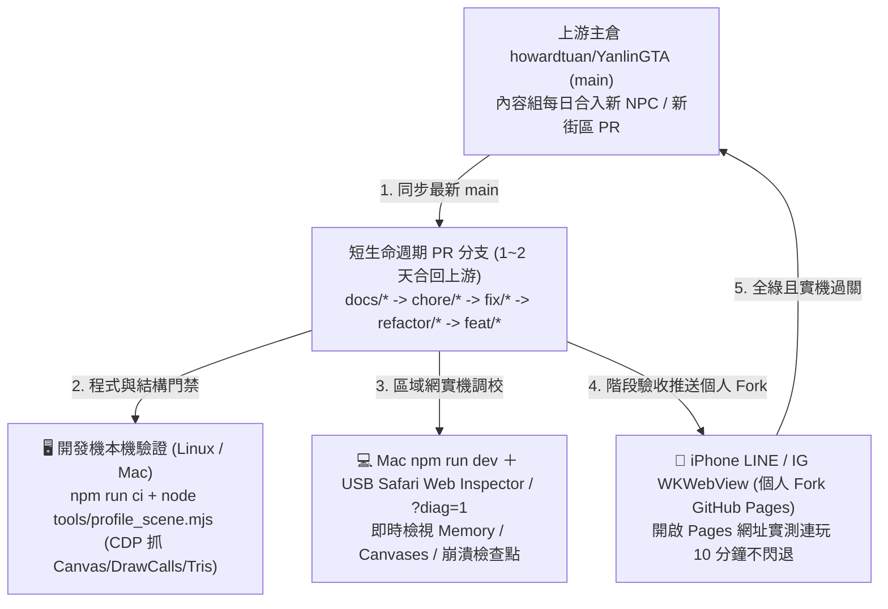

# 過渡期 Git 分支規劃、並行協作與雙環境實機測試 SOP (`git-and-transition-plan.md`)

本文件定義重構期間如何在**「另一組人馬（內容組）每日持續往 `main` 提交新建築、NPC 與小遊戲」**的同時，安全推進長週期底層效能重構，並結合 **本機自動化剖析（Linux / Mac）** 與 **iPhone 實機／Fork GitHub Pages 驗收**。

---

## 一、 團隊現況與為什麼必須「小步積層」

1. **上游保護規則（詳見 [AGENT.md](../AGENT.md) 第三章）**：
   - 上游主倉 `howardtuan/YanlinGTA` 禁止直接 push `main`，所有變更必須從最新 `main` 切出符合白名單前綴的短生命週期分支（`docs/*`、`fix/*`、`refactor/*`、`feat/*`、`chore/*`）。
   - 必須通過 `.github/workflows/ci.yml` 的 `npm run ci`（`format:check` + `lint` + `test` + `build` + `check:dist`）與 Docker 建置檢查，並使用 `--merge` 建立 Merge Commit。
2. **高度活躍的內容並行開發**：
   - 內容組夥伴（`src/world/` 建築、NPC 作息與支線、麻將與小遊戲迭代）幾乎每日都有 PR 合入 `main`。
   - **絕對禁忌**：切出「為期兩週、修改幾十個檔案的巨型重構分支」悶頭開發。我們把**低衝突、純底層渲染封裝的 Phase 2（120m 分塊、去 `discard`、`Kit.finish` 平面合批）**排在 **Phase 3（真拆包空間動態載入）**之前，正是為了先用最小衝突面拿回內顯 60 FPS，再穩健推進檔案拆分。

---

## 二、 過渡期架構策略：絞殺者模式（Strangler Fig）＋ 向後相容雙軌

我們採用 **「底層無感接管 ＋ 漸進遷移 Adapter ＋ URL Feature Flag」** 三原則，讓兩組人馬像在兩條平行軌道上各自全速前進：



### 過渡期三大防衝突鐵律

1. **既有公共 API 100% 向後相容（對內容組透明）**：
   - Phase 1 改造 [Kit.js](../src/world/Kit.js) 的 `ctex()` / `sg()` / `finishRow()` / `Kit.finish()` 與 [Textures.js](../src/graphics/Textures.js) 時，**絕不更改任何既有函式的呼叫參數或回傳型別**。
   - Phase 2 在 `Kit.finish()` 新增平面圖集化與純色頂點合批時，自動識別可合批的靜態 `k.plane()`，保留動畫部件（如電梯 `cab`、滑門）原本獨立物件行為。
2. **新舊 `ZONES` 雙模相容 Adapter（Phase 3 過渡期核心）**：
   - 校內外觀（`ZoneA`～`ZoneH`、`Dorms`、`Weiche`、`GateExtras`、`Court`）**維持常駐**，僅靠 Phase 2 空間分塊剔除省 GPU，不更動其檔案結構。
   - 當內容組新增校外區或只有傳統 `build()` 時，`WorldStreamer` 自動走同步 Adapter，**絕不會報錯或漏建**；我們自己的串流遷移則嚴格將輕量 Spec 與重型 Builder 拆為不同檔案，確保 Vite 真正拆出 async chunk。
3. **Feature Flag 與 URL 參數保護（不影響既有功能與 E2E 機器人）**：
   - 未經實機完整驗收的串流機制（`?stream=1`）與診斷麵包屑暫停開關（`?diag=1` / `?diag=halt`），在開發階段一律預設關閉或安全介入，確保 `tools/e2e/story-bot.mjs` 與日常開發 **0 風險**。

---

## 三、 雙環境測試與實機驗收工作流（Linux / Mac / iPhone）

### 1. 開發機自動化基準剖析（無需接手機即可跑的量化門禁）
- 除 `npm run ci` 外，Phase 0 新增 `tools/profile_scene.mjs`（複用 [tools/e2e/serve.mjs](../tools/e2e/serve.mjs) 與 [tools/e2e/cdp.mjs](../tools/e2e/cdp.mjs)）。
- 在具備 Chrome / Chromium 的 Linux 或 Mac 上可直接透過 CDP 自動量測：
  - 啟動過程累積與存活的 `<canvas>` 總數、非 `1×1` 未釋放畫布數量與 MB 估算；
  - `renderer.info.memory`（`textures`、`geometries`）與 `calls` / `triangles`；
  - `BootDiag` 每個啟動階段的真實耗時（ms）。

### 2. 區網聯調 ＋ `?diag=1` 麵包屑 ＋ USB Safari Web Inspector
- [vite.config.js](../vite.config.js#L164) 已設定 `host: '0.0.0.0'`，開發機執行 `npm run dev` 後，同區網 iPhone Safari 可直連 `http://<LAN-IP>:5173/?perf&diag=1`。
- 若遇到 iPhone 在載入期就撞上 Jetsam 重整而無法掛載 USB Web Inspector，**`?diag=1` 會讀取持久化於 `localStorage` 的上一次未完成檢查點**並在連續失敗 2 次時自動暫停重載循環，直接顯示死在哪個階段、同時保留頁面供 Mac Safari Web Inspector 掛載除錯。
- 成功進入標題頁後，Mac USB **Safari → 開發 (Develop) → iPhone → 該分頁** 可進一步在 **Graphics → Canvases** 與 **Timelines → Memory** 確認所有離屏 Canvas 是否成功縮至 `1×1`。

### 3. 階段驗收：個人 Fork GitHub Pages ＋ LINE / IG `WKWebView`
- [.github/workflows/deploy.yml](../.github/workflows/deploy.yml#L13) 已原生支援 **`workflow_dispatch`**。將工作分支推至個人 Fork 後，到 GitHub Actions 手動觸發 Deploy 選擇該分支，即可於 `https://<your-account>.github.io/YanlinGTA/` 供 iPhone LINE / IG 內建瀏覽器實測，完全不污染上游。

### 4. 日常開發與發 PR 標準指令流

```bash
# A. 確認遠端設定（若 origin 指向 howardtuan/YanlinGTA，可自行選擇新增個人 fork remote 做 Pages 預覽）
git remote -v
# 如尚未設定 fork：
# git remote add fork git@github.com:<your-account>/YanlinGTA.git

# B. 每次開始新 PR 前，先單向同步最新 main
git checkout main
git fetch origin main
git merge --ff-only origin/main

# C. 切出符合白名單前綴的短生命週期工作分支
git checkout -b fix/ios-canvas-lifecycle

# ... 進行開發（本機 npm run ci + profile_scene.mjs + iPhone 實機量測）...

# D. Push 前本機 CI 全驗（必須全綠）
npm run format
npm run ci

# E. 實機驗證通過、更新 perf-refactor/agent-handoff-log.md 後發 PR 並開啟自動合併（--merge）
gh pr create --repo howardtuan/YanlinGTA --base main --head <your-account>:fix/ios-canvas-lifecycle \
  --title "fix(graphics): ..." \
  --body-file <pr-body.md>
gh pr merge <PR編號> --repo howardtuan/YanlinGTA --auto --merge
```

> [!CAUTION]
> **分支命名白名單提醒**：上游只允許 `feat/*`、`fix/*`、`hotfix/*`、`refactor/*`、`docs/*`、`chore/*` 前綴（全小寫 kebab-case）。其他名稱會被 GitHub Rulesets 直接拒收。

---

## 四、 建議 PR 切分排程（控制衝突面與 Review 成本）

| 順序 | 分支建議名稱 | 對應階段 | 預估改動範圍 | 上游安全度 |
| :--- | :--- | :--- | :--- | :--- |
| **PR #1** | `docs/perf-refactor-plan`（已合併）＋ `docs/revise-perf-refactor-plan` | 規劃文件 | `AGENT.md` + `perf-refactor/**` | 🟢 完全零執行期風險 |
| **PR #2** | `chore/perf-flags-and-metrics` | Phase 0 | `src/core/PerfProfile.js`、`BootDiag.js`、`Game.js` 讓幀與檢查點、`GameLoop.js` `?perf`、`tools/profile_scene.mjs` | 🟢 預設無副作用、完全向後相容 |
| **PR #3** | `fix/ios-canvas-lifecycle` | Phase 1A | `src/graphics/CanvasLifecycle.js`、消除頂層 `ctex`（`Dorms`/`Weiche` 等）、統一 20+ 私有 helper、兩階段釋放與 `hc`/`dc` 回收 | 🟢 API 不變，內容組無感 |
| **PR #4** | `fix/ios-lazy-noncore-assets` | Phase 1B | `AudioSystem.js`、`FirstPerson.js`、`Arena.js`、`Game.js`/`SkySystem.js` `lowQ` 啟動不建陰影貼圖 | 🟢 消除明顯資源浪費 |
| **PR #5** | `refactor/mapbuilder-chunking` | Phase 2A | `src/world/MapBuilder.js` 120m `ChunkedGeo` 分塊 ＋ CPU 地形/鋪面切洞移除 `cutMask()` `discard` | 🟡 需跑完 `tests/unit/` 與洞口視覺比對 |
| **PR #6** | `refactor/kit-plane-batch-and-igpu` | Phase 2B | `Kit.finish()` 靜態平面圖集化＋純色頂點合批、室內家具距離剔除、`HUD.js` 小地圖節流、`guessGpu()`/`autoQuality()`/`PostFX` 重校 | 🟢 顯著砍 Draw Calls、內顯穩 60 FPS |
| **PR #7** | `refactor/world-streamer-core` | Phase 3A | `ScopedChunk.js`、分步驟 `WorldStreamer.js`、`Interiors` chunkScope、`PhysWorld.js` 動態 Chunk 碰撞 API（`?stream=1` 隔離先行） | 🟢 核心骨幹（Flag 隔離先行） |
| **PR #8** | `refactor/stream-outer-streets` | Phase 3B | 將外圍街屋與 `Arena.js` 的輕量 Spec 與重型建模檔物理拆檔，`Zones.js` 改用真動態 `import()` | 🟡 需通知建模隊友外圍街屋已拆 Spec/Builder |
| **PR #9** | `refactor/stream-interiors-and-enable` | Phase 3C | 大型室內（`Lixing`/`Sac`/`SacB1`/`IM`/`McD`/`YanlinHome`/`GordonShop`）拆出 `anchor()` 與 `mount(ctx)`，驗證 `tools/floorplan` 與 `Walker` 碰撞後開啟預設串流 | 🟡 拆離 Anchor 確保 `game.interiors.*` 永遠存在 |
| **PR #10** | `feat/build-time-texture-baking` | Phase 4 | `tools/bake_textures.mjs`、`vite.config.js`、`Textures.js` KTX2/WebP 載入 | 🟢 進階優化（保留 `dev` fallback） |
