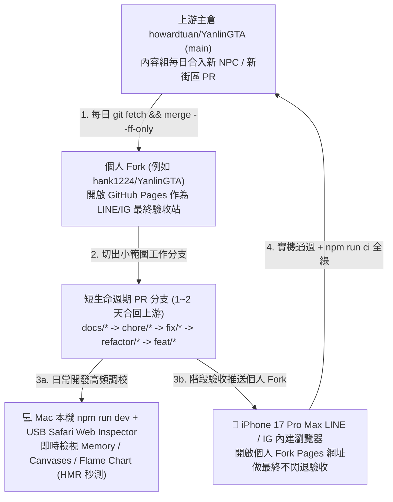

# 過渡期 Git 分支規劃、並行協作與 Mac/iPhone 實機測試 SOP

本文件定義重構期間如何在**「另一組人馬（內容組）每日持續往 `main` 提交新建築、NPC 與小遊戲」**的同時，安全推進長週期底層效能重構，並結合 **Mac + iPhone 17 Pro Max 實機聯調**與 **個人 Fork GitHub Pages 驗收**。

---

## 一、 團隊現況與為什麼必須「小步積層」

1. **上游保護規則（詳見 [AGENT.md](../AGENT.md) 第三章）**：
   - 上游主倉 `howardtuan/YanlinGTA` 禁止直接 push `main`，所有變更必須從最新 `main` 切出符合白名單前綴的短生命週期分支（`docs/*`、`fix/*`、`refactor/*`、`feat/*`、`chore/*`）。
   - 必須通過 `.github/workflows/ci.yml` 的 `npm run ci`（`format:check` + `lint` + `test` + `build` + `check:dist`）與 Docker 建置檢查，並使用 `--merge` 建立 Merge Commit。
2. **高度活躍的內容並行開發**：
   - 另一組夥伴（如 `src/world/` 街區與建築建模、NPC 作息與支線、麻將與小遊戲迭代）幾乎每日都有 PR 合入 `main`。
   - **絕對禁忌**：切出一條「為期兩週、修改幾十個檔案的巨型重構分支」悶頭開發。因為 `src/world/zones/Zones.js`、`src/world/MapBuilder.js`、`src/core/Game.js` 每天都在演進，且共用決定性亂數流（PRNG），長分支最終必定爆發不可收拾的 Merge Conflict。

---

## 二、 過渡期架構策略：絞殺者模式（Strangler Fig）＋ 向後相容雙軌

我們採用 **「底層無感接管 ＋ 漸進遷移 Adapter ＋ URL Feature Flag」** 三原則，讓兩組人馬像在兩條平行軌道上各自全速前進：



### 過渡期三大防衝突鐵律

1. **既有公共 API 100% 向後相容（對內容組透明）**：
   - Phase 1 改造 [Kit.js](../src/world/Kit.js) 的 `ctex()` / `sg()` / `finishRow()` / `Kit.finish()` 以及 [Textures.js](../src/graphics/Textures.js) 時，**絕不更改任何既有函式的呼叫參數或回傳型別**。
   - 內容組照原本寫法新建建築或店面貼圖，底層就會自動替他們完成「上傳 GPU 後釋放 `<canvas>`」、「手機端自動降解析度」、「空間分塊註冊」。
2. **新舊 `ZONES` 雙模相容 Adapter（Phase 2 過渡期核心）**：
   - 當隊友在 [Zones.js](../src/world/zones/Zones.js) 新增一個區（只有傳統同步 `build(I, scene, data, collision)`，尚未寫 `bounds` 與非同步 `load()`）時，`WorldStreamer` 必須自動走 Fallback Adapter：啟動時照舊運行並將產物納入統一距離顯隱與貼圖生命週期管理，**絕對不會因為隊友沒寫串流設定而報錯或消失**。
   - 我們自己的遷移則以「先外圍街區與體育館 → 再大型室內 → 最後細部優化」分批把 `ZONES` 改為 `load: () => import(...)`，每批 2～3 個檔案即可獨立發一個 PR 合入 `main`。
3. **Feature Flag 與 URL 參數保護（不影響既有功能與 E2E 機器人）**：
   - 未經手機實機完整驗收的功能（如實驗性全域串流 `?stream=1`），在開發階段一律透過 URL 參數或明確的環境旗標（預設關閉或僅在顯式參數啟用）先行合入 `main`。
   - 這樣可以確保上游的 `tools/e2e/story-bot.mjs` 與團隊日常電腦開發體驗 **0 風險**；待在 iPhone 實機驗證穩定後，最後再發一個不到 10 行的「切換預設開關」PR 正式上線。

---

## 三、 Mac 區網聯調 ＋ 個人 Fork 實機驗收工作流

因為手邊有 **Mac 與 iPhone 17 Pro Max**，我們採用「日常靠 Mac 區網＋USB 抓深層數據、階段完靠個人 Fork 測第三方 App WebView」的雙段式測試：

### 1. 日常高頻開發：Mac `npm run dev` ＋ USB Safari Web Inspector
- [vite.config.js](../vite.config.js#L164) 已設定 `host: '0.0.0.0'`，Mac 啟動 `npm run dev` 後，同一 Wi-Fi 下的 iPhone Safari 可直接開啟 `http://<Mac-LAN-IP>:5173`（享受 Vite HMR 秒測，不必每改一行就 push build）。
- iPhone 接上 USB 至 Mac 後，透過 **Mac Safari → 開發 (Develop) → iPhone → 該分頁**，可直接觀看：
  - **Graphics → Canvases**：確認每張離屏 Canvas 是否成功縮回 `1×1`。
  - **Timelines → Memory**：精確觀察 Page / Layers / Images / JS 峰值 MB。
  - **Timelines → JavaScript & Events**：錄製 `Game.init()` 火焰圖找出卡頓函式。

### 2. 階段驗收：個人 Fork GitHub Pages ＋ LINE / IG 內建瀏覽器 (`WKWebView`)
- iOS 第三方 App（LINE / IG）的 `WKWebView` 不開放 USB 掛載 Safari Web Inspector，且記憶體上限比獨立 Safari 更嚴格，因此每個階段完成後必須用個人 Fork 做真實環境驗收。
- **零污染部署技巧**：[.github/workflows/deploy.yml](../.github/workflows/deploy.yml#L13) 已原生支援 **`workflow_dispatch`**。只要把工作分支 push 到個人 Fork（`git push fork <branch>`），到個人 Fork 的 **GitHub Actions → Deploy to GitHub Pages → Run workflow** 選擇該分支，1 分鐘內即可將該分支部署至 `https://<your-account>.github.io/YanlinGTA/` 供 LINE / IG 開啟測試，完全不污染上游或 workflow 檔。

### 3. 日常開發與發 PR 標準指令流

```bash
# A. 設定雙遠端（首次執行）
git remote rename origin upstream          # 若目前 origin 指向 howardtuan/YanlinGTA
git remote add fork git@github.com:<your-account>/YanlinGTA.git

# B. 每次開始新階段或新小 PR 前，先單向同步上游最新 main
git checkout main
git fetch upstream
git merge --ff-only upstream/main

# C. 切出符合白名單前綴的短生命週期工作分支
git checkout -b fix/ios-canvas-lifecycle

# ... 進行開發（Mac npm run dev + iPhone USB Web Inspector 即時量測）...

# D. Push 前本機 CI 全驗（必須全綠）
npm run ci

# E. 推到個人 Fork 並用 iPhone LINE / IG 開啟 Pages 做最終驗收
git push -u fork fix/ios-canvas-lifecycle
# 到個人 Fork GitHub Actions -> Deploy to GitHub Pages -> Run workflow 選該分支

# F. 實機驗證通過、更新 perf-refactor/agent-handoff-log.md 後，發 PR 回上游並開啟自動合併
gh pr create --repo howardtuan/YanlinGTA --base main --head <your-account>:fix/ios-canvas-lifecycle \
  --title "fix(graphics): 釋放離屏 Canvas 與修復 iOS WebKit 記憶體上限崩潰" \
  --body-file <pr-body.md>
gh pr merge <PR編號> --repo howardtuan/YanlinGTA --auto --merge
```

> [!CAUTION]
> **分支命名白名單提醒**：上游只允許 `feat/*`、`fix/*`、`hotfix/*`、`refactor/*`、`docs/*`、`chore/*` 前綴（全小寫 kebab-case）。其他名稱會被 GitHub Rulesets 直接拒收。

---

## 四、 建議 PR 切分排程（控制衝突面與每次 Review 成本）

| 順序 | 分支建議名稱 | 對應階段 | 預估改動範圍 | 上游安全度 |
| :--- | :--- | :--- | :--- | :--- |
| **PR #1** | `docs/perf-refactor-plan` | 規劃文件 | `AGENT.md`（頂部公告）+ `perf-refactor/**` | 🟢 完全零執行期風險 |
| **PR #2** | `chore/perf-flags-and-metrics` | Phase 0 | `src/core/PerfProfile.js`、擴充 `GameLoop.js` `?perf`（補 `renderer.info.memory` 行） | 🟢 改動 < 40 行，預設無感 |
| **PR #3** | `fix/ios-canvas-lifecycle` | Phase 1A | `src/graphics/CanvasPool.js`、`Textures.js`、`Kit.js`、`MapBuilder.js`、`HUD.js`（GPU 上傳後釋放 Canvas、降解析度、null 防護） | 🟢 API 不變，內容組無感 |
| **PR #4** | `fix/ios-lazy-noncore-assets` | Phase 1B | `AudioSystem.js`、`FirstPerson.js`、`Arena.js`（延遲預載、修 `frustumCulled`、動態 `localClippingEnabled`） | 🟢 消除明顯資源浪費 |
| **PR #5** | `refactor/world-streamer-core` | Phase 2A | `src/world/WorldStreamer.js`、`ScopedChunk.js`、`Interiors.js`（支援 chunkId 卸載）、單元測試 | 🟢 核心骨幹（Flag 隔離先行） |
| **PR #6** | `refactor/stream-outer-streets` | Phase 2B | 將外圍街屋（環中東路、普忠路、大仁一/二/五街、實踐路、日新路、中北路等）與 `Arena.js` 改為 `load: () => import(...)` | 🟡 需通知建模隊友這幾支檔案會切出 Anchor 與 Builder |
| **PR #7** | `refactor/stream-interiors-and-phys` | Phase 2C | `Lixing.js`、`Sac.js`、`SacB1.js`、`GordonShop.js`、`PhysWorld.js` 改為按區塊動態掛載與卸載 | 🟡 拆離 Anchor 確保 `game.interiors.*` 永遠存在 |
| **PR #8** | `refactor/mapbuilder-chunking` | Phase 3A | `src/world/MapBuilder.js` 120m 網格分塊與移除 `cutMask()` Shader `discard` | 🟡 需跑完 `tests/unit/` 與視覺比對 |
| **PR #9** | `refactor/igpu-culling-and-quality` | Phase 3B | `GameLoop.js` `guessGpu()` / `autoQuality()` 重校準、`HUD.js` 小地圖節流、室內外剔除 | 🟢 電腦無獨顯顯著提速 |
| **PR #10** | `feat/build-time-texture-baking` | Phase 4 | `tools/bake_textures.mjs`、`vite.config.js`、`Textures.js` KTX2/WebP 載入 | 🟢 進階優化（保留 `dev` fallback） |
