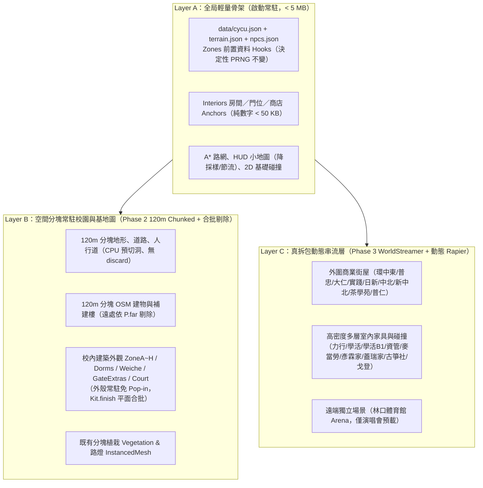

# L0 總綱：底層架構、單一職責與空間策略 (`00-master-architecture.md`)

本文件為 `perf-refactor/` 的最高層架構總綱，闡明為何保留 Three.js 單一技術棧、釐清畫質系統單一職責邊界、定義**校園外殼常駐分塊 ＋ 外圍街屋與室內真拆包串流**的三層世界模型，以及全階段量化驗收指標（KPIs）。

> [!NOTE]
> 本總綱僅涵蓋**底層引擎、記憶體、渲染分塊合批與空間串流管線**改造；所有 UI/UX 介面設計與主線第五章劇情皆不在本重構範疇。

---

## 一、 框架決策：為什麼不更換 3D 引擎？

針對「無獨顯電腦卡頓」與「iOS 手機打不開」，我們評估過遷移至 Unity WebGL、Godot Web、Babylon.js 或 PlayCanvas 的選項，**明確結論是不建議、也不需要更換 3D 框架**：

1. **換引擎無法解決真正的瓶頸**：iOS 崩潰來自 WebKit 對 2D `<canvas>` 緩衝區的硬上限（~256–384 MB）與全專案 86 處畫布未回收；電腦內顯卡頓來自「跨公里巨型 Mesh 破壞視錐體剔除」、「地板 `discard` 破壞 Early-Z」、「26 處 `Kit.finish()` 未合批 1,258 個散裝平面」與「4.2 km 外林口體育館關閉剔除」。這些問題換任何引擎都不會自動消失。
2. **首屏載入體積優勢**：Unity / Godot 編譯出的 WASM 動輒 25–50 MB，在 IG / LINE 行動網路下首開即流失使用者；目前 Three.js (`r160`) 本體僅 `~673 KB`，最適合手機瀏覽器 `<= 5 秒` 快速開啟。
3. **15.5 萬行程序化資產護城河**：專案 `src/world/` 超過 10.2 萬行程式碼（`src/` 總計 155,393 行）以純程式幾何搭建中原大學與周邊街景，且已具備 7 層無環依賴、雙 WASM 運算與完整單元測試。在現有架構上補齊資源生命週期、空間分塊與串流，性價比遠高於重寫。

---

## 二、 核心設計原則：單一畫質職責與階段順序優化

### 1. 畫質與硬體分級的單一真相來源（SSOT）
- **`GameLoop.js`（`QUALITY` / `QPROF`）為渲染畫質唯一真相**：負責 `far`（視距）、`fog`（霧氣）、`pr`（Pixel Ratio 上限：`low: 0.8`、`medium: 1.0`、`high: 1.6`）、`shadows`（陰影開關與解析度）、`view`（人車距離）與 `PostFX` 後製開關。
- **`PerfProfile.js` 嚴格不重複定義畫質視覺欄位**：僅負責：
  1. 硬體等級偵測 `tier`（`mobile-lite` / `desktop-igpu` / `desktop-dgpu`）；
  2. 程序貼圖與圖集上限（`texScale`、`atlasMaxW`、`atlasMaxH`）；
  3. 空間串流半徑與 LRU 預算（`STREAMING_PROFILES`）；
  4. URL 實驗旗標（`?tier=`、`?texscale=`、`?stream=`、`?diag=`）。

### 2. 為什麼將「渲染分塊＋合批（Phase 2）」排在「真拆包空間串流（Phase 3）」之前？
- 實測顯示 Apple M1 Pro 在懷恩樓前靜止僅 `50 fps`（1,729 Draw Calls / 424 萬三角形）。
- `MapBuilder` 120m 網格分塊、CPU 切洞移除 `discard`、`Kit.finish()` 平面圖集合批與室內家具遮擋屬於**純渲染底層封裝**，**不需拆動任何建築檔或 NPC 錨點**，與內容組近乎零衝突，能立刻幫電腦內顯拿回 60 FPS，也大幅減輕手機 GPU 負擔。
- 接著在 Phase 3 專心處理「輕重檔案拆檔真 Code-Splitting ＋ 動態 Rapier 碰撞體」的動態串流工程，整體風險大幅下降。

### 3. 借鏡《臺北狂飆》篩選後納入 vs 明確排除的架構技術
經實證比對 `Three.js r160` 與 `YanlinGTA` 既有實作後，本藍圖吸收以下高投報設計並明確拒絕過度工程：
- **納入設計**：
  1. **Phase 0**：`BootDiag` 玩家端無感自動降階（連死 2 次或 `webglcontextlost` 自動進低記憶體 `safeMode`，穩玩 3 分鐘恢復）＋ 免插線 `--mobile --assert-ios-budget` 自動化軟體記憶體門禁。
  2. **Phase 1**：`GpuMemLifecycle` 除了 `<canvas>` 兩階段縮 `1×1`，連同靜態合併幾何之 CPU 端 `TypedArray` 透過 `onUploadCallback` 清空、`ImageBitmap.close()`、`WebGLRenderer({ alpha: false, stencil: false })`、`checkShaderErrors = false` 與條件式 Apple `gcNudge` 一併納管。
  3. **Phase 2**：`low` 畫質自動切換 `MeshLambertMaterial` 並跳過法線／RM 貼圖生成、`opaqueSort` 按 `program.id` 排序、高負載 30Hz 隔幀陰影更新，以及維持零額外 npm 相依的 `PostFX.js` 瘦身（延遲 `import()`、`samples: 0`、1/4 Bloom）。
  4. **Phase 3 & 4**：`Three.js r160` 相容分帶 `texSubImage2D`（`3ms/frame`）、`pinPrograms()` 防重編、分批讓幀 `.dispose()`、`MessageChannel` 動態幀預算排程，以及 KTX2（ETC1S + UASTC）上傳後清空 `mipmaps` CPU 陣列。
- **明確排除（避免誤用或過度工程）**：
  - ❌ 不在 `r160` 使用單通道 `slimShadowMaps`（`r160` 陰影用 `RGBADepthPacking` 四通道，改單通道會直接毀掉陰影）。
  - ❌ 不重寫 2D `uLampMap` 路燈貼圖（`MapBuilder.js#L7164` 在 `low` 已是 `0` 盞 `PointLight`，`desktop-igpu` 封頂 `0–2` 盞即可）。
  - ❌ 不引入 `pmndrs/postprocessing` 套件、不替換 Rapier 物理、不上原生 WebGL2 `TilePool` 私有欄位魔改、不急推 worker `OffscreenCanvas` 繪圖。
- 實測顯示 Apple M1 Pro 在懷恩樓前靜止僅 `50 fps`（1,729 Draw Calls / 424 萬三角形）。
- `MapBuilder` 120m 網格分塊、CPU 切洞移除 `discard`、`Kit.finish()` 平面圖集合批與室內家具遮擋屬於**純渲染底層封裝**，**不需拆動任何建築檔或 NPC 錨點**，與內容組近乎零衝突，能立刻幫電腦內顯拿回 60 FPS，也大幅減輕手機 GPU 負擔。
- 接著在 Phase 3 專心處理「輕重檔案拆檔真 Code-Splitting ＋ 動態 Rapier 碰撞體」的動態串流工程，整體風險大幅下降。

---

## 三、 統一三層世界模型（Three-Tier World Architecture）

手機端與電腦端共用同一套引擎與地圖邏輯，並將**校內建築外殼**與**校外長街屋／室內細部**劃出明確邊界，兼顧「校園四面八方零彈出（No Pop-in）」與「外圍重資源真按需載入」：

### 裝置串流與資源設定檔（`PerfProfile`）對照

| 參數項目 | `mobile-lite`（手機預設） | `desktop-igpu`（無獨顯 / M 系列） | `desktop-dgpu`（獨顯桌機/筆電） |
| :--- | :--- | :--- | :--- |
| **對應預設 `QPROF` 畫質** | `low`（`pr <= 0.8`，無陰影與 PostFX） | 新世代內顯 / M 系列 `medium`（無 MSAA PostFX）；舊款 UHD 自動 `low` | `medium` / `high`（完整開啟） |
| **程序貼圖倍率 (`texScale`)** | `0.5x` | `0.75x` | `1.0x` |
| **街屋圖集尺寸上限 (`atlasMaxW × H`)** | `1024 × 2048` | `2048 × 2048` | `2048 × 4096` |
| **街屋串流半徑 (`enter / exit`)** | `150m / 220m` | `320m / 420m` | `550m / 700m` |
| **室內細部串流半徑 (`enter / exit`)** | `38m / 60m` | `65m / 95m` | `100m / 140m` |
| **同時駐留動態 Chunk 上限 (LRU)** | `6` 個 | `16` 個 | 無上限（全部常駐） |
| **Rapier 靜態 Tile 半徑 (`physTileRadius`)** | `1`（周邊 `3×3` Tiles ＋ 動態室內） | `2`（周邊 `5×5` Tiles ＋ 動態室內） | 全地圖（`Infinity`） |

---

## 四、 全計畫量化驗收指標（Global KPIs）

所有數據以 **本機 `tools/profile_scene.mjs` ＋ Mac Safari Web Inspector ＋ iPhone 實機（Safari & LINE/IG `WKWebView`）** 實測為準：

| 指標 | 現況基準（Phase 0 實測） | Phase 1 目標 | Phase 2 目標 | Phase 3 最終目標 |
| :--- | :--- | :--- | :--- | :--- |
| **iPhone 17 Pro Max (Safari / LINE / IG)** | ❌ 載入失敗（畫面停 2% 後重整循環） | ✅ **`<= 5s` 進場、連玩 `>= 10m` 零閃退** | ✅ `>= 30 FPS`（Safari `45–60 FPS`） | ✅ 秒開（真拆包首屏 JS 減重）、高速騎車零閃退 |
| **存活非 `1×1` `<canvas>` 記憶體** | 86 處建立點、多張 `2048×4096` 常駐未釋放 | **核心建置後皆縮 `1×1`（`< 16 MB`）** | 同 Phase 1（含 `Kit` 平面圖集回收） | **`< 12 MB`**（動態卸載同步回收） |
| **無獨顯筆電平均幀率（1080p）** | M1 Pro 靜止 `50 fps` (`20.0 ms`)；UHD 更低 | 略微改善 | **M 系列 / Iris Xe `55–60 FPS`；舊款 UHD (`low`) `>= 45 FPS`** | **雙級皆達標且降低啟動記憶體** |
| **主場景單幀三角形 / Draw Calls（M1 Pro）** | `1,729–1,774` calls / `4.24M–4.64M` tris（含多 Pass） | 修 Arena 剔除 | **三角形降 `60%+`、Draw Calls 顯著下降** | 視距內外圍按需載入，資源駐留再減半 |
| **啟動期下載/執行的街屋與室內 JS** | 100% 全量同步執行（`2.8 MB` 主包） | 100%（但消除頂層 `ctex` 與降維） | 同現況（渲染分塊與合批已完成） | **外圍街屋／體育館／大型室內拆出獨立 async chunks** |
| **自動化 CI 門禁 (`npm run ci` + E2E + Floorplan)** | 全綠 | 全綠 | 全綠（洞口與建築視覺無破圖） | 全綠（補齊串流、物理碰撞與 `floorplan` 驗證） |
