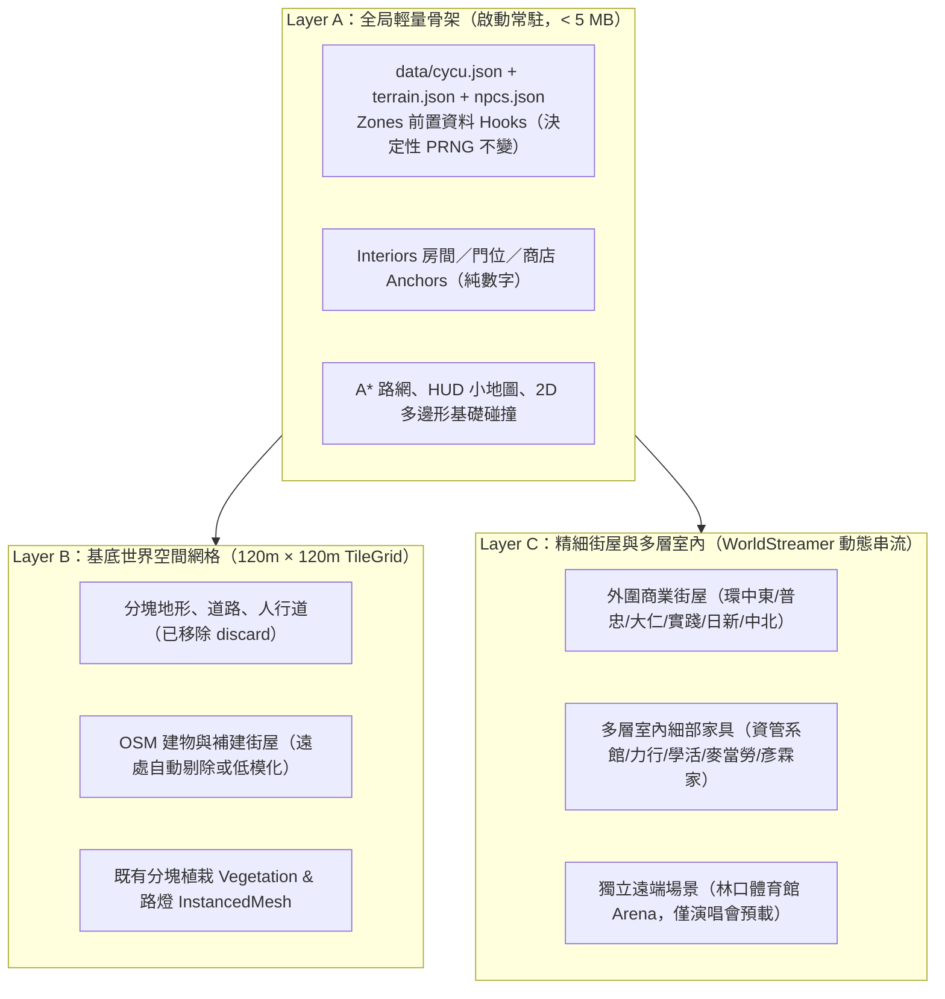

# L0 總綱：底層架構與全局動態載入可行性評估 (`00-master-architecture.md`)

本文件為 `perf-refactor/` 的最高層架構總綱，闡明為何保留 Three.js 單一技術棧、詳述**全局空間動態載入（Global Spatial Streaming）**的技術可行性評估與難點解法，並定義全階段共用之三層世界模型與量化驗收指標（KPIs）。

> [!NOTE]
> 本總綱僅涵蓋**底層引擎、記憶體、空間串流與渲染管線**改造；所有 UI/UX 介面設計與主線第五章劇情皆不在本重構範疇。

---

## 一、 框架決策：為什麼不更換 3D 引擎？

針對「無獨顯電腦卡頓」與「iOS 手機打不開」，我們評估過遷移至 Unity WebGL、Godot Web、Babylon.js 或 PlayCanvas 的選項，**明確結論是不建議、也不需要更換 3D 框架**：

1. **換引擎無法解決真正的瓶頸**：iOS 崩潰來自 WebKit 對 2D `<canvas>` 緩衝區的 384 MB 硬限制；內顯卡頓來自「跨公里巨型 Mesh 破壞視錐體剔除」、「地板 `discard` 破壞 Early-Z」與「4.2 km 外林口體育館關閉剔除」。這些問題在任何 WebGL 引擎上若沿用同樣建模邏輯都會發生。
2. **首屏載入體積優勢**：Unity / Godot 編譯出的引擎本體 WASM 動輒 25–50 MB，在 IG / LINE 行動網路下首開即流失大量使用者；目前 Three.js (`r160`) 打包體積極小，最適合手機瀏覽器快速開啟體驗。
3. **15.4 萬行程序化資產護城河**：專案 `src/world/` 超過 10.2 萬行程式碼以純程式幾何搭建中原大學與周邊街景，且已具備 7 層無環依賴、雙 WASM 運算與完整單元測試。在現有架構上補齊生命週期管理與空間串流，性價比遠高於重寫。

---

## 二、 全局空間動態載入（Global Spatial Streaming）可行性評估

我們放棄「死板把校園寫死進手機白名單、把校外全部砍掉」的靜態做法，改為評估**基於玩家座標與移動速度的全局空間動態載入與卸載（Global Spatial Streaming）**。

### 評估結論：**高度可行，且完全契合既有分層設計**
原因在於本專案有兩個極佳的先天條件：
1. [src/world/zones/Zones.js](../../src/world/zones/Zones.js) 已經把每個分區的**「輕量資料修正 Hooks（`drop`, `fix`, `add`, `look`, `footprints`, `terrain`, `trees`, `vegHide`, `treeHide`）」**與**「重量級幾何建模（`build()`）」**拆開。
2. [src/physics/PhysWorld.js](../../src/physics/PhysWorld.js#L35) 已經天然將靜態牆壁、樹幹與樓板依照 **`TILE = 100`（100m × 100m 網格）**分組為 Compound Colliders。

### 五大核心技術難點與工程解法

| 技術難點 | 具體風險分析 | 工程解法 |
| :--- | :--- | :--- |
| **1. NPC 與任務啟動期強耦合 `game.interiors.*`** | `Jianyu.js`、`Hank.js`、`Zz.js`、`DevNPC.js`、`Ruizhe.js`、`Garry.js`、`McShift.js` 等在 `Game.init()` 便直接讀取房間床位、書桌座標與門市門位，若建築延遲建置會導致啟動 Crash。 | **「錨點（Anchors）」與「幾何（Mount）」徹底分離**：所有房間座標、床位與門位規格在啟動時以純數值物件（< 50 KB）立即註冊於 `game.interiors`；只有 3D `Mesh`、貼圖圖集與室內家具按距離動態掛載／卸載。 |
| **2. `MapBuilder` 與 `Zones` 共用亂數流（PRNG）** | `Zones.js` 前置資料會影響 `MapBuilder` 抽樹與路燈的決定性亂數；若動態跳過某些 Zone 會讓全校植栽與冷氣亂掉。 | **資料階段同步、幾何階段非同步**：啟動時照原 `ZONES` 順序跑完所有前置資料 Hooks（耗時 < 3ms）；只有最後的 `build()` 與網格化幾何進入 `WorldStreamer` 串流管線。 |
| **3. 騎乘 SYM JET SL 高速移動時卡頓（Hitching）** | 騎車時速達 80–100 km/h（約 22–28 m/s），若進範圍才同步建置整條街屋與幾十張 Canvas 圖集，主執行緒會瞬間卡死 100–300 ms。 | **速度前瞻預測 ＋ 分幀時間切片（Time-Slicing）**：以預測點 `pos + vel * 2.5s` 提前觸發 `import()` 預載；`FrameScheduler` 每幀只分配 **≤ 3.5 ms** 執行幾何掛載，將建置平滑攤提至多幀完成。 |
| **4. 邊界反覆進出抖動與 iOS 記憶體堆積** | 玩家在某條街邊界來回騎車可能反覆觸發載入/釋放，或累積太多已載入區域導致手機 OOM。 | **雙半徑遲滯環（Hysteresis）＋ 冷卻期 ＋ LRU 上限**：設定 `enterR < exitR`（例如進 `150m` 載入、出 `220m` 才卸載），加上最少駐留 `12s` 冷卻；並依裝置 Profile 設定活躍 Chunk 上限，超過即按 LRU 強制 `.dispose()` 與釋放 Canvas。 |
| **5. 內容組隊友持續新增建築與街道** | 另一組人馬持續在 `Zones.js` 增加新區域，不能要求他們每天學複雜的串流介面。 | **向後相容 Adapter**：未標註 `stream` 規格的傳統 `Zone` 會由 `WorldStreamer` 自動包裝，照常運作並自動獲得距離顯隱與 Canvas 回收紅利。 |

---

## 三、 統一三層世界模型（Three-Tier World Architecture）

手機端與電腦端共用同一套引擎與地圖邏輯，僅由 `StreamingProfile` 決定各層的半徑與畫質參數：

### 裝置串流設定檔（`StreamingProfile`）對照

| 參數項目 | `mobile-lite`（手機預設） | `desktop-igpu`（無獨顯 / M1/M2 Air） | `desktop-dgpu`（獨顯桌機/筆電） |
| :--- | :--- | :--- | :--- |
| **街屋串流半徑 (`enter / exit`)** | `150m / 220m` | `320m / 420m` | `550m / 700m` |
| **室內細部串流半徑** | `38m / 60m` | `65m / 95m` | `100m / 140m` |
| **同時駐留精細 Chunk 上限 (LRU)** | `6` 個 | `16` 個 | 無上限（全部常駐） |
| **程序貼圖倍率 (`texScale`)** | `0.5x`（圖集上限 `1024×2048`） | `0.75x` | `1.0x` |
| **Rapier 物理模式** | 依階段選擇：僅近距離 100m Tile 或輕量模式 | 動態掛載玩家周邊 `3×3` Tiles | 全地圖或 `5×5` Tiles |
| **陰影與後製 (`PostFX`)** | 關閉陰影與 PostFX，原生 DPR ≤ 1.5 | `medium` 關閉 PostFX，動態視距 | `high` / `medium` 完整開啟 |

---

## 四、 全計畫量化驗收指標（Global KPIs）

所有 iOS 指標以 **Mac Safari Web Inspector（`Timelines → Memory` & `Graphics → Canvases`）** 實測為準：

| 指標 | 現況基準（Phase 0 實機記錄） | Phase 1 目標 | Phase 2 + 3 最終目標 |
| :--- | :--- | :--- | :--- |
| **iPhone 17 Pro Max (Safari / IG / LINE)** | ❌ 無法開啟（WebKit Canvas/OOM 閃退） | ✅ 100% 穩定進場可逛校園 | ✅ 秒開、騎車高速穿梭零閃退 |
| **Web Inspector `Canvases` 未釋放記憶體** | 估計 > 300–400 MB（> 850 張常駐） | **< 24 MB**（上傳後皆縮至 `1×1`） | **< 12 MB**（含動態卸載回收） |
| **啟動階段同步載入的街屋/室內 JS** | 100% 全量同步執行 | 100%（但貼圖減半） | 僅核心骨架＋出生點周邊（< 25%） |
| **主場景單幀 Draw Calls / 三角形（電腦內顯）** | 未分塊全圖送顯（待 `?perf` 記錄） | 同現況（修 Arena 剔除） | 視錐體分塊剔除後 **下降 60%～80%** |
| **無獨顯筆電平均幀率** | 嚴重卡頓（< 20–25 FPS） | 略微改善 | **穩定 55–60 FPS** |
| **自動化 CI 門禁 (`npm run ci`)** | 全綠 | 全綠（不破壞 `story-bot`） | 全綠（補齊串流與生命週期測試） |
