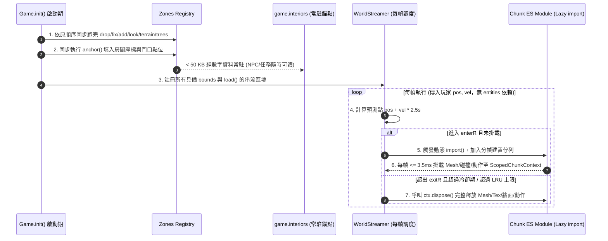

# Phase 2 規格書：全局空間動態載入引擎 (`phase-2-global-dynamic-streaming.md`)

## 一、 階段目的（Why）
Phase 1 解決了 2D `<canvas>` 記憶體上限崩潰，但專案在啟動時仍舊**同步下載並執行全部 10.2 萬行世界建置程式碼**、將所有外圍街屋與多層室內家具塞進同一個場景與物理世界。
本階段旨在打造**「全局空間動態載入（Global Spatial Streaming）」**引擎：
- 捨棄死板的「手動校區白名單」，改由玩家座標與移動向量統一驅動全地圖建築、街屋、室內細部與 Rapier 物理區塊的按需載入（Lazy `import()` ＋ 掛載）與遠離卸載（`.dispose()`）。
- 讓手機端、內顯筆電與高階電腦跑在同一套優雅的串流架構上，僅透過參數檔調控串流半徑與上限。

---

## 二、 架構核心：`Anchor` 與 `Mount` 分離 ＋ `ScopedChunkContext`

為了遵守 [pitfalls-and-memory.md](../pitfalls-and-memory.md) 中的兩大鐵律（**不破壞 NPC 對 `game.interiors.*` 的啟動期讀取**、**不破壞 `Zones.js` 前置資料的決定性 PRNG 順序**），所有串流分區嚴格分為兩個生命週期層：



---

## 三、 詳細技術規格（Technical Spec）

### 1. 空間資源容器：`ScopedChunkContext` (`src/world/ScopedChunk.js`)
為了確保動態卸載時**絕不發生記憶體或碰撞體洩漏**，每個串流區塊在執行 `mount(ctx)` 時，必須透過 `ctx` 註冊其建立的所有資源：
- `ctx.addObject(obj)`：記錄掛入 `scene` 的根 `THREE.Group`。
- `ctx.trackTexture(tex)` / `ctx.trackMaterial(mat)` / `ctx.trackGeometry(geo)`：記錄專屬幾何、材質與貼圖（共用基礎材質 `MATS` 不應在單一區塊卸載時被誤殺，只釋放區塊專屬生成的 Atlas 與 Geometry）。
- `ctx.addInteriorWall(...)` / `ctx.addInteriorSurface(...)` / `ctx.addAction(...)` / `ctx.addUpdater(...)`：轉發至 `Interiors`，並自動標記 `chunkId`。
- **`ctx.dispose()`**：卸載時一鍵執行：
  1. 從 `scene` 移除所有 `Group`。
  2. Traverse 所有專屬幾何與貼圖呼叫 `.dispose()`。
  3. 通知 `Interiors.removeByChunk(chunkId)` 清除該區塊註冊的室內牆面（並從空間雜湊網格 `this.grid` 移除索引）、樓板與 `E` 鍵動作。

### 2. `Interiors` 支援按區塊註冊與註銷 (`src/world/Kit.js`)
擴充 `Interiors` 類別：
- 新增 `beginScope(chunkId)` / `endScope()` 或讓 `Kit` 支援綁定 `chunkId`。
- 新增 `removeByChunk(chunkId)`：安全移除屬於該 `chunkId` 的 `walls`、`surfaces`、`actions`、`updaters` 與 `zones`（注意：僅移除幾何級的碰撞牆與進門動作，保留 NPC 需要的常駐座標參考）。
- **向後相容**：未呼叫 `beginScope` 的既有 `build()` 程式碼預設屬於 `'__global__'` 永久範圍，完全不受影響。

### 3. 串流調度器：`WorldStreamer` (`src/world/WorldStreamer.js`)
- **依賴合規（關鍵）**：放置於 `src/world/`，**嚴禁 `import` 任何 `src/entities/` 或 `src/ui/` 模組**（確保通過 [import-graph.test.js](../../tests/unit/import-graph.test.js)）。
- **每幀呼叫介面**：由 `GameLoop` / `world.update()` 傳入純資料：`streamer.update(dt, { x, y, z, vx, vz }, isTeleport)`。
- **核心排程機制**：
  1. **雙半徑遲滯環（Hysteresis）**：每個 Chunk 定義包圍盒 `bounds: { minX, minZ, maxX, maxZ }` 與類型（`street` | `interior` | `arena`）。計算玩家到包圍盒的最短距離 `dist`（以及前瞻點 `pos + vel * 2.5s` 的距離 `predDist`）：
     - 當 `Math.min(dist, predDist) <= enterR` 時進入「欲載入」狀態。
     - 僅當 `dist > exitR` **且** 已掛載時間超過冷卻期（`12 秒`）時，才列入卸載佇列。
  2. **動態 `import()` 預載快取**：JS 模組一旦透過 `() => import(...)` 抓回來後，模組本身留在記憶體（通常僅數十 KB），但重度 GPU Mesh 與 Atlas 貼圖會隨 `unmount()` 完整釋放、下次走近再從模組 `mount(ctx)` 重建。
  3. **分幀時間切片（`FrameScheduler`）**：建置佇列依距離由近到遠排序，每幀最多消耗 **`3.5 ms`**（由 `performance.now()` 控制），若當幀已有重度掛載超過預算，剩餘 Chunk 順延至下一幀，避免騎車瞬間掉幀。
  4. **LRU 駐留上限**：依 `StreamingProfile.maxActiveChunks`（如手機端 `6` 個），若活躍數超過上限，強制卸載距離最遠且已過冷卻期的最久未使用區塊。
  5. **強制同步預載（Teleport Hook）**：當發生瞬間傳送事件（`toGate()` 回校門口、搭 `PinHanRide` 漢堡車、`Concert.js` 搭接駁車去林口體育館）時，先 `await streamer.ensureAt(targetX, targetZ)` 掛載目的地周邊區塊再切換鏡頭，確保玩家不會掉進還沒蓋好的建築裡。

### 4. `ZONES` 擴充與雙模過渡 Adapter (`src/world/zones/Zones.js`)
擴充 `ZONES` 支援選填的串流欄位（完全相容 [data-consistency.test.js](../../tests/unit/data-consistency.test.js)）：
```js
{
  name: '環中東路街屋',
  drop: HZ_ST.drop,
  fix: hzFix,
  look: hzLook,
  ownSign: HZ_ST.ownSign,
  footprints: hzFootprints,
  // 新增選填串流描述（未填則自動走傳統同步 build() Adapter）
  stream: {
    kind: 'street',
    bounds: { minX: -140, maxX: 610, minZ: 60, maxZ: 670 },
    load: () => import('../buildings/StreetHuanzhong.js').then((m) => (ctx) => ...),
  },
}
```
- **對於長條街屋的進一步切塊**：像 `StreetHuanzhong.js`（7,082 行）與 `StreetPuzhong.js`（5,488 行）涵蓋範圍極長，在 Phase 2B 可按路段切為 2～3 個子 Chunk（例如東段／西段），讓手機沿邊走過時只載入眼前那一段街屋。

### 5. Rapier 物理世界動態空間區塊 (`src/physics/PhysWorld.js`)
`PhysWorld.js` 已經按 `TILE = 100`（100m）將牆壁、樹幹與樓板彙整成 `batch` 中的 Compound Colliders，目前是一次性全部塞進 `physics.world`。
- **改造方案**：
  - 保留 `batch` 中產出的純 JS 形狀描述清單（按 `tx, tz` Tile 索引），啟動時**不全部呼叫 `world.createCollider()`**。
  - 新增 `updateActiveTiles(px, pz, radiusTiles)`：僅將玩家所在格子周邊 `3×3`（或手機端 `1×1`～`3×3`）內的靜態 Compound Colliders 與 `terrain` 對應區塊掛入 `physics.world`，離開後 `world.removeCollider(c, false)` 卸載。
  - 若為 `mobile-lite` 模式且 `?nophysics` 或簡化物理啟用時，確保既有 2D `CollisionWorld` + `Interiors` 碰撞可無縫支撐走路與騎車體驗。

---

## 四、 分批遷移策略與 PR 切分

為避免大改動與內容組衝突，Phase 2 嚴格拆分為 **3 個可獨立合併的 PR**：
1. **PR #5 (`refactor/world-streamer-core`)**：實作 `ScopedChunk.js`、`WorldStreamer.js`、`Interiors.removeByChunk()`、雙模 Adapter，以及單元測試（驗證 `import-graph` 無環與模擬進出包圍盒載入/卸載記憶體歸零），預設掛在 `?stream=1` 下先上 `main`。
2. **PR #6 (`refactor/stream-outer-streets`)**：將所有校外長街屋（`StreetHuanzhong`、`StreetPuzhong`、`StreetDaren1/2/5`、`StreetRixin`、`StreetShijian`、`StreetZhongbei`、`StreetXinzhongbei`、`PurenCenter`）與 `Arena.js` 加上 `stream` 邊界與動態 `import()`。
3. **PR #7 (`refactor/stream-interiors-and-phys`)**：將大型多層室內（`Lixing.js`、`Sac.js`、`SacB1.js`、`Interiors.js` 中的 `buildIM` / `buildMcD` / `buildYanlinHome`、`GordonShop.js`）拆出同步 `anchor()` 與非同步 `mount()`，並啟用 `PhysWorld.js` Tile 動態掛載，最後開啟全域串流預設值。

---

## 五、 驗收標準

1. `npm run ci` 全綠，且 `tools/e2e/story-bot.mjs` 完整跑通主線劇情至結局無報錯。
2. 驗證 **Anchor 不斷鏈**：在尚未靠近力行宿舍時，所有宿舍 NPC（劍玉、漢克、吱吱、品漢堡、瑞哲、三位開發者）在出生時不報錯，且走近力行宿舍 38m 內後建築與家具平滑掛載可正常進入 277 寢與 278 寢。
3. 驗證 **卸載無殘留**：在手機端騎車從校園正門 → 夜市 → 環中東路 → 回到校園，`?perf` 顯示 `Active Chunks` 穩定維持 `<= 6`，`Geo` 與 `Tex` 數量不會隨探索時間無限上漲。
