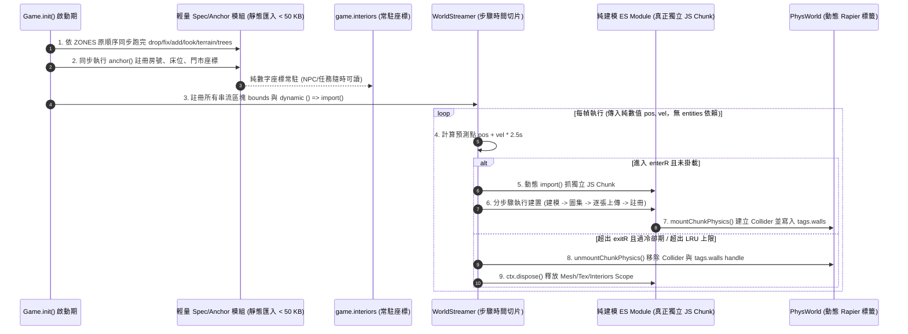

# Phase 3 規格書：真拆包全局空間動態載入與動態物理碰撞 (`phase-3-global-dynamic-streaming.md`)

## 一、 階段目的（Why）
在 Phase 1（iOS 記憶體止血）與 Phase 2（120m 分塊、去 `discard` 與 `Kit.finish` 合批）完成後，遊戲已可在手機穩定開啟並在內顯順跑。但啟動時仍舊**同步下載並執行 2.8 MB 主 JS 包裡的全部外圍商業街屋、林口體育館與大型多層室內幾何**。

本階段旨在實作**真正具備 Code-Splitting 的「全局空間動態載入（Global Spatial Streaming）」**：
- **校園外觀常駐、外圍與室內串流**：校內建築外觀（`ZoneA`～`ZoneH`、`Dorms`、`Weiche`、`GateExtras`、`Court`）維持常駐並由 Phase 2 空間分塊視錐體剔除（避免校內彈出 Pop-in 並減少內容組衝突）；將**外圍長街屋、遠端林口體育館、與高密度多層室內細部**拆為獨立 async chunks，依玩家位置與速度向量按需載入與卸載。
- **動態 Rapier 物理同步**：確保動態掛載的室內建築牆面與樓板能正確支援 [Walker.js](../../src/entities/Walker.js)（不穿牆、不墜落）。

---

## 二、 架構核心：輕重物理分離（真拆包）＋ `Anchor` 與 `Mount` 分離

為了同時滿足「Vite/Rollup 真正拆出獨立 JS Chunk」、「不破壞 NPC 啟動期讀取 `game.interiors.*`」、「不破壞 `Zones.js` 決定性 PRNG」、「不穿牆」、以及「相容 `tools/floorplan`」五大條件，採用以下架構：

---

## 三、 詳細技術規格（Technical Spec）

### 1. 輕量 Spec 與重型 Builder 物理拆檔（杜絕假拆包）
- **紅線**：禁止在 `Zones.js` 靜態 `import` 任何已被 `load: () => import(...)` 動態引用的模組（否則 Rollup 無法拆包）。
- **拆檔規格**：
  - 每個串流街屋或建築拆為：
    - `src/world/buildings/<Name>Spec.js`（或 `zones/StreetSpecs.js`）：只含 `drop`、`fix`、`look`、`ownSign`、`footprints` 與 `anchor(I)` 純數字座標設定（零 `THREE`、`Kit` 幾何依賴）。由 [Zones.js](../../src/world/zones/Zones.js) 靜態匯入。
    - `src/world/buildings/<Name>.js`：純 3D 幾何與貼圖 `mount(ctx, ...)`。主 Bundle 內**零靜態引用**，完全由 `stream.load: () => import(...)` 觸發載入，建置後於 `dist/assets/` 產出獨立 `.js` Chunk。
  - **長街屋分段**：`StreetHuanzhong.js`（7,082 行）與 `StreetPuzhong.js`（5,488 行）在拆分後可進一步切分為東／西或南北 2～3 個 Chunk，讓手機沿路邊經過時只建眼前一段。

### 2. `ScopedChunkContext` (`src/world/ScopedChunk.js`) 與 `Interiors` Chunk Scope
- 每個動態掛載的區塊透過 `ctx` 註冊其建立之資源：
  - `ctx.addObject(obj)`：記錄掛入 `scene` 的根 `THREE.Group`。
  - `ctx.trackGeometry(geo)` / `ctx.trackMaterial(mat)` / `ctx.trackTexture(tex)`：記錄區塊專屬 GPU 資源（不誤殺全域共享 `MATS`）。
  - `ctx.walls` / `ctx.surfaces` / `ctx.actions` / `ctx.updaters`：透過 `Interiors.beginScope(chunkId)` / `endScope()` 自動標記歸屬並收集牆面與樓板清單（供同步送入 `PhysWorld`）。
  - **`ctx.dispose()`**：卸載時從 `scene` 移除群組、`.dispose()` 專屬幾何/材質/貼圖、呼叫 `Interiors.removeByChunk(chunkId)` 清理空間雜湊 `grid` 與互動動作，並通知 `PhysWorld.unmountChunkPhysics(chunkId)`。

### 3. 步驟級時間切片調度器與平滑資源上下架：`WorldStreamer` (`src/world/WorldStreamer.js`)
- **依賴合規**：放置於 `src/world/`，**嚴禁 `import` `entities/` 或 `ui/`**，由 `GameLoop` 傳入 `{ x, y, z, vx, vz }`。
- **動態幀預算排程（`MessageChannel` + `15 - frameCpu`）**：
  - 依主渲染執行緒實際 CPU 耗時 EMA 動態核發預算（60Hz 取 `clamp(3, 6, 15 - frameCpu)` ms），避免 `setTimeout(..., 0)` 的 4ms 強制延遲。
- **步驟切分 ＋ `Three.js r160` 相容分帶紋理上傳（`3ms/frame`）**：
  - 將大街屋的建置拆成離散微步驟，特別是 `Step 3` 上傳 `1024×2048` / `2048×4096` 圖集時**不可整張同步 `initTexture()`**：
    1. 在 `r160`（無 `tex.source.dataReady`）中先以 `new THREE.DataTexture(null, W, H)` 呼叫 `renderer.initTexture(tex)` 僅配置 GPU 空紋理，取得 `renderer.properties.get(tex).__webglTexture`；
    2. 透過條帶 `<canvas>` 每幀以 `gl.texSubImage2D()` 上傳一組橫條（動態控在 `~3 ms` 內）；
    3. 最後一條帶完成後才呼叫 `gl.generateMipmap(gl.TEXTURE_2D)`，隨即透過 `GpuMemLifecycle` 回收原畫布，徹底消滅騎車高速進區時的微卡頓。
- **平滑卸載保護（`pinPrograms()` ＋ 分批讓幀 `.dispose()`）**：
  - 卸載區塊前先呼叫 `pinPrograms()` 保護仍會複用的 GLSL Shader Program 不被 Three.js 誤驅逐；
  - 釋放大量 Mesh / Geometry / Texture 時採每幀分批（例如每 16～32 個資源讓幀），避免單幀觸發 iOS JSC GC 尖峰。
- **遲滯環 ＋ 冷卻 ＋ LRU ＋ 傳送預載**：
  - 雙半徑 `enterR < exitR`（前瞻點 `pos + vel * 2.5s`）、最少駐留 `12s` 冷卻、依 `PerfProfile.streaming.maxActiveChunks` 執行 LRU 卸載。
  - 瞬間傳送 Hook（`toGate()`、`PinHanRide`、`Concert.js` 搭接駁車去體育館）必須 `await streamer.ensureAt(targetX, targetZ)` 完成掛載後才放行畫面。

### 4. `PhysWorld.js` 動態 Chunk 碰撞與外圍 Tile 管理（確保 `Walker.js` 不穿牆）
- **新增 Chunk 級別 Rapier 碰撞 API**：
  - `mountChunkPhysics(chunkId, walls, surfaces)`：依據該 Chunk 的 `walls`（以當地 `H()` 換算世界高度）建立 Compound/Cuboid Colliders 並**將每個 Collider handle 加入 `physics.tags.walls`**，同時建立 `surfaces` 樓板 Trimesh，全部紀錄於 `chunkColliders.get(chunkId)`。
  - `unmountChunkPhysics(chunkId)`：呼叫 `world.removeCollider(c, false)` 並從 `physics.tags.walls` 刪除對應 handle，確保無幽靈碰撞體與記憶體洩漏。
- **外圍靜態 Tile 動態掛載**：對 `PhysWorld` 原本 `TILE = 100` 的外圍牆壁／樹幹／甲板形狀清單，依 `PerfProfile.streaming.physTileRadius`（手機周邊 `3×3` Tiles、內顯 `5×5` Tiles）動態掛入／卸載，兼顧載具與行人碰撞。

### 5. `tools/floorplan` 相容保護
- [tools/floorplan/buildings/lixing.mjs](../../tools/floorplan/buildings/lixing.mjs) 與 [tools/floorplan/buildings/sac.mjs](../../tools/floorplan/buildings/sac.mjs) 仍須可透過 `buildLixing`、`buildSac`、`buildMcD` 與 `readConsts` 讀取平面常數與產圖；拆出 `Spec` 與 `mount` 時須保留既有函式匯出與檔案頂部常數宣告。

---

## 四、 分批遷移策略與 PR 切分

1. **PR #7 (`refactor/world-streamer-core`)**：`ScopedChunk.js`、步驟級 `WorldStreamer.js`、`Interiors` chunk scope、`PhysWorld.js` 動態 Chunk Collider 與 Tile API、雙模 Adapter 與單元測試（含模擬進出包圍盒與 Rapier 牆面標籤增刪驗證），掛於 `?stream=1` 下先上 `main`。
2. **PR #8 (`refactor/stream-outer-streets`)**：將外圍商業街屋（環中東、普忠、大仁一/二/五街、實踐、日新、中北、新中北、茶學苑、普仁）與 `Arena.js` 拆為 Spec ＋ 獨立 async Chunk，驗證 `dist/assets/` 確實產出獨立 JS 檔案且主包體積明顯下降。
3. **PR #9 (`refactor/stream-interiors-and-enable`)**：將大型多層室內（`Lixing`、`Sac`、`SacB1`、`IM`、`McD`、`YanlinHome`、`GarryHome`、`ClubRoom`、`GordonShop`）拆出常駐 `anchor()` 與動態 `mount(ctx)`，驗證 NPC 出生、`Walker.js` 不穿牆與 `tools/floorplan` 產圖全過後，正式依 `PerfProfile` 開啟預設串流。

---

## 五、 驗收標準

1. `npm run ci` 全綠，`tools/e2e/story-bot.mjs` 完整跑通主線至結局無報錯，且 `tools/floorplan/make.mjs` 產圖正常。
2. **真拆包驗證**：檢查 `npm run build` 後的 `dist/assets/`，主 Bundle `index-*.js` 體積顯著縮減，外圍街屋與大型室內皆成為獨立按需載入之 JS Chunk。
3. **Anchor 與碰撞不斷鏈**：尚未靠近力行宿舍前，所有宿舍 NPC 正常出生不報錯；走近力行宿舍 `38m` 內掛載後可正常爬樓梯、進 277/278 寢室且 `Walker.js` 牆壁碰撞精準不穿牆。
4. **卸載無殘留**：手機端騎車從校園正門 → 夜市 → 環中東路 → 回到校園，`?perf` 顯示活躍 Chunk 穩定 `<= 6`，`Geo`、`Tex` 與 Rapier `colliders` 數量維持平穩，Canvas 記憶體 `< 12 MB`。
