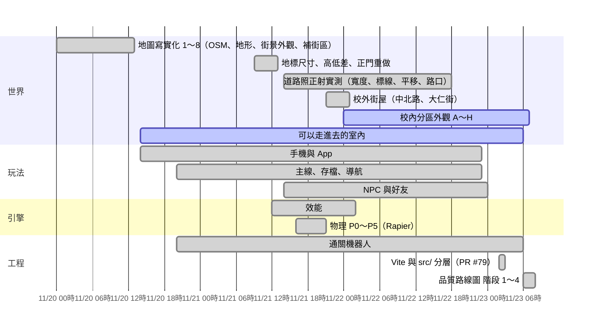

狀態：2026-11-23 依 commit 歷史重畫。截至 `edec096` 共 326 筆 commit（其中 87 筆是合併），從 2026-11-19 到 2026-11-23。

## 這份文件怎麼來的

用 [repo-chronicle](https://github.com/richardkuo2002/repo-chronicle) 對這個 repo 跑 20 個關鍵字（vite、階段、tests、tools/e2e、機器人、物理、街景、zone、道路、室內、Interiors、NPC、小遊戲、手機、存檔、效能、ci、Pages、wasm、音），拿每一包的「命中 commit」與「常被改到的檔案」，再對照完整的 `git log` 標題整理成下面幾條線。每一項後面的雜湊都可以用 `git show <雜湊>` 核對。

重新產生脈絡包（repo-chronicle 沒有安裝成指令時，從它的原始碼資料夾跑）：

```bash
PYTHONPATH=src python -m repo_chronicle.cli explain 道路 --repo /path/to/YanlinGTA --lang zh-TW --max-commits 0
```

限制：repo-chronicle 是比對 commit 訊息與檔案路徑的字串，不是語意搜尋；PR #79（`e00f7cd`）把 `js/` 搬到 `src/` 之後，舊 commit 裡的路徑（`js/map.js` 等）已經不存在，所以它列的「常改檔案」要自己換算成新路徑，「建議執行的測試」那一節幾乎都對不上，不能當成測試缺口的證據。

## 時間軸



每天的 commit 數：11-19 5 筆、11-20 42 筆、11-21 109 筆、11-22 148 筆、11-23 22 筆。

## 各條線做到哪裡

「命中」是 repo-chronicle 對該關鍵字找到的 commit 數，只代表訊息或路徑裡出現過那個字，不是工作量。

### 世界

| 線 | 命中 | 代表 commit | 現況 |
| --- | --- | --- | --- |
| 地圖寫實化 | 街景 40 | `d89d168` OSM 與樓高、`71451ea` 地形、`d4a02ab` 街景外觀、`1180e87` 街道家具、`93010c7` 補街區第二輪 | 八輪做完，之後改成一區一區照街景做 |
| 高低差 | — | `28ac7bf` 平台與階梯、`df75605` 地下道與高架、`cf9e6c7` 橋面路面、`ef795ea` 水面 | 做完 |
| 道路實測 | 道路 31 | `a8726d5` 寬度、`1697697` 標線、`2f4f2e8` 平移、`9cc74f6` 95 個路口、`8005a61`／`e79703e`／`429367e` 三輪複核、`8d193ca` 分段寬度 | PR #37～#78 逐條做完，最後一筆是 `74a124d` 實踐路拉直 |
| 校外街屋 | — | `47c6ff2` 茶學苑兩側、`eb29800` 大仁街轉角、`e99f65f`～`297f864` 大仁街四段、`5483b4d` 中北路兩側 | 中北路、大仁街做完；整排合併畫見 `a7ee190`、`324991c` |
| 校內分區外觀 | zone 32 | A `1f1b1a0`、B `e7fe7d1`、C `6202d75`、D `9534580`、E `d106120`、F `7a8cb46`、G `ac3e17f`、H `1b05965`；註冊表 `877156c` | A～H 都有第一輪；B、C、D、E 有補做（`df9972e`、`f9718e1`、`329845b`、`2ff362c`）。仍在進行 |
| 可進入室內 | 室內 21 | 麥當勞 `7f8d423`、孫師傅與彥霖房間 `552871a`、茶學苑 `9a5d609`、戈登肉鋪 `8564e2e`、蓋瑞家 `6973c77`、力行宿舍 `caa7527`、學活一～四樓 `a72c634`、學活 B1 `b03926d` | 力行、學活的平面圖經使用者確認（`bb4fde6`、`dd670ba`）。仍在進行 |

### 玩法

| 線 | 命中 | 代表 commit | 現況 |
| --- | --- | --- | --- |
| 手機與 App | 手機 40 | i-Piyan `7f8d423`、Gemini Nano 聊天 `e14d792`、靈感股 `e317d08`、演唱會搶票 `19de9f6`、無人機 `09f135e`、任務 App `4284e31` | 做完；AI 聊天卡住的問題修了七八輪（`e50fa7e`～`c0ebb3d`） |
| 主線與存檔 | 存檔 15 | 任務四修正 `44857dc`、存檔與導航 `599eb4a`、白天版故事 `4e61e5c`、任務五 `7042ed4`、人物導航 `3edd6aa` | 主線五個任務加結局，通關機器人打得完 |
| NPC 與好友 | NPC 35 | 吱吱 `313d7b0`、勞大 `0a37d4d`、漢克 `84e57b3`、黃蓋瑞 `42aee78`、劍玉 `9b628b7`、羊明衫 `3347508`、YeeMing `fd3a34b`、行為 `6d8b22b`、後台 `fd8df78` | 做完；之後新增 NPC 走 `tools/npc-dashboard` 與 `data/npcs.json` |
| 小遊戲與活動 | 小遊戲 2 | 障礙賽 `45cc109`、麥當勞值班 `52d69bf`、資管學堂 `f9e53ad`、籃排球場 `0038409` | 13 個檔在 `src/systems/minigames/`；命中少是因為 commit 訊息很少寫「小遊戲」三個字 |
| 操作 | — | 搖桿 `ed3398f`、按鍵提示 `60a905f`、第一人稱 `80ed75f`／`31a86ac` | 做完 |
| 音效 | 音 13 | 21 個音效 `395c18b`、喇叭錄音 `079dbca`、撞擊音 `b3a3e7a` | 做完 |

### 引擎與工程

| 線 | 命中 | 代表 commit | 現況 |
| --- | --- | --- | --- |
| 物理 | 物理 15 | P0 `e47f20a`、P2 `52144b5`、P3 `75eb804`、P4 `b9cc700`、P5 `897cfcc`；車身碰撞 `5b9f356` | PR #29～#34 全部合併 |
| 效能 | 效能 6 | 燈罩材質 `47129b0`、WASM 貼圖 `1aab347`、遠景簡化 `e3efacc`、陰影 `2a528fc`、街屋合併 `a7ee190`、角色靜態化 `e162723` | 畫面效能做過六輪；載入時間沒做過（見下一節） |
| 通關機器人 | 機器人 22 | 建立 `fde2491`、任務五 `9d2b545`、跟上 Vite `72ac687` | 可用，oldpc 一趟約 2.5～5 分鐘；最近一次 `bf4264f` PASS |
| 架構 | vite 7 | PR #79 `e00f7cd`、暫停選單 id `d255b0e` | 做完 |
| 品質路線圖 | 階段 16 | 階段 1 `d7b0e55`、階段 2 `1961b98`、階段 3 `6142a02`／`5dc7fdb`、階段 4 `bf4264f` | 做完，細節在 `task/quality-roadmap.md` |

## 已經決定的事（2026-11-23，使用者決定）

- `src/` 不照 Prettier 整個重排。`src/` 留在 `.prettierignore`，格式檢查不含 `src/`，靠 ESLint 把關。
- 通關機器人不排程每天跑，維持手動：會影響主線的改動才在 oldpc 跑。
- 階段 4 第 2 項（小遊戲、手機 App 延後載入）不做。

## 接下來

歷史看得出來的未完事項，依「卡住別人的程度」排序。除了第 1 項，其餘都是我的建議，還沒有人說要做。

1. **GitHub Pages 發布來源**：issue howardtuan/YanlinGTA#81 還開著，`build_type` 仍是 `legacy`。每次推 main 兩種發布會比誰後跑完，線上版可能壞掉。等 howardtuan 處理；壞了就到 Actions 手動重跑「Deploy to GitHub Pages」。
2. **世界內容繼續做**（進行中，各有自己的 session）：校內分區第二輪、學活與宿舍室內。流程不變：照街景與正射、一區一個 worktree、做完一條就出貨。
3. **載入時間**：`quality-roadmap.md` 量到的大宗是建世界 13～22 秒，不是下載。效能那六輪都是畫面張數，這一塊從沒動過。已量測（2026-11-23，見下面「載入時間量測」）：最大的一塊不是建世界，是標題畫面出現後第一張畫面的著色器編譯。
4. **測試範圍**：8 個測試檔對 103 個原始檔，都是純邏輯。歷史上改最多的是 `Interiors`（62 筆）、`MapBuilder`、`Game`、手機，這幾個都沒有測試，現在靠通關機器人把關。可以補的是不需要畫面的部分（分區註冊表的資料一致性、`roads.json` 的格式）。
5. **剩下的一處分層例外**：`world/Interiors.js` 匯入 `entities/Character.js`，列在 `tests/unit/import-graph.test.js` 的 `KNOWN_VIOLATIONS`。
6. **小事**：`src/styles/style.css` 有 19 處註解寫舊路徑；`src/entities/Vehicles.js` 的 `console.warn` 文字寫 `js/vehicles.js`（是程式碼，改了會動到打包結果）。

## 載入時間量測（2026-11-23，`e1ebb1c`）

做法：建一份不壓縮的版本（`vite build --minify false`，放在 repo 外），用遠端 Chrome 的 CPU 取樣（每 1 ms）從開始載入錄到標題畫面，並記下載入畫面每次換文字的時間。畫質 low，各跑兩次。沒有改任何原始碼。

| 步驟（載入畫面的文字） | oldpc 軟體繪圖 | olddesk GTX 1060 |
| --- | --- | --- |
| 載入地圖資料（下載、Rapier 與 WASM 初始化） | 0.1 秒 | 3.8～12.4 秒（走 SSH 通道下載，不算數） |
| 搭建中原大學（`buildWorld`） | 3.1～3.5 秒 | 4.9 秒 |
| 蓋資管系館、麥當勞、警衛室（`buildInteriors` 與物理世界） | 2.2～2.7 秒 | 5.0 秒 |
| 召喚同學與機車 | 3.0～3.1 秒 | 0.8 秒 |
| 準備出發（NPC、`compileAsync`） | 0.5 秒 | 5.6～5.7 秒 |
| **標題畫面出現後畫面卡住** | **10.4～10.8 秒** | **27.0～27.6 秒** |
| 合計（開始到能操作） | 15～19 秒 | 50 秒（扣掉下載約 43 秒） |

看到的事：

1. **最大的一塊在標題畫面之後**。`setLoad(1, '完成')` 之後第一張畫面要等著色器，主執行緒整個卡住。GTX 1060 上 `compileAsync` 只先編好 96 個程式，第一張畫面又多出 59 個沒預編到的（原因見下面），一個一個同步編，共 27 秒（three 的 `onFirstUse` 自身時間 25.7 秒）。軟體繪圖上同一段是 3.5～3.7 秒。
2. **建世界本身是 5～10 秒**，`buildWorld` 與 `buildInteriors` 大約各半。`buildInteriors` 幾乎都在 `buildZones`（軟體繪圖 1.5 秒、olddesk 3.2 秒），其中中北路街屋 `buildZhongbeiStreet` 一項就佔 0.6～1.3 秒，主要是招牌文字縮放 `fit`。`buildWorld` 裡最大的是街道家具 `buildFurniture`（0.7～1.6 秒，多半在 `nearReserved`）。
3. **只在軟體繪圖出現的**：機車輪胎貼圖 `heightToNormal` 2.6～2.8 秒、劍玉海報 `toDataURL` 5.6～5.7 秒、天空環境貼圖 `bakeEnv` 1.0 秒。在顯示卡上前兩項小到取樣看不到、`bakeEnv` 是 0.35 秒；前兩項是從畫布讀回像素時等繪圖程序造成的，只影響沒有顯示卡的環境（通關機器人、GitHub 的機器）。
4. 下載不是問題：區網內全部資源 0.2 秒內到齊。

著色器沒被預編到的原因（已查清楚）：

- 59 個裡有 56 個，和先編好的版本只差「有沒有環境貼圖」三個欄位（`envMapMode` 從沒有變成 CubeUV、`envMapCubeUVHeight` 變成 1024、`envMap` 旗標打開）。另外 3 個是烤環境貼圖本身用的（模糊、天空）。
- 原因：`src/core/Game.js` 在 `compileAsync` 的時候 `scene.environment` 還是空的。環境貼圖要等第一張畫面的 `updateSky` 呼叫 `SkySystem.bakeEnv()` 才設定，一設定，所有 `MeshStandardMaterial` 的著色器就要換成有環境貼圖的版本重編。先編好的那 56 個從此用不到，白編了。
- 驗證：暫時在 `compileAsync` 前面加一行 `this.gameLoop.updateSky(0)`，建到 repo 外量測後還原，原始碼沒有留下改動。

| | 改之前 | 預編前先烤環境貼圖 |
| --- | --- | --- |
| olddesk GTX 1060：標題後卡住 | 27.0 秒 | 2.2 秒 |
| olddesk GTX 1060：準備出發 | 5.7 秒 | 7.7 秒 |
| olddesk GTX 1060：開始到能操作 | 50 秒 | 27 秒 |
| oldpc 軟體繪圖：標題後卡住 | 10.8 秒 | 8.6 秒 |
| 著色器程式總數 | 154 | 98 |

各跑一次，沒有頁面錯誤。軟體繪圖剩下的 8.6 秒主要是劍玉海報 `toDataURL` 那一項，和著色器無關。這個改法只量了載入時間，沒有比對畫面，也沒有跑通關機器人。

還不知道的：

- 只量了 low 畫質，也沒有在 Mac（Metal）或一般玩家的顯示卡上量。D3D11 編著色器特別慢，別的平台比例可能不同。
- oldpc 的顯示卡這次拿不到 WebGL（context lost），所以顯示卡的數字只有 olddesk 一台，它的 CPU 也比 oldpc 慢。

如果要動，建議順序（都還沒有人說要做）：先把烤環境貼圖移到 `compileAsync` 之前；再看只在軟體繪圖慢的劍玉海報與輪胎貼圖；最後才是 `fit` 與 `nearReserved`。
